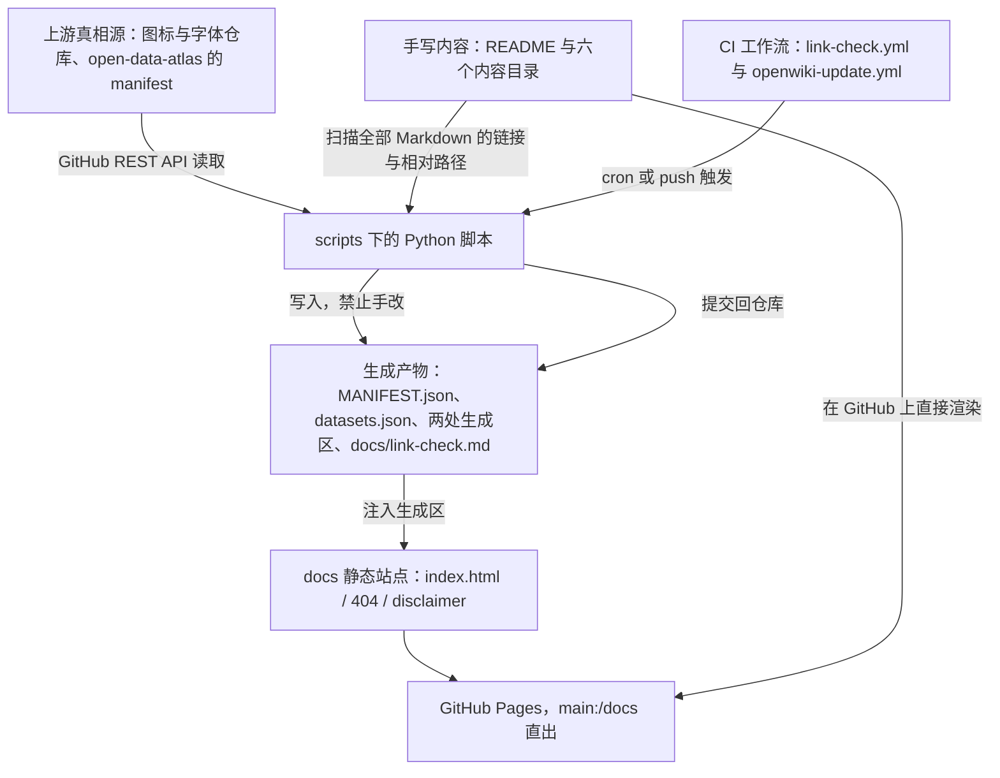

# 仓库全景：内容分组、站点与自动化脚本

这个仓库是一个**资源导航项目**，不是应用：没有依赖安装、没有构建步骤、没有服务端。全部自动化就是 `scripts/` 下的几个 Python 文件加两个 GitHub Actions 工作流，最终产出是一个静态站点（`docs/`）和几份可审计的清单文件。

判断一次改动该落在哪个系统，只需问两个问题：**这是内容还是生成物？生成它的脚本在哪里？** 文末的「改动落点速查」给出直接答案。

## 四类资产与职责边界

| 类别 | 位置 | 谁写 | 边界 |
|---|---|---|---|
| 手写内容 | `README.md`、`10-resources/` … `60-others/` | 人 | 唯一真相源，只用 Markdown；不放脚本 |
| Python 脚本 | `scripts/` | 人 | 生成器与体检器；不含内容文案，只依赖标准库 |
| 生成产物 | `MANIFEST.json`、`10-resources/datasets/datasets.json`、两处生成区、`docs/link-check.md` | 脚本 | 只读；手改会被下一次运行覆盖 |
| 展示层与执行层 | `docs/`（站点）、`.github/workflows/`（CI） | 人 + 脚本 | 站点是展示层，不是内容正本；CI 只调脚本 |

## 仓库没有应用运行时

- 没有 `package.json`、没有 lockfile、没有 `node_modules`，也没有 Python 依赖清单。脚本只 import 标准库：`urllib.request`、`json`、`base64`、`hashlib`、`ctypes`、`concurrent.futures`、`pathlib`。
- 因此不存在「安装」这一步：`python scripts/<name>.py` 直接可跑。CI 里也只是 `actions/setup-python` 固定 `python-version: "3.12"` 后调脚本，没有任何 install 步骤。
- 唯一的外部运行时在 `openwiki-update.yml`：Node 22 + 全局安装的 `openwiki@0.9.0`（可选 `mermaid`、`jsdom`），它只负责生成 `openwiki/` 文档，与仓库本身能否运行无关。
- 脚本不依赖当前工作目录：每个脚本用 `Path(__file__).resolve().parent.parent` 定位仓库根，并把自己的目录插进 `sys.path` 以导入共享的 `gh_auth`。

## 六个内容目录：一条功能轴

分类轴只有一条——**你想干什么**；归不了类的进 `60-others`，攒够同类再拆新组。注意 `README.md` 的功能表写「5 组」并列 6 行（第 6 行是「其他」），磁盘上则是 6 个内容目录。

| 目录 | 回答的问题 | 形态 |
|---|---|---|
| `10-resources/` | 有没有能直接拿来用的东西 | 带 `assets/`（图标、字体、原始许可证）与 `datasets/` 两个受脚本管理的子目录 |
| `20-tools/` | 现成工具怎么用 | `README.md` + `projects.md` 跨期精选清单 |
| `30-ai/` | 用 AI 干活 | `README.md` + `projects.md` + `install/install-ollama.sh` 可执行示例 |
| `40-ship/` | 让任务自动跑、把东西发上线 | 三个子指南 `codespaces/` `actions/` `pages/`，含 `actions/templates/` 三个 workflow 模板 |
| `50-benefits/` | 少花钱、别犯规 | `student-pack/` 申请路径 + `limits/` 额度速查与坑位 |
| `60-others/` | 暂时没有功能归属的 | `README.md` + `pending.md`，等同类够了再拆组 |

一个容易误判的点：`40-ship/actions/templates/*.yml` 是**给人复制的示例模板**，不是本仓库在跑的 CI；真正生效的工作流只有 `.github/workflows/` 下的两个。

## 生成产物：读，不要写

| 产物 | 生成者 | 触发时机 | 手改的后果 | 正确改法 |
|---|---|---|---|---|
| `MANIFEST.json` | `scripts/fetch_assets.py` | 本地手动跑 | `sha256` 与文件不再对应，清单失去审计意义，下次运行直接覆盖 | 改脚本里的 `ICON_NAMES` / `FONTS` / `LICENSES` 后重跑 |
| `10-resources/assets/{icons,fonts,LICENSES}/` 下的文件 | 同上 | 同上 | 与 `MANIFEST.json` 记录漂移 | 同上 |
| `10-resources/datasets/datasets.json` | `scripts/sync_atlas.py` | 本地手动跑，或每周 CI | 被覆盖，且与上游 manifest 不一致 | 改上游 `open-data-atlas` 的 `data/manifest.json` |
| `10-resources/datasets/README.md` 的 `<!-- BEGIN GENERATED: datasets -->` … `<!-- END GENERATED: datasets -->` 之间 | `scripts/sync_atlas.py` | 同上 | 表格被整块重写 | 只改生成区外的正文 |
| `docs/index.html` 的 `<!-- BEGIN GENERATED: atlas-items -->` 区块（内含 `<script id="atlas-datasets" type="application/json">`） | `scripts/sync_atlas.py` | 同上 | 站点上的数据集数量与卡片与 `datasets.json` 漂移 | 同上 |
| `docs/link-check.md` | `scripts/verify_links.py` | 每周一 CI，或本地手动跑 | 下次体检整份覆盖 | 不手改；报告只当信号看 |
| `openwiki/` 与 `AGENTS.md` 中的 `OPENWIKI` 区块 | `openwiki code --update` | `openwiki-update.yml`（每天 UTC 08:00 或手动） | 下次运行覆盖 | 走它开出的 PR |

这些生成区之所以能「只重写一块」，是因为脚本以 HTML 注释标记为界做字符串切分；**标记缺失时 `sync_atlas.py` 会报错退出而不是覆盖整份文件**，所以移动或删除标记等于主动关掉同步。

## 数据流

箭头方向即数据流方向：上游 → 脚本 → 生成产物 → 站点。内容（Markdown）只被脚本**读取**（体检链接），从不被脚本改写；CI 的职责是按时间或路径触发脚本，并把脚本的输出提交回去——这形成了一个环，也是下面几条不变量的来源。

## Python 脚本：输入、输出与失败语义

### `gh_auth.py`——被三个脚本共用的凭据解析

解析顺序固定：`GITHUB_TOKEN` / `GH_TOKEN` 环境变量 → Windows 凭据管理器（target = `GitHub - https://api.github.com/<login>`）。token 只在内存里传递，不落盘、不打印；找不到时 `required=True` 直接 `SystemExit`，`sync_atlas.py` 则以 `required=False` 调用，允许匿名访问（受 60 次/小时限流）。

### `fetch_assets.py`——素材下载 + `MANIFEST.json`

- 输入：硬编码的精选图标名列表、两套 OFL 字体与四份上游 LICENSE 的仓库路径。
- 输出：`10-resources/assets/` 下的文件 + `MANIFEST.json`（每文件记 `path` / `repo` / `source_path` / `license` / `bytes` / `sha256` / `source_url`，外加 `total_files` / `total_bytes`）。
- 机制：统一走 GitHub REST API——`contents` 优先（<1MB 直接带 base64），否则回退 `git/blobs`；之所以不用 `raw.githubusercontent.com`，是因为受限网络下只有 `api.github.com` 稳定可达。并发 8 线程，遇 403/429 退避重试，并在 `x-ratelimit-remaining` 过低时按 reset 时间等待。
- `--only icons|fonts|licenses` 会与现有 `MANIFEST.json` 的条目合并（按 `path` 去重），避免局部刷新把别的条目丢掉。

### `sync_atlas.py`——数据集目录的三处同步

- 唯一真相源在**别的仓库**：`xushan628/open-data-atlas` 的 `data/manifest.json`（经 `api.github.com` 取回并 base64 解码）。本仓库不存数据集清单的正本。
- 一次写三个目标：`datasets.json`、`datasets/README.md` 的生成区表格、`docs/index.html` 的 `atlas-datasets` 数据块（`</` 会被转义成 `<\/`，避免破坏 `<script>`）。
- 上游字段缺失（`name` / `repo` / `repo_url` / `license`）或标记缺失即 `SystemExit`，**绝不写半截文件**；内容无变化则不写，因此 CI 不会产生空提交。
- 刻意不收录 star 数：每周都变，只会制造无意义提交。
- `--check` 只比对不写文件，有差异返回 1——这是判断「上游是否已更新」的入口。

### `verify_links.py`——链接体检

- 输入：`ROOT.rglob("*.md")` 扫到的全部 Markdown（跳过自己的产物 `docs/link-check.md`），既收 `[label](target)` 也收裸 URL。
- 检查策略分三条：`github.com/<owner>/<repo>` 改走 `api.github.com/repos/...`（blob 链接改走 `contents` API），以规避直连 `github.com` 被重置；其他 `http(s)` 先 HEAD 后退 GET；站内相对路径直接查本地文件是否存在，越出仓库目录即判 `dead`。
- 结论分四态：`ok` / `dead` / `unverified`（超时、连接重置、403、429）/ `local`（`localhost` 示例，跳过）。限流与网络受限不会被误报成失效。
- 输出：整份 `docs/link-check.md`（含失效表、未验证表、全量结果）。`--strict` 时有 `dead` 就返回 1，否则恒为 0。

### `check_site.py`——判断站点是挂了还是被缓存坑了

只做本机诊断，不写文件。对一个 Pages URL 发两次请求（普通 + `Cache-Control: no-cache` 并附加时间戳参数），读 `x-served-by` / `x-cache` 等头，并识别 GitHub 的 "Site not found" 404 文案，最后用退出码表达结论：`0` 正常、`1` 站点确实不存在或异常状态、`2` 连不上（网络/DNS 问题）。

### `deploy_github.py`——纯 REST API 推送

用 Git Data API 走完 `blobs → trees → commits → refs`，并能在仓库不存在时先建仓、为空仓时补初始提交（空仓建 blob 会 409）。存在理由是环境问题：本机 `git` / `curl` 因 TLS 走 Windows schannel 而完全无法出网，而 Python 自带 OpenSSL 可用。`--dry-run` 只列文件；`--squash` 用一个根提交覆盖历史。它是**本地发布工具，不在 CI 里**。

## CI：两条闭环

`.github/workflows/link-check.yml` 是「体检 + 同步 → 直接提交」：`schedule`（每周一 UTC 01:00）或内容目录 Markdown / `scripts/verify_links.py` / 自身变更触发，`permissions: contents: write`，依次跑 `verify_links.py` 和 `sync_atlas.py`，然后把 `docs/link-check.md` 与 `10-resources/datasets/` `git add` 后提交推送（无变化就跳过）。

`.github/workflows/openwiki-update.yml` 是「文档生成 → 开 PR」：`fetch-depth: 0` 便于 diff 出上次记录的提交，跑 `openwiki code --update --print`，删除瞬态文件 `openwiki/.run.json`，再用 PR 提交 `openwiki/`、`AGENTS.md`、自身文件；OpenWiki 失败时仍保留已完成页面的 PR，最后一步 `exit 1` 把失败传播出去。

三条操作性结论：

1. **CI 不启用严格模式**：跑的是裸 `python scripts/verify_links.py` 与 `python scripts/sync_atlas.py`，没有 `--strict` / `--check`，所以失效链接或过期数据集只会体现在提交的 diff 与报告里，不会让 job 变红。
2. **防自触发是硬约束**：这个 workflow 会把 `.md` 提交回仓库，所以 `push.paths` 只能列内容目录的 Markdown，写成 `**/*.md` 会自触发成死循环、不断产生新提交，并取消紧随其后的 Pages 构建（表现为站点忽新忽旧）；提交信息还带 `[skip ci]`。`concurrency: link-check` + `cancel-in-progress` 再兜一层。
3. 细节与排障见 [CI 工作流](../operations/ci-workflows.md)。

## `docs/` 站点：展示层，不是内容正本

`docs/` 里就三个手写页面加一个 `.nojekyll`：`index.html`（单页、内联样式与脚本）、`404.html`（自动跳回站点首页）、`disclaimer.html`。Pages 从 `main:/docs` 直出静态文件，没有构建步骤，因此源码里写什么就发布什么。

站点的项目卡片是 `index.html` 里手写的 `DATA` 数组，**与 Markdown 内容目录不共享数据源**（同一项目可能在 `20-tools/projects.md` 与 `DATA` 各写一份）；唯一由脚本喂数的部分是 `<script id="atlas-datasets">` 区块，它只提供数据集卡片字段与页头「N 个开源数据集」的计数。页头其余统计数字是手写的，改内容后需要人工核对。结构细节见 [静态站点](static-site.md)。

## 改动落点速查

| 我想改… | 落在哪 | 怎么验证 |
|---|---|---|
| 某个资源推荐、文案、分组 | 对应内容目录的 `.md` | `python scripts/verify_links.py`，看新链接是否 `dead` |
| 新增 / 更换图标、字体 | `scripts/fetch_assets.py` 的 `ICON_NAMES` / `FONTS` / `LICENSES` | 重跑脚本，看 `MANIFEST.json` 的 diff |
| 数据集清单（增删、改名、许可证） | 上游 `open-data-atlas` 的 `data/manifest.json` | `python scripts/sync_atlas.py --check` |
| 站点卡片、样式、页头数字 | `docs/index.html` 生成区**之外** | 本地打开页面；线上问题用 `python scripts/check_site.py` |
| 体检 / 同步的调度、触发路径 | `.github/workflows/link-check.yml` | 改 `push.paths` 时确认不会自触发 |
| `openwiki/` 文档 | 不手改；改源码后等 PR，或手动 `openwiki code --update` | 看 PR 的 pages 清单 |
| 首次发布到新账号/新仓库 | `python scripts/deploy_github.py` | `--dry-run` 先看文件清单 |

## 不变量与常见故障

**不变量**

- 生成区之外才可手写；标记缺失时脚本拒写而不是覆盖。
- 所有生成脚本都是幂等的：内容没变不落盘，CI 不产生空提交。
- 上游结构不符就报错退出（`SystemExit`），不会留下半截文件。
- token 只在内存中，`.gitignore` 已排除 `.env` / `*.pem` / `github_token*`。
- 体检报告排除自身，避免「报告里的链接」被当成被检链接。

**常见故障**

- 报告里大片「⚠️ 未验证」通常是你所在网络的限制，不是链接死了；`github.com` 仓库类链接已改走 API，结论可信。
- 未认证访问 `api.github.com` 只有 60 次/小时，本地跑 `fetch_assets.py` / `sync_atlas.py` 前先设 `GITHUB_TOKEN`，否则容易被限流成「未验证」或重试失败。
- 站点 404 先怀疑本地缓存了旧的 404（`check_site.py` 会给出结论），而不是 Pages 构建失败。
- 把生成区当成正文改，是本仓库最容易犯错的一类改动：改完能显示，下一次同步就消失。

## 延伸阅读

- [静态站点](static-site.md)：`docs/index.html` 的结构、生成块消费方式与发布链路。
- [内容分类](../concepts/content-taxonomy.md)：六个目录的判断标准与收录边界。
- [CI 工作流](../operations/ci-workflows.md)：两个 workflow 的触发矩阵、权限与排障。
- [快速开始](../quickstart.md)：跑脚本、看报告的最短路径。
