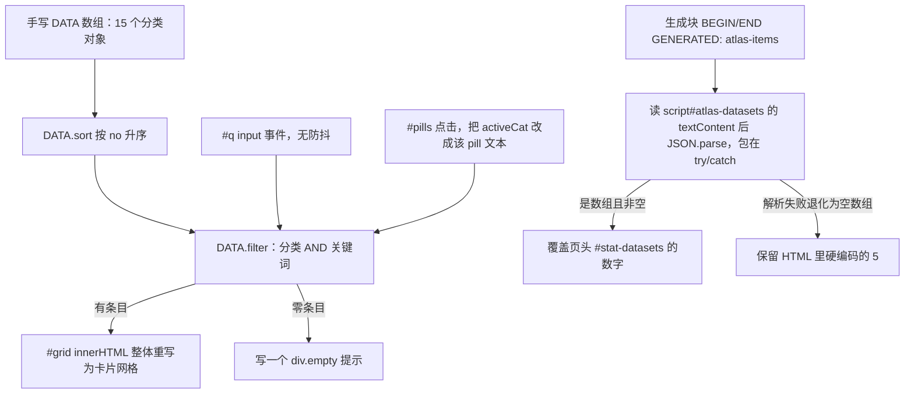
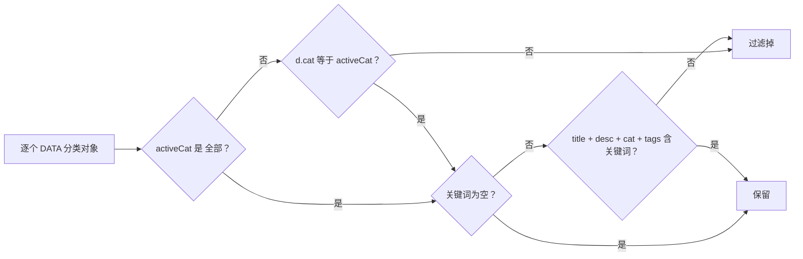
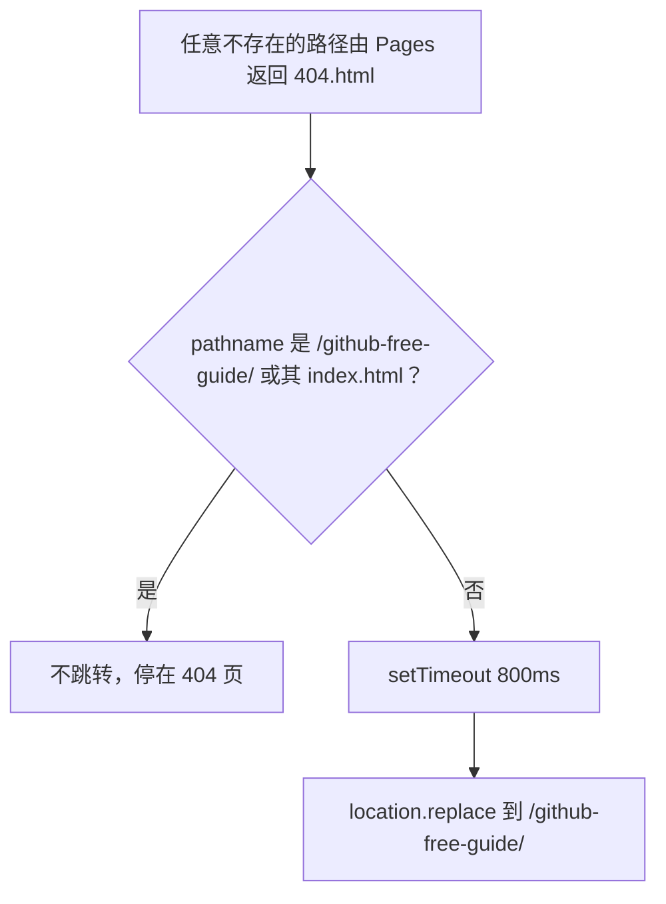

# 静态站点（docs/ 单页应用与页面契约）

`docs/` 是本仓库的**展示层**，不是内容正本：没有 `package.json`、没有构建步骤、没有服务端，GitHub Pages 直接从 `main` 分支的 `/docs` 目录把文件原样发布出去（见 [发布与部署](../operations/publishing-and-deploy.md)）。所以「源码里写什么，线上就是什么」——`docs/index.html` 里的一行手写文本，和 `DATA` 数组里的一条项目，是同一等级的发布物。

这一页只讲站点本身：单页运行时怎么把数据变成卡片、哪些部分是生成区不能手碰、URL 与路径踩在什么假设上。

## 四个文件，三种角色

| 文件 | 角色 | 关键契约 |
|---|---|---|
| `docs/index.html` | 唯一的功能页：页头统计、搜索框、分类 pill、卡片网格、免费额度速查表、页脚 | 单文件自包含（内联 `<style>` 与 `<script>`），无任何外部资源请求 |
| `docs/404.html` | 兜底页：任意不存在的路径由 Pages 返回它 | 客户端 JS 把访问者送回站点首页，首页常量硬编码 `/github-free-guide/` |
| `docs/disclaimer.html` | 静态免责声明与版权说明 | 纯 HTML，无脚本；首页页脚用相对路径 `./disclaimer.html` 链入 |
| `docs/.nojekyll` | 空文件，唯一作用是存在 | 让 Pages 跳过 Jekyll 构建，`docs/` 下的文件按字节原样发布 |

此外 `docs/link-check.md` 也在这个目录里，它是 `scripts/verify_links.py` 的生成产物，会随站点一起被发布；但页脚的外链体检链接指向的是 GitHub 上的 blob 版本，而不是站内这份副本。

**`.nojekyll` 的语义是「关掉预处理」**：没有它，Pages 会把 `docs/` 当 Jekyll 站点处理一遍——以下划线开头的文件/目录会被排除在产物之外，含 `{{ }}` 的内容会被 Liquid 解析改写。对本站点这种内联脚本里塞满模板字符串的页面来说，跳过这一步比多一个构建阶段更重要。

## 单页运行时：静态骨架 + 脚本填充

`index.html` 的 HTML 部分是骨架，真正的内容区在加载时由脚本写进 DOM：

- **静态可见**：标题与副标题、四枚页头统计（`15` 组分类 / `200` 个图标 / 数据集计数 / `136` 个精选项目）、搜索框 `#q`、空的 `#pills` 与 `#grid` 容器、免费额度速查表、页脚。
- **脚本生成**：分类 pill 按钮、卡片网格。`#grid` 在 HTML 里是空的 `<div>`，脚本跑完前页面上只有一条「额度速查表」。

这带来一个直接的降级语义：**JS 被禁用或脚本抛错时，搜索框、pill 与卡片全都不存在**，页面退化成静态的额度表 + 页脚，没有 `<noscript>` 提示。排查「线上卡片不见了」时，先看控制台有没有异常，而不是先怀疑 Pages。

页头四枚统计里只有一枚是活的：`<b id="stat-datasets">5</b>`，其余三枚（`15`、`200`、`136`）是手写常量。`15` 对应 `DATA` 的条目数、`136` 恰好等于所有 `items` 条目之和（10+9+10+10+10+10+10+5+10+10+10+10+10+3+9），但**没有任何代码在校验这一点**——增删项目后必须人工同步 `136`、`15` 以及每张分类卡片 `tags` 里的 `"N 个"`。这三个数字是三份彼此独立的、手工维护的重复计数。

## 数据流：DATA + atlas-datasets → render() → 卡片网格



图里两条链路几乎不相交：上半是 `DATA` → 卡片，下半是生成块 → 一个数字。**当前版本中由脚本喂的数据集 JSON 只驱动页头计数，不生成任何卡片**——卡片全部来自手写的 `DATA`。源码里 `DATA.sort` 上方那句注释（「第 9 类由数据块生成、在第 10 类之后 push」）描述的是旧形态，已经与实现不符；不要照着注释去找「数据块生成的分类」。数据集增减的正确入口是上游 manifest，见 [数据集目录同步](../workflows/dataset-catalog-sync.md)。

## DATA 的形状：分类层与条目层

`DATA` 是 `docs/index.html` 里唯一的卡片数据源，15 个对象按 `no: "1"` … `no: "15"` 编号。

分类层字段：

| 字段 | 必需 | 渲染成什么 |
|---|---|---|
| `no` | 是 | 卡片右上角的大号编号；同时是排序键 `Number(a.no) - Number(b.no)` |
| `cat` | 是 | pill 的文本与过滤键，如 `发现`、`Agent`、`收口` |
| `icon` | 是 | `<h3>` 里的 emoji，**不经 `esc()`**，因为它是内联字面量 |
| `title` / `desc` | 是 | 卡片标题与摘要，经 `esc()` |
| `tags` | 是 | 一串 `<span class="tag">`；命中 `/MIT|ISC|OFL|免|0 元|已下载/` 的加 `free` 绿样式 |
| `items` | 否 | 卡片内的项目列表 `<ul class="ds">`；非数组或空数组时整段不渲染 |
| `links` | 是 | 卡片底部的外链组，形如 `[["仓库根目录", REPO+"/tree/main"]]` |

条目层（`items[]`，**新增条目必须用这同一套字段形状**）：

| 字段 | 必需 | 渲染规则 |
|---|---|---|
| `name` | 是 | 项目名，作为主链接锚文本，经 `esc()` |
| `cn` | 否 | 中文短注；为空时不输出 `<span class="cn">` |
| `license` | 是 | 行尾许可证标签；缺字段会渲染出字面量 `undefined` |
| `repo_url` | 是 | 主链接 `href`，经 `esc()` |
| `dl` | 否 | 下载入口；缺省时回落到 `repo_url + '/releases'` |
| `ver` | 否 | 只用于「下载」链接的 `title` 提示：有则 `下载 <ver>`，无则 `去 Releases 页` |

两个约束值得在改动前想清楚：

1. **`ver` 不参与 `href`**。下载地址永远是 `dl`（或回落后的 `…/releases`），版本号只影响鼠标悬停提示；`dl` 与 `ver` 对不上不会报错，只会让人点错版本。带标签的版本（如 `@cloudflare/computer@0.11.4`）在 `dl` 里要做 URL 编码，`ver` 里保留原始写法。
2. **条目 URL 是约定，不是校验**。`esc()` 只做 HTML 转义，不检查 scheme；写进 `repo_url` / `dl` 的东西必须是人能复核的 `https://github.com/...`。

## esc() 与拼接规则

渲染走的是「模板字符串 → `innerHTML` 整体重写」，所以每个插值点都得自己保证安全：

```js
function esc(s){ return String(s).replace(/[&<>"]/g, m => ({"&":"&amp;","<":"&lt;",">":"&gt;",'"':"&quot;"}[m])); }
```

- 转义集合是 `& < > "` 四个字符，**单引号不转义**——之所以够用，是因为所有动态值都落在双引号属性里或元素文本中，源码里没有用单引号包裹的插值属性。
- 每一个插值字段都过 `esc()`：`title`、`desc`、`tag` 文本、`name`、`cn`、`license`、`repo_url`、`dl`、链接文本、链接 URL，以及 `title` 属性里的 `ver`。不过 `esc()` 的只有 `no` 与 `icon`。
- `tags` 的 `free` 类名判断用的是**原始 tag 文本**做正则测试（`/MIT|ISC|OFL|免|0 元|已下载/`），不是转义后的值——加新标签时「免费」这个语义靠字符串里出现这些片段来触发，写「Apache-2.0」不会变绿。
- 下载入口的回落是一次字符串拼接：`it.dl || it.repo_url + '/releases'`。它假设 `repo_url` 是干净的仓库主页、末尾没有 `/`；带尾斜杠会拼出 `//releases`。

**失败是整页级的**：`render()` 是 `DATA.filter(...).map(...).join("")` 一次成型的，某个条目缺 `tags` 或 `links` 会在 `d.tags.join` / `d.links.map` 上抛 `TypeError`，整块 `#grid` 保持初始的空状态。没有逐条目的容错，也没有错误提示——这就是为什么字段形状必须统一。

## 搜索与 pill：两个 AND 条件



两句话概括语义：**分类是硬过滤，关键词是软过滤，两者 AND**；关键词为空时只看分类。

- 关键词取自 `#q` 的当前值，`trim().toLowerCase()` 后做子串匹配；被搜索的字段是 `title + desc + cat + tags.join(" ")`。
- **`items` 里的项目名不在搜索范围内**。搜 `yt-dlp`、`Immich`、`Stirling-PDF` 这类工具名会直接落到「没有匹配的结果」——搜索框的占位符写的也是「图标 / 定时任务 / 建站 / 学生 / 额度」这种分类级词。要让项目名可搜，得把 `items.map(it => it.name + " " + it.cn)` 拼进匹配串，这是一处明确的扩展点。
- 每次 `input` 都同步重渲染，没有防抖；15 个分类的 `filter` + 一次 `innerHTML` 成本可忽略，不必提前优化。
- 状态不落在 URL 上：`activeCat` 是闭包变量，没有 `history`/`pushState`/`localStorage`，刷新即回到「全部」。因此搜索结果不可分享、不可回退——这是刻意省掉的复杂度，不是 bug。

pill 的构建顺序有一处容易踩的细节：`pills` 用 `["全部", ...new Set(DATA.map(d => d.cat))]` **按 `DATA` 的源码出现顺序**生成，而这一步发生在 `DATA.sort(...)` 之前；卡片网格则按 `no` 升序。当前 `DATA` 本身就按编号排好，两处顺序一致；但如果有人把新分类追加到数组末尾却给了个中间编号，pill 的顺序会与卡片顺序分叉。改分类时要么保持数组有序，要么把排序提到 pill 构建之前。

## 生成区：`atlas-items` 区块只许脚本写

```html
<!-- BEGIN GENERATED: atlas-items -->
<script id="atlas-datasets" type="application/json">[{"name":"…","license":"MIT","repo_url":"https://github.com/…"},…]</script>
<!-- END GENERATED: atlas-items -->
```

- 区块由 `scripts/sync_atlas.py` 以 HTML 注释为界整块覆写：切出标记前的 `head` 与标记后的 `tail`，中间换成新块，其余部分字节不变。标记缺失时脚本只打印提示并**跳过**站点同步（不报错、不覆盖），所以删掉标记等于静默关掉这条同步。
- 块内只有一行 `<script type="application/json">`，不是可执行脚本；页面通过 `textContent` 取文本再 `JSON.parse`，解析失败静默退化为 `[]`。
- 脚本侧 `render_index_block()` 只写三个字段：`name`、`license`、`repo_url`（上游 `NOASSERTION` 会被改写成 `见 LICENSE`）。也就是说**这里的字段形状比 `DATA.items` 窄**：没有 `cn`、没有 `dl`、没有 `ver`。想给数据集条目加下载链接或中文名，得同时改 `scripts/sync_atlas.py` 的 `render_index_block()` 与消费端，手写进 JSON 会在下次同步时消失。
- 序列化时 `</` 被替换成 `<\/`，防止数据集名里出现 `</script>` 之类片段提前闭合标签。
- 消费端只在**解析出非空数组**时才覆盖页头数字（`if (el && Array.isArray(rows) && rows.length)`）；空数组或解析失败会保留 HTML 里硬编码的 `5`。这条兜底会掩盖上游清空数据集的情况：数字看着正常，实际是陈旧值。

改站点文案、样式、`DATA` 卡片时，把这一整块当只读——包括**不要动两行标记**。数集增删改名的正确改法见 [数据集目录同步](../workflows/dataset-catalog-sync.md)。

## 部署契约：`main:/docs` 与项目站点根

- 仓库里**没有 Pages 工作流**：`.github/workflows/` 下只有链接体检与 OpenWiki 生成两条，站点靠 `Settings → Pages → Deploy from a branch` 选 `main` + `/docs` 直出（[40-ship/pages 的方式 A](../../40-ship/pages/README.md)）。push 到 `main` 后 1–2 分钟内生效。
- 项目站点的根是 **`/<仓库名>/`**，即 `https://xushan628.github.io/github-free-guide/`，不是域名根 `/`。所以站内链接一律写相对路径（页脚用 `./disclaimer.html`），**写死 `/` 开头的绝对路径会 404**。唯一的绝对路径出现在 `404.html` 里，原因见下。
- 站点的线上自检入口是 `python scripts/check_site.py`：它默认打 `https://xushan628.github.io/github-free-guide/`，发两次请求（普通 + `no-cache` 带时间戳参数）看 `x-cache` / `x-served-by`，用退出码区分「站点正常」「站点不存在」「网络连不上」。

### 404 兜底：为什么它必须是绝对路径



- 404 页可能被在任意深度的路径上返回（`/github-free-guide/a/b/c`），此时任何相对链接都会解析到错误位置，所以 `HOME` 与按钮 href 都写成 `/github-free-guide/`。这是**唯一**需要绝对路径的场景。
- 守卫条件 `location.pathname !== HOME && location.pathname !== HOME + "index.html"` 防止循环：当 404 页本身被当作首页返回时不再跳转，避免无限重定向。
- 代价是硬耦合：仓库改名、迁到用户站点（`<user>.github.io`）、或绑自定义域名后，`/github-free-guide/` 这个前缀不再存在，兜底会把人送去一个同样 404 的地址。这三处（`HOME` 常量、按钮 href、`<link rel="canonical">`）必须一起改。
- 页面同时给了手动「返回首页」按钮和「按 `Ctrl + Shift + R` 强制刷新」的提示——因为 Pages 会把 404 响应交给浏览器缓存，缓存住的旧 404 是「改了却看不到」的常见原因。

## 改动落点与自检

| 我想改… | 落在哪 | 怎么验证 |
|---|---|---|
| 卡片内容（增删项目、改分类、改 `no`） | `docs/index.html` 的 `DATA`，生成区之外 | 本地直接打开 `docs/index.html`；同步 `tags` 的 `"N 个"`、页头 `15` / `136` |
| 搜索命中范围、pill 排序、卡片样式 | `render()` / `esc()` / 内联 `<style>` | 浏览器里输关键词、点 pill、看空结果分支 |
| 数据集数量与相关字段 | 上游 `open-data-atlas` 的 `data/manifest.json` | `python scripts/sync_atlas.py --check` |
| 免责声明、风险提示、下架承诺 | `docs/disclaimer.html`（纯静态，末尾 `最后更新` 手工维护） | 打开页面确认相对返回链接 `./` 可用 |
| 兜底跳转目标 | `docs/404.html` 的 `HOME` + 按钮 href + canonical | 访问一个不存在的路径，确认 800 ms 后落到首页且不循环 |

## 不变量与常见故障

**不变量**

- `docs/` 没有构建步骤：文件内容即发布内容，任何「本地看着对、线上不对」都先归因于缓存或路径，而不是编译。
- 生成区之外才可手写；`docs/index.html` 里 `BEGIN/END GENERATED: atlas-items` 之间的内容与标记本身都由 `scripts/sync_atlas.py` 拥有。
- 卡片渲染只有一条代码路径（`render()` → `#grid.innerHTML`），搜索与 pill 都只是改过滤条件后重跑它。
- 条目字段形状统一（`name/cn/license/repo_url/dl/ver`）是硬约束：一个条目的字段错，整张网格空白。

**常见故障对照**

| 现象 | 最可能的原因 |
|---|---|
| 卡片区空白，控制台报 `TypeError` | 某个 `DATA` 条目缺 `tags` / `links`，或 `no` 不是可转数字的字符串 |
| 搜项目名搜不到 | 搜索不覆盖 `items`，只覆盖 `title/desc/cat/tags` |
| 页头数据集数字不更新 | 生成块空数组/解析失败时会保留硬编码 `5`；或标记被删导致同步静默跳过 |
| 改了 `atlas-datasets` 却被打回 | 该块归脚本所有，手改会被下一次同步覆盖 |
| 刷新后又回到「全部」 | 过滤状态不写 URL，这是设计如此 |
| 线上 404 跳到同样 404 的地址 | `404.html` 的 `HOME` 仍指向 `/github-free-guide/`，但站点已换仓库名/域名 |
| 页面结构正常但样式/脚本全没生效 | 站点根是 `/<repo>/`，指向 `/` 的绝对路径失效 |

相关阅读：[仓库全景](repository-map.md)（站点在整体架构中的位置）、[发布与部署](../operations/publishing-and-deploy.md)、[数据集目录同步](../workflows/dataset-catalog-sync.md)、[条目约定](../concepts/entry-conventions.md)（内容侧的分类轴与许可证标注规则）。
