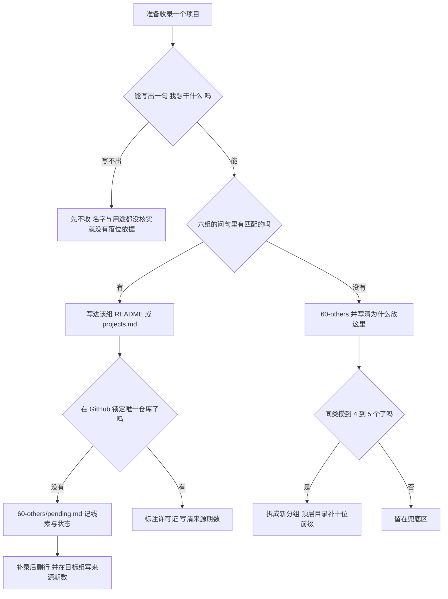

# 内容分类法：唯一分类轴「你想干什么」

仓库里的全部 Markdown 内容都挂在六个顶层目录下。判断一条内容该落哪，只需要回答一句「我想干什么」——不按项目技术栈、不按视频期数、也不按项目类别分。本页给出这条轴的具体判定、编号与命名约定、三种页面的分工，以及两个特殊区域（`60-others` 与 `pending.md`）的收录规则。目录与脚本、站点的整体地图见[仓库全景](../architecture/repository-map.md)。

## 一条轴，六个落点

根 [README.md](../../README.md) 开头就把规则写死了：**分类轴只有一条：你想干什么**，暂时归不了类的一律放 `60-others`，不硬塞。它的功能表标题写「5 组」，实际列 6 行，第 6 行是兜底的其他项；磁盘上则是 6 个内容目录。

| 目录 | 回答的问题 | 典型内容 | 形态 |
|---|---|---|---|
| `10-resources/` | 有没有能直接拿来用的东西 | 图标字体、数据集、项目榜单、Markdown 手册、教材、设计系统 | 组页 + `assets/` + `datasets/` |
| `20-tools/` | 现成工具怎么用 | 在线轻工具、自托管服务、桌面客户端 | 章页 + `projects.md` |
| `30-ai/` | 用 AI 干活 | 本地模型引擎、免代码工作流、DeepTutor 案例 | 章页 + `projects.md` + `install/` |
| `40-ship/` | 让任务自己跑、把东西发上线 | Codespaces → Actions → Pages 一条流水线 | 组页 + 三个子指南 |
| `50-benefits/` | 少花钱、别犯规 | 学生包权益、免费额度速查、高频坑 | 组页 + 两个子目录 |
| `60-others/` | 暂时答不上来 | 暂无功能归属的项目、待核实清单 | 组页 + `pending.md` |

十位前缀不只是编号，也固定了这条阅读顺序：先「拿」（10）、再「用」（20）、再「用 AI 干活」（30）、然后「让它跑起来」（40）、最后算「成本与边界」（50），`60` 永远是兜底位。

判定看用途，不看形态。`10-resources/` 里既有图标字体，也有项目榜单与月刊、Obsidian 可直接打开的 Markdown 手册、教材、数据 API 和设计系统——它们的共同点是「我不想自己做，想直接拿来用」，而不是同类技术。同理 `20-tools/` 里既有一打开浏览器就能用的纯前端小工具，也有一条 Docker 命令起的服务，共同点只是「直接拿来干活」。同一个项目按「你想干什么」只会属于一个组；换一种用法不新增条目，而是从原条目链过去。

## 编号与命名规则

**顶层目录**用 `NN-slug`：十位数字 `10`–`60` 加英文小写 slug。**子目录**不带数字前缀（`assets/`、`datasets/`、`student-pack/`、`limits/`、`actions/`、`pages/`、`codespaces/`、`install/`、`templates/`）。**文件名按角色**：`README.md` 是组内导航/章页，`projects.md` 是跨期精选，`pending.md` 是待核实清单，其余按主题直接命名（如 `install-ollama.sh`、`templates/` 下的三个 workflow 模板）。

页面 H1 里还有另一套编号，和目录前缀**不是一回事**，读的时候不要混用：

- 叶子章页保留 `01`–`09` 的早期顺序：素材 `01`、工具 `02`、AI `03`、Actions `04`、Pages `05`、Codespaces `06`、学生包 `07`、额度速查 `08`、数据集 `09`；
- 组页用十位前缀：`10-resources/README.md` 是「10 · 找资源」，`40-ship/README.md` 是「40 · 自动化与上线」，`50-benefits/README.md` 是「50 · 省钱与避坑」，`60-others/README.md` 干脆不编号。

两套编号已经漂移：`10-resources/datasets/README.md` 编号是 `09`（页内还自称「前 8 章……这一章」），`20-tools/README.md` 标题是 `02` 而目录是 `20`。三条操作性结论：

1. 定位内容只看路径，不要根据标题编号推断归属；
2. 新增页面不要续写 `01`–`09` 章号，那是一条已经封口的旧序列；
3. `20-tools/` 与 `30-ai/` 的 `README.md` 实际就是 `02`/`03` 那两张章页，所以这两组没有单独的组级概览页；`10`/`40`/`50` 才有「组页 + 子指南」的两层结构。

## 三种页面的分工

### 组 README：这一组回答什么

组页的开头是一句加粗的「**这一组回答：……**」，先把这一组要解决的问题说清楚，再列子目录与阅读顺序，最后给组级边界。`40-ship/README.md` 直接把三个子指南写成一条流水线（Codespaces 写代码 → Actions 定时跑 → Pages 发出去），并用 `docs/` 本站举例；`50-benefits/README.md` 给的是阅读顺序——**先看 `limits/` 再去薅学生包**，理由写在正文里（额度与坑位决定能不能长期白嫖，学生包会过期）。组级免费边界也落在组页：Actions 公开仓库不限时长、私有仓库 2000 分钟/月、单 job 6 小时、cron 是 UTC；Pages 1 GB 站点、100 GB 月流量、10 次构建/小时；Codespaces 120 core-hours + 15 GB-month、空闲 30 分钟自动停。

组页的职责是「进组先看哪一页 + 这一组的硬边界」，不是再抄一遍项目清单。

### projects.md：按能力归位的跨期精选

`projects.md` 只在 `20-tools/` 与 `30-ai/` 存在，因为这两组的条目来自持续追更的视频，需要跨期沉淀。两个文件的表头都固定为五列：**项目 / 仓库 / 许可证 / 干什么 / 来源**，并明确写着「不按第几期排，按它能干什么排」。

「来源」列是溯源标记，不是时间轴：可以写抖音的期数（`73`、`86`、`130`、`133`、`137`、`138`）、频道名（抖音、小白神器），也可以写「专题」（本仓库单独写过完整一节的项目，如 DeepTutor）或「本仓库 · 工具篇」。因此同一期的条目会散在不同的能力分组里，同一张表里也能混着不同渠道的来源；想知道出处看这一列，想看时间顺序去看视频期号本身。

精选页同时承担风险边界，而且这个边界会反过来影响落位：`20-tools/projects.md` 里专门有一节「闲鱼自动化：高风险项目不放这里」，把自动发货/自动过滑块的「闲鱼超级管家」留在 `60-others`，本页只留只读的 `ai-goofish-monitor`（监控、选品，不改平台操作）。可见同主题项目要按「用途 + 风险」再分流一次——分组不是把相似名字排在一起。

### 跨组只链接，不复制

同一事实只在一处写，其余位置给相对链接：`20-tools/README.md` 部署纯前端工具的步骤指向 `40-ship/pages`；`30-ai/README.md` 讲「每天 8 点抓数据」时指向 `40-ship/actions`；`40-ship/README.md` 与 `40-ship/actions/README.md` 的额度、密钥问题都指向 `50-benefits/limits`。好处是数字只有一份、不会两处漂移；代价是移动页面时必须同步改链接（`scripts/verify_links.py` 会把站内相对路径当本地文件检查，路径断了就报 `dead`）。

## 60-others：兜底区不是垃圾桶

`60-others/README.md` 的定位写得很明确：放**暂时没有合适功能归属**的项目，「不是不重要，是分类轴还没想清楚」。它的收录规则有三层：

- **每个条目要写「为什么放这里」**，给出具体理由而不是一句「未分类」。例如 OpenStock 是金融行情面板，要归类得单开一个「数据看板」组，为一个项目开组不划算；ziwei-doushu 是命理计算库，跟「GitHub 免费福利」主线不搭但确实开源可跑。
- **攒够同类再拆组**：同一坑位满 4–5 个就拆成独立分组，拆的时候按顶层目录规范补十位前缀。
- **高风险但确实开源的也走这条路**：闲鱼超级管家放在这里，并单独附一张风险表（平台协议禁止脚本运营、README 自述「自动过滑块」属于绕过人机验证、主推在线托管等于把账号 cookie 交给第三方、AGPL-3.0 对外提供服务要开源），而不是塞进 `20-tools` 与常规工具并列。

一个排版陷阱：`60-others/README.md` 的表格在 `daily_stock_analysis` 行之后被「三步装法」段落插断，`Disc Image Studio` / `OpenStock` / `ziwei-doushu` 三行接在段落之后，渲染出来是第二张表。新增条目要接在**文件末尾那张表**的末尾；插到断点之前会被段落切断，看起来像丢了行。

## pending.md：准确性的守卫

`60-others/pending.md` 只收一类东西：视频里报了名字/描述、但**没能在 GitHub 上锁定唯一仓库**的项目。表结构是 项目 / 已知线索 / 来源 / 状态，状态写的是具体原因（「未定位」「搜索无结果」「候选太多，未锁定」「未定位（教材类仓库常因版权反复下架）」）。

三条规则写在文件末尾：**不硬凑**（名字对不上、只有衍生版或小号复刻的，一律留在这里，不占用正式分组）、**补录后把对应行删掉**、**补进目标分组时写清来源期数**。

因此它不是待办清单，而是准确性的守卫：

- 表里的条目**不属于任何分组，不占正式位置**，所以一条永远核实不到的项目可以一直留着，也不会污染任何分组的推荐质量；
- 「待办」暗示早晚要完成，这张表的意思正相反——**没核实清楚就不收录**；它的长度衡量核实缺口，不衡量工作量；
- 补录是**原子动作**：在目标组加条目并写来源期数 + 从 `pending.md` 删掉该行。只做一半就会产生重复条目或悬空引用。

单批的缺口可以就地记在项目页，不必都塞进 `pending.md`：`30-ai/projects.md` 的「本期没收录的」就列了 3 个没匹配到唯一仓库的名字，同时注明 `Orca` 已核实入库。跨期、跨组都还没定位的才进 `pending.md`。

## 站点是另一套展示分类

`docs/index.html` 的卡片集合是手写的 15 张（`no` 1–15，`cat` 为 发现 / 学习 / 下载 / 文档 / 图像 / 视听 / 桌面 / 手机 / 采集 / Agent / 内容 / 模型 / 自托管 / 技能包 / 收口），页头「15 组分类」也是手写统计。它和 Markdown 的六个目录**不是同一棵树，也不共享数据源**：在内容目录里新增条目不会自动出现在站点，站点新增卡片也不会回流到 Markdown。分类的权威是 Markdown 目录，站点只是展示层；生成块与站点结构见[静态站点](../architecture/static-site.md)。

## 新增内容怎么落位

上图是落位判定：先确认用途能说清，再看六组问句是否匹配，最后过一遍「仓库是否唯一」这道闸。

配套的检查清单：

1. 先用一句话写清「我想干什么」；写不出来就先别收。
2. 能匹配就进对应组：教程/选型进该组 `README.md`，跨期条目进 `projects.md`（只有 `20-tools`、`30-ai` 有）。
3. 都不匹配 → `60-others`，并在「为什么放这里」写下理由；同类满 4–5 个再拆新组。
4. 仓库没锁定 → 只进 `pending.md`，不进任何分组表格。
5. 同一主题的高风险变体不进常规组，按 `20-tools` 与 `60-others` 的既有分工处理。
6. 改完跑 `python scripts/verify_links.py`，确认新链接没被记为失效、站内相对路径没写错。

## 延伸阅读

- [仓库全景](../architecture/repository-map.md)：六个目录之外，脚本、CI 与站点的职责边界。
- [条目约定](entry-conventions.md)：单条目的字段、许可证标注与来源列写法。
- [许可证与风险策略](licensing-and-risk-policy.md)：什么能收，GPL/AGPL 与「无 LICENSE」怎么标。
- [静态站点](../architecture/static-site.md)：站点卡片、生成块与「两套分类不共享数据源」的后果。
