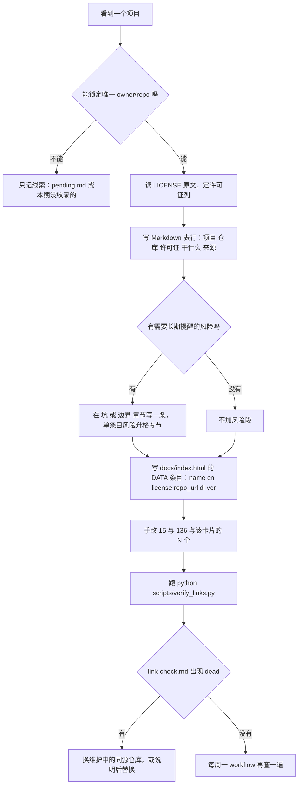

# 条目约定：表格列、来源标注与「坑」章节

这个仓库的每一页都在回答同一件事：**这个东西能不能用、敢不敢用、从哪拿**。所以「收录一个项目」不等于写一段介绍，而是把一条记录填进固定的字段槽位——字段缺一个，读者就得自己去 GitHub 补，条目也就失去了索引的意义。

本页讲单条条目的写法。哪个项目该落进哪一组、`60-others` 与 `pending.md` 怎么收，见[内容分类法](content-taxonomy.md)；许可证明细与风险判据见[许可证与风险策略](licensing-and-risk-policy.md)。

## 一条条目 = 四件不变量 + 一个溯源标记

无论长成表格行、专题小节还是站点卡片，一条条目必须能回答四件事：

1. **它叫什么**（项目名，必要时带中文别名）；
2. **上游仓库在哪**（可点开的 `https://github.com/<owner>/<repo>`）；
3. **许可证是什么**（GitHub 识别到的标识，或「识别不出」「没有」）；
4. **它能干什么**（一句动词开头的用途，不是宣传语）。

第五件是可选的出处标记（「来源」列）与风险说明。前四件缺任何一件，那就不算条目——这也是 `pending.md` 存在的理由：仓库锁不定的项目只能记线索，不能进表。

## 标准五列：项目 / 仓库 / 许可证 / 干什么 / 来源

`20-tools/projects.md`、`30-ai/projects.md`、`60-others/README.md` 三张跨期表共用同一个表头，并且都在开头声明「不按第几期排，按它能干什么排」。列语义如下：

| 列 | 写什么 | 典型毛病 |
|---|---|---|
| 项目 | 项目名**加粗**；中文别名放全角括号里，如 `**OldAlmanac（电子老黄历）**` | 只写中文译名、丢掉上游原名，读者搜不到仓库 |
| 仓库 | `[owner/repo](https://github.com/owner/repo)`，锚文本与 URL 必须同源 | 锚文本写项目名、URL 指向官网首页，等于没有仓库地址 |
| 许可证 | GitHub 认得的 SPDX 标识；识别不出写 `NOASSERTION`；仓库里没有 LICENSE 文件写 `无 LICENSE` | 把 README 里那句 "free to use" 抄成许可证 |
| 干什么 | 一句话、动词开头，写能力 + 那句必须提前说的边界（如「只读，不改平台操作」） | 抄官网 slogan，读者看完仍不知道能拿它做什么 |
| 来源 | 频道名、视频期数、「专题」或「本仓库 · 工具篇」 | 写日期当来源，时间轴冒充出处 |

两条真实行的形状（不是整张表）：

```markdown
| **MediaCrawler** | [NanmiCoder/MediaCrawler](https://github.com/NanmiCoder/MediaCrawler) | **NOASSERTION** | 多平台内容与评论采集：小红书/抖音/快手/B站/微博/贴吧/知乎 | 抖音 |
| **OldAlmanac（电子老黄历）** | [jingguanzhang/OldAlmanac](https://github.com/jingguanzhang/OldAlmanac) | **无 LICENSE** | 手撕质感电子老黄历，公历农历对照、0–9999 年、可导出高清图/ PDF | 抖音 |
```

「干什么」列里允许出现唯一的例外语气：当项目正确用法本身就带限制时，边界要挤进这一列（`ai-goofish-monitor` 的「只读，不改平台操作」）。这样筛选的人不必读完整个页面才发现它会把账号玩坏。

## 许可证列：加粗是一个必须兑现的信号

**加粗不是排版偏好，是「停下来读 LICENSE」的索引。** 实际只用在三种取值上：

- `**NOASSERTION**`——GitHub 识别不出标准许可证；
- `**无 LICENSE**`——仓库根本没有许可文件，按默认版权规则「保留所有权利」；
- `**AGPL-3.0**`——网络服务也算分发，对外提供就要开源修改。

第二种与第三种是明确结论，第一种是**不确定**。站点的免责声明把前两者并列处理：`NOASSERTION` 不等于「没有许可证」，它只表示自动识别失败，但对外说法一律收紧成「请勿再分发或商用」（`docs/disclaimer.html` §3）。所以加粗之后必须兑现一条正文说明，否则就是半条条目：

- `MediaCrawler` 加粗 → 「采集类工具的边界」小节里补「商用前自己读 LICENSE」；
- `OldAlmanac` 加粗 → 「这四个的边界」里写明「不能商用、不能二次分发，自己看、自己打印可以」；
- `Motrix` 表里写的是不加粗的 `NOASSERTION`，但「用之前要知道的」仍补了一句「GitHub 识别不出，商用前自己读 LICENSE」——加粗可以漏，解释不能漏。

反过来说，`MIT` / `Apache-2.0` / `BSD-3-Clause` / `GPL-3.0` 一般不加粗：它们的义务是读者已知的常识，价值在填写准确，不在视觉提醒。判断加粗与否的标准是「不解释会不会有人踩坑」，不是「许可证严不严重」。

## 来源列：溯源标记，不是时间轴

来源列的取值是一组**异构**标记，混在同一张表里是正常的：

| 取值形态 | 例子 | 含义 |
|---|---|---|
| 频道名 | `抖音`、`小白神器` | 整期节目的渠道，不区分第几期 |
| 期数 | `73`、`86`、`130`、`133`、`137`、`138`、`78` | 该期视频里出现过这个项目 |
| 复合标记 | `抖音 · 324 期`、`抖音 · 考公脑库` | 频道 + 期号或栏目名，信息更精确时不要退化成纯数字 |
| `专题` | `DeepTutor` | 本仓库为它单独写过完整一节，脚注里给出定义与链接 |
| `本仓库 · 工具篇` | `IT-Tools`、`CyberChef`、`Stirling-PDF` | 出处是本仓库自己的章页，不是某期视频 |

三条使用规则：

1. **它只回答「从哪知道的」**，不承担排序功能。表按能力分组，因此同一期的条目会散在不同段落里——这是设计结果，不是漏排。想看时间顺序就去看期号本身。
2. **补录时要写清期数**。未核实项目补进正式分组时，来源列必须写明出处，否则下次没人能复核。
3. **信息更精确时选复合写法**，别为了整齐把 `抖音 · 324 期` 压成 `抖音`。

## 列集会收缩，四件不变量不变

同样是条目，章页与精选页的列数并不一致，这是有意的取舍：

| 页面 | 列 | 差在哪 |
|---|---|---|
| `20-tools/projects.md` 等跨期表 | 项目 / 仓库 / 许可证 / 干什么 / 来源 | 基线五列 |
| `20-tools/README.md` 章页表 | 项目 / 能干什么 / 许可证（+ 部署难度） | 砍掉独立「仓库」列，把仓库链接折进「项目」列的锚文本 |
| `10-resources/assets/README.md` 素材表 | 素材 / 数量 / 许可证 / 目录 / 上游 | 「目录」是仓库内落位，「上游」才是仓库地址 |
| `10-resources/datasets/README.md` 数据集表 | 数据集 / 上游仓库 / 许可证 / 收录 / 能拿来做什么 | 「收录」写文件数与体积，因为它是被机读的目录 |

规则是「可以砍列，不能砍信息」：`20-tools/README.md` 把仓库链接折进项目列（`[CorentinTh/it-tools](https://github.com/CorentinTh/it-tools)`），读者仍然点得到上游；反过来，如果哪张表既不写仓库也不能点，那张表就只能当广告看。

## 「数字会变」类免责声明是刻意写的

仓库里凡出现配额、星标、版本号、许可证判定的地方，都紧跟一句把权威推回外部的话，措辞几乎固定：

- 额度速查表后：「表格是速查，**数字会变**。真要下单前点最后一列核对。」（`50-benefits/limits/README.md`）
- Actions 额度表后：「额度会调整，以 GitHub 官方计费文档为准。」（`40-ship/actions/README.md`）
- 站点额度表后：「**数字会变。** 下单前请以 GitHub 官方计费文档为准。」（`docs/index.html`）
- 免责声明 §5：「星标数、许可证、最新版本号通过 GitHub 公开 API 获取，随时间变化；**请以仓库实际页面为准**。」（`docs/disclaimer.html`）

这类句子在整理、翻译、合并段落时**不要删**。它们不是免责的套话，而是把「速查表」和「承诺」分开的那道线：没有它，读者会把三个月前的 2,000 分钟当成今天的合同条款，然后在超支时认为文档骗人。同一逻辑也解释了为什么自动同步数据集目录时**故意不抓 star 数**——「每周都会变，会制造无意义提交」（`scripts/sync_atlas.py`）。

## 「坑」章节与「边界」段落：同一件事的两级写法

风险内容不是散落在正文里的括号注，而是有固定位置的章节：

- **页级 `## 坑`**：`20-tools/README.md`、`30-ai/README.md`、`40-ship/actions/README.md`、`40-ship/codespaces/README.md`、`40-ship/pages/README.md`、`50-benefits/student-pack/README.md` 各有一节。形式统一为**编号列表，一条一个失效模式，粗体领头语先点症状**（「cron 是 UTC」「默认权限只读」「`docs/` 和根目录二选一」）。`40-ship/actions/README.md` 的小标题干脆写成「坑（这一节比正文重要）」。
- **精选页的分批边界**：`20-tools/projects.md` 与 `30-ai/projects.md` 用「这批的边界」「这四个的边界」「采集类工具的边界」按收录批次收口，最后统一以「用之前要知道的」收尾；`60-others/README.md` 同样以「用之前要知道的」结束。
- **单条目升格成专节**：当一条风险大于项目本身的价值时，它不再是一行脚注——「闲鱼超级管家」在 `20-tools/projects.md` 里有独立小节说明「高风险项目不放这里」，并在 `60-others/README.md` 里配一张四行风险表（平台规则 / 自动过滑块 / 账号托管 / AGPL）；`TVBox` 类项目的「版权红线」也独立成节。

两级分工是：**「坑」讲会怎么坏，「边界」讲你能做到哪。** `50-benefits/limits` 的四个坑各自还能再拆（权限只读、cron 时区、密钥泄露、许可证误用），因为它们对应四类不同的失败。这三层内容在整理时**一律保留**：正文讲能力，坑讲能力的反噬面；删掉坑，剩下的就是一段推荐语。

一条纪律：**同一个风险只写在一处**。项目在 `20-tools/projects.md` 有边界段，`docs/index.html` 就不重复长文，只留 `cn` 短注；跨页引用走相对链接，别复制。

## 「只做索引、不托管」如何落到条目上

站点的立场写得很直白：**索引，不镜像、不代下**（`docs/disclaimer.html` §1、§2；页脚再次重申 `docs/index.html`）。这对条目写法有三处硬约束：

1. **Markdown 表里没有「下载」列。** 表格只给仓库地址；想拿安装包，就去站点卡片上的下载链接。这也是为什么正文里出现的总是官方地址，例如「Concat 官网/下载：<https://concat.standalones.org>」「到 Releases 下载对应安装包」（`30-ai/README.md` 的 DeepTutor 专题）。
2. **站点的下载入口指向项目自己的 Releases。** 渲染时 `href` 取 `it.dl`，缺省回落到 `repo_url + '/releases'`；`ver` 只影响悬停提示（「下载 v1.9.3」或「去 Releases 页」），不参与拼接（`docs/index.html` 的渲染函数）。带标签的版本要在 `dl` 里写成 `releases/tag/<tag>` 并做 URL 编码。
3. **不要给条目加「网盘备份」「镜像下载」。** 既违背站内立场，也让外链体检无法判断真实来源——体检认的是 `github.com/<owner>/<repo>` 这种可复核的官方地址。

两个**有意的例外**，别把它们当成违反立场：

- **`10-resources/assets/` 是真托管的素材**：文件确实下载进了仓库，许可证原文在 `LICENSES/`，来源、许可证与 SHA-256 逐文件记在 `MANIFEST.json`（`repo` / `source_path` / `license` / `sha256` / `source_url`）。「不托管」针对的是第三方代码与安装包，不是这几百个已核验许可的图标字体。
- **数据集只收目录与元数据**：`The Well` 只收元数据（本体体量远超 git 上限），`word-atlas` 标了 skipped（记录校验和但未入库），体量超限的一律按上游说明另行下载。

## 同一条目要写两处：Markdown 与 `DATA`

Markdown 是正本，`docs/index.html` 是展示层且**不共享数据源**：在内容目录里加一行表格，站点不会自动出现对应卡片。新增条目的完整动作是：

1. 在对应页面的表格里加一行（或在专题小节里加一段）；
2. 在 `docs/index.html` 的 `DATA` 数组里给对应分类的 `items` 加一条，字段形状固定为 `name` / `cn` / `license` / `repo_url` / `dl` / `ver`；
3. 手改三处计数：页头的 `15` 组分类与 `136` 个精选项目、该分类卡片 `tags` 里的 `"N 个"`——没有代码在校验它们。

两处的措辞允许不同：站点 `cn` 是短语（「多平台评论采集」），Markdown「干什么」是整句；但 `license` 与 `repo_url` **不能打架**，同一个项目在两处给出不同许可，读者只会按较宽松的那个理解。字段渲染细节、`esc()` 转义集合与计数漂移的位置见[静态站点](../architecture/static-site.md)。

## 机器生成的表不要手改

`10-resources/datasets/README.md` 的数据集表被 `<!-- BEGIN GENERATED: datasets -->` / `<!-- END GENERATED: datasets -->` 包着，由 `scripts/sync_atlas.py` 整块重写（幂等，结构不符就报错退出，绝不写半截文件）。这带来两条与手写表不同的约定：

- **`NOASSERTION` 在这里渲染成「见上游 LICENSE」**，而不是加粗的 `NOASSERTION`。手写表加粗是因为正文会替读者下结论；生成表不下结论，只把问题退回上游。
- **「收录边界」写在备注里，不写进「能拿来做什么」**。`The Well` 的「仅收录元数据」、`word-atlas` 的「manifest 标记 skipped」都以子注形式挂在数据集名下方，措辞是事实性描述，不替上游判断。

要改这类表，去改上游 manifest 或 `sync_atlas.py` 的 `PURPOSE` / `NOTE` 映射；直接编辑表格会在下一次每周同步时被覆盖。

## 条目会烂：体检是写法的一部分

资源索引的烂法只有一种——**推荐的项目改名、删库或换了许可证，而没人发现**。所以「写条目」的最后一环是让它可被定期复核：

- `scripts/verify_links.py` 扫全部 Markdown 里的 `[文本](目标)` 与裸 URL；`github.com/<owner>/<repo>` 自动改走 `api.github.com`，`github.com/.../blob/...` 改走 contents API；站内相对路径直接查本地文件是否存在，越出仓库目录记为失效。
- 结果写进 `docs/link-check.md`：✅ / ❌ 失效 / ⚠️ 未验证 / ⏭️ 跳过（本地服务）四态，失效行会列出「出现在」哪个文件，改的时候不用猜。
- `.github/workflows/link-check.yml` 每周一 UTC 01:00 跑一次，并只监听六个内容目录下的 `*.md`——不能写成 `**/*.md`，否则提交回 `docs/link-check.md` 会自触发成死循环，把紧随其后的 Pages 构建一个个取消掉（站点忽新忽旧就是这个症状）。

已经烂掉的条目有两种正确处置，都要在正文里留痕：**换成仍在维护的同源版本**（如 `twemoji/twemoji` → `jdecked/twemoji`），或**说明并替换**（视频里提到的 `kon9chunkit/GitHub-Chinese-Top-Charts` 已 404，收录的是仍在维护的 `ChHsiching` 版本并写清口径差异）。悄悄删行最糟：读者会以为那个项目从没被推荐过。



上图是一条条目从核实到上线再到被体检的完整路径：文件路径与期数在 Markdown 侧落定，展示与下载入口在 `DATA` 侧落定，两者靠人工同步，靠体检兜底。

## 落笔清单

1. 先读仓库里的 `LICENSE` / `NOTICE` **原文**，不看 README 的一句 "free to use"；识别不出写 `NOASSERTION`，没有文件写 `无 LICENSE`。
2. 表格行按五列填满，项目名加粗，仓库列用 `[owner/repo](https://github.com/owner/repo)`。
3. 需要提醒的许可证取值加粗，并在正文（「边界」或「用之前要知道的」）兑现一句处置。
4. 「干什么」写一句能力 + 必要边界，别抄宣传语。
5. 「来源」写频道名、期数、`专题` 或 `本仓库 · 工具篇`；补录时务必写期数。
6. 同步在 `docs/index.html` 的 `DATA` 里加条目并手改 `15` / `136` / `"N 个"`。
7. 新条目接在**文件末尾那张表**的末尾（`60-others/README.md` 中间被段落插断过，插到断点前会被渲染成第二张表），详见[内容分类法](content-taxonomy.md)。
8. 跑 `python scripts/verify_links.py`，确认没有新增 `dead`；机器生成的表格不要手改。

## 延伸阅读

- [内容分类法：唯一分类轴「你想干什么」](content-taxonomy.md)：条目该落进哪一组、`60-others` 与 `pending.md` 的收录规则。
- [许可证与风险策略](licensing-and-risk-policy.md)：什么能收，GPL/AGPL 与「无 LICENSE」在文字上怎么处理。
- [静态站点（docs/ 单页应用与页面契约）](../architecture/static-site.md)：`DATA` 字段渲染、`esc()` 转义、下载回落与三个手写计数。
- [仓库全景](../architecture/repository-map.md)：内容目录、脚本、CI 与站点的整体职责边界。
