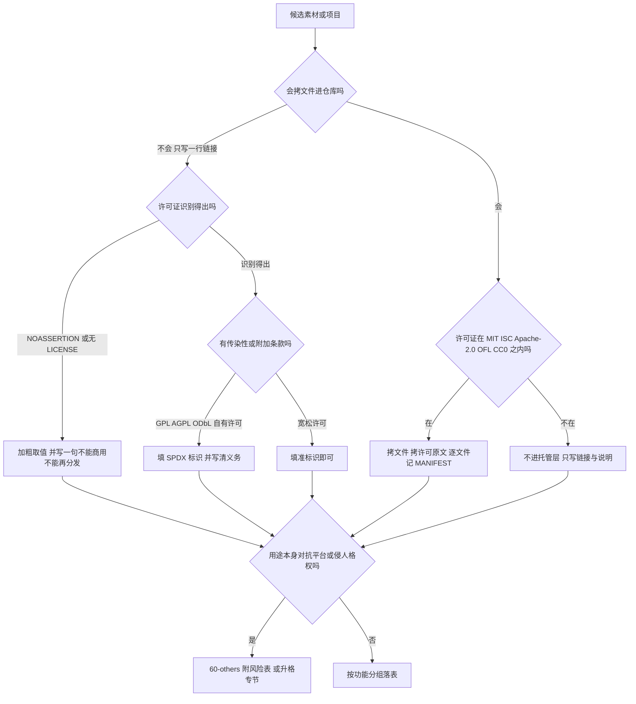

# 许可证与风险边界

这个仓库同时做两件事：**收录别人的东西**，并**把自己写的东西按 MIT 放出去**。两件事的许可证不是一回事，判断边界也不是一回事。本页给的是可判定的收录取舍规则——什么能拷进仓库、什么只能写一行链接、什么必须配一段警告、什么干脆不收——以及这些规则在脚本层怎么变成不会漂的代码。

一句话版本：**白名单管的是「拷不拷」，不是「提不提」。** 收录一个 GPL 项目不会传染本仓库；把它的文件拷进来才会。

## 两条互不覆盖的许可层

仓库里并存两种「许可证事实」，混谈就会出错：

| 层 | 覆盖范围 | 许可证 | 权威出处 |
|---|---|---|---|
| 本仓库自有内容 | 文档、`scripts/`、`docs/` 站点 | MIT（保留版权声明即可商用、修改、再分发） | [LICENSE](../../LICENSE) 正文 |
| 下游素材与项目 | `10-resources/assets/` 的文件、各表里的条目 | 各自上游许可证 | `LICENSES/`、`MANIFEST.json`、条目所在表格 |

`LICENSE` 末尾的第三方排除条款是这条分界线的法律落点：「第三方素材不在本许可证范围内。……分别适用 MIT（Tabler Icons）、ISC（Lucide）与 SIL Open Font License 1.1（字体）」。但**这段的指针已经腐烂**：它写的是 `01-assets/LICENSES/`，而磁盘上是 `10-resources/assets/LICENSES/`。条款本身没错，错的是路径——读者照着 LICENSE 找不到许可原文。因此**找上游许可原文的可靠入口是根 `README.md` 的「许可证」节与 `10-resources/assets/README.md`**，不是 `LICENSE` 末尾那段。修这段路径文案不改变任何条款，只影响人能不能找到原文。

同理，站点侧的口径写在 `docs/disclaimer.html`：各项目版权归作者，使用条件以仓库中的 `LICENSE` 为准，站内文字是转述与评论（§3）；本站是索引，不托管、不镜像、不代下第三方代码与安装包（§1–§2）。

## 先分层，再判定

判定顺序不是「这个许可证严不严」，而是「我要不要把这个文件放进仓库」。

- **托管层**：文件真的进了仓库——目前只有 `10-resources/assets/` 下 206 个文件（200 个图标、2 个字体、4 份上游许可原文），来源、许可证与 SHA-256 逐文件记在 `MANIFEST.json`。这一层受白名单硬约束，因为仓库一旦被 clone 分发，就得对这些字节负责。
- **索引层**：只写项目名、上游仓库、许可证、用途——`20-tools/projects.md`、`30-ai/projects.md`、`60-others/README.md`、`10-resources/datasets/` 的表格都属于这一层。它允许 GPL、AGPL、ODbL、项目自有许可甚至 `NOASSERTION`，代价是**标注**：识别不出的加粗、有传染性的写清义务、有风险的配一段边界。

数据集是索引层的特殊形态：只收目录与元数据（`The Well` 只收 README / YAML，`word-atlas` 标 skipped），不整库再分发——这正是它能容纳 `BSD-3-Clause`、`ODbL-1.0` 与两个 `NOASSERTION` 的原因。

## 四态决策表

| 判定 | 触发条件 | 必须做什么 | 落点 |
|---|---|---|---|
| **允许收录（可进托管层）** | `MIT` / `ISC` / `Apache-2.0` / `OFL` / `CC0` | 拷文件 + 拷许可证原文 + 逐文件写 `MANIFEST.json`（`license` / `sha256` / `source_url`） | `10-resources/assets/` |
| **允许收录，需标注** | `GPL-2.0` / `GPL-3.0` / `AGPL-3.0` / `BSD-3-Clause` / `ODbL-1.0` / `CC-BY-4.0` / `Unlicense` / 项目自有许可（如 open-webui「源码可用，非 OSI」、dify「Apache-2.0 + 附加条款」） | 只写链接，许可证列填 SPDX 标识；传染性或附加条款补一句义务 | 各内容目录的表格 |
| **允许收录，需警告** | `NOASSERTION` / 无 LICENSE 文件 | 手写表把取值加粗，并紧跟一句处置（不能商用 / 不能再分发）；生成表回落「见上游 LICENSE」 | 表格 + 「边界」或「用之前要知道的」段 |
| **允许收录，需单列风险** | 采集、平台自动化运营、设备提权、影视聚合源、换脸/声音克隆、聚合公开数据 | 不进常规工具组；在 `60-others` 附风险表，或升格成专节 | `60-others/README.md` / 专节 |
| **不收录** | 只允许非商用（`CC-BY-NC` 等）；未能锁定唯一 `owner/repo`；第三方代码、安装包、镜像、网盘转载 | 非商用件不带入任何层；锁不定的只记 `pending.md`；不托管二进制 | — |

判定顺序：先决定是否进托管层，再决定标注强度，最后按用途判断是否需要风险落位。

## GPL / AGPL：标注不是判决，但有例外要加粗

常规处置是**只标注、不回避**：`IT-Tools`（GPL-3.0）、`OBS Studio`（GPL-2.0）、`Immich` / `SingleFile` / `RustDesk` / `OpenStock`（AGPL-3.0）都正常进索引层，许可证列写 SPDX 标识，不加粗。

加粗的判据是「不解释会不会有人踩坑」，而不是「许可证严不严重」。当前唯一的 AGPL 加粗条目是 `Concat`：它被定位成「剪映的开源平替」、又带 JSON-RPC + MCP 可被 AI agent 脚本化驱动，读者最容易做的下一步恰好是包进产品或对外提供剪辑服务——正是 AGPL 要求开源修改的场景。所以它标成 **AGPL-3.0**，并在「用之前要知道的」里兑现那句义务。

AGPL 的边界句在仓库里几乎是固定句式：**自建服务器给自己用没问题，对外提供网络服务就要按 AGPL 开源你的修改**（`RustDesk` 远程桌面服务、`OpenStock` 行情面板、`Concat` 剪辑服务三处同一口径）。这条句式比「AGPL 有传染性」有用，因为它把判断条件落到了具体动作上。

反过来的纪律是：**收录 GPL 项目不会让本仓库变成 GPL。** 索引层只写链接、不复制代码，自有内容仍由 MIT 覆盖；把这一条讲清楚，才不会出现「仓库里有 GPL 条目所以整仓 GPL」的误读。

## ODbL 与数据集：传染对象是「衍生数据库」

数据集许可证比代码杂，而它们进仓库的方式是「目录 + 元数据」，不是整库再分发。`countries-states-cities-database` 是 `ODbL-1.0`，边界写成一句可操作的话：**整库塞进产品对外提供服务，衍生的数据库部分要同样开放；只做内部分析或只输出统计结果不受影响。** 若把「ODbL 有传染性」停在形容词层面，读者无法判断自己属于哪种情况。

判断入口只有一个：读仓库里的 `LICENSE` / `NOTICE` **原文**，不看 README 里那句 "free to use"。`10-resources/assets/README.md` 把这条写成三条动手前必查：看 LICENSE 文件本身、区分代码许可证与素材许可证（代码 MIT 而图标另有许可甚至只许非商用，是最常见的陷阱）、保留署名。

## 无 LICENSE 与 NOASSERTION：两种写法，同一个不结论

这一档最容易写错，因为仓库里**故意存在两种措辞**：

- **手写表**：取值加粗成 **无 LICENSE**（`OldAlmanac`、`ChinaTextbook`、`HelloGitHub`），并在正文兑现一句处置。`OldAlmanac` 是「自己看、自己打印可以，不能商用、不能二次分发」；`ChinaTextbook` 是「教材版权归原出版方，仅供个人学习，别商用/二次分发」。
- **生成表**：`NOASSERTION` 由 `sync_atlas.py` 的 `license_label()` 渲染成「见上游 LICENSE」，站点卡片再降一级成「见 LICENSE」。措辞本身就是结论——**退回上游，本仓库不替上游下结论**。

这两种不是不一致，而是分工：手写表的加粗是因为紧邻正文会给出处置；生成表不写结论，是因为数据来自上游 `open-data-atlas` 的 manifest，本仓库只做转述。

两个必须记住的区分：

1. **`NOASSERTION` ≠ 没有许可证。** 它只表示 GitHub 识别不出标准许可证。所以「自有许可」项目会以 `NOASSERTION` 出现（`Odoo`、`Beekeeper Studio`、`Cap`、`anthropics/skills`），处置都一样：商用前自己读。
2. **对外说法取最保守那一档。** 站点免责声明把 `NOASSERTION` 与「无 LICENSE」并列收紧成「默认保留所有权利或条款不明，请勿再分发或商用」（§3）；`50-benefits/limits` 的许可证误用表也把「无 LICENSE 文件」判为**不能商用、不能闭源分发**，因为这是版权法的默认规则，不是 GitHub 的规则。

## 脚本层：规则怎么变成代码

规则写在文档里会漂，写成函数和数据就不容易漂。相关脚本的职责分工见[仓库全景](../architecture/repository-map.md)，这里只讲与许可证明细直接有关的部分。

### `sync_atlas.py`：一个函数决定两处渲染

- `license_label(license_id)` 是唯一的降级点：空字符串或 `NOASSERTION` → 「见上游 LICENSE」，其余原样返回。README 生成表的单元格与 `docs/index.html` 里 `atlas-datasets` 数据块**都从它取数**，所以表格与站点卡片不可能给出两个不同的许可证。
- 站点侧再映射一次：`render_index_block()` 把「见上游 LICENSE」改写成「见 LICENSE」，因为卡片空间小。这是同一结论的两种长度，不是两条规则。
- `build_catalog()` 做硬校验：上游每个数据集必须有非空的 `name` / `repo` / `repo_url` / `license`，缺一个就 `SystemExit` 且**不写任何文件**。也就是说「不知道」必须被写成 `NOASSERTION` 这个字面量，不能留空——留空等于让渲染层替上游猜。`datasets.json` 里 `exercises-dataset` 与 `word-atlas` 的 `license` 就是字符串 `NOASSERTION`，降级只发生在渲染时。

### `fetch_assets.py`：逐文件账本

- `record()` 为每个下载的文件追加 `path` / `repo` / `source_path` / `license` / `bytes` / `sha256` / `source_url`。`MANIFEST.json` 因此是一份可审计的账本：哪个字节来自哪个仓库的哪个路径、按哪个许可证、当时的内容哈希是多少。
- 许可证 id 是**脚本里人写死的声明**（`FONTS`、`LICENSES` 两个元组的最后一列），脚本是抄写员，不是判定者：它不去解析许可证文本，也不会发现上游悄悄换证。想改某个素材的许可证结论，必须改这两张表，而不是改清单。
- `LICENSES` 列表把四份上游许可原文本身也下载进 `10-resources/assets/LICENSES/`，于是读者不必回上游就能读到条款——这是「真托管」的合规代价，也是它比「只给链接」贵的地方。
- `--only icons|fonts|licenses` 会按 `path` 与现有 `MANIFEST.json` 合并，避免只刷字体时把图标条目丢掉；不带 `--only` 的全量跑整份覆盖清单，手改必然丢失。

### 两个真实的运维缺口

1. **上游换证不会自动被发现。** 数据集侧每周由 CI 跑一次 `sync_atlas.py`（`.github/workflows/link-check.yml`，周一 UTC 01:00）；素材侧只有人手动跑 `fetch_assets.py` 才会更新。没人跑，`MANIFEST.json` 里记的就一直是上一次的声明。
2. **站点数据集卡片可能落后于 `datasets.json`。** 该 workflow 跑完只 `git add docs/link-check.md 10-resources/datasets/`，而 `sync_atlas.py` 同时改写了 `docs/index.html` 的 `atlas-datasets` 块——那处改动留在工作区、不随提交进库。因此上游改了许可证，会先体现在 `datasets.json` 与 `README.md` 的生成表，站点卡片要等人在本地跑一遍 `python scripts/sync_atlas.py` 并把 `docs/index.html` 一起提交才跟上。

两个缺口共同的处置是同一句：**许可证类改动的正本在上游，本仓库要重新渲染就必须跑脚本并把全部三个目标一起提交**，否则「已经标注过」这件事本身就成了过期信息。

## 灰产与高危：可以不收，但不能不提

分流判据只有一条：**它会不会改动第三方平台的状态，或侵犯他人的人格权/著作权。**

- **只读留在常规组。** `ai-goofish-monitor`（闲鱼监控与选品，不改平台操作）留在 `20-tools/projects.md`，并在「干什么」列直接写「只读，不改平台操作」。
- **对抗风控的只进兜底区，并单列风险。** 同主题的「闲鱼超级管家」被明确排除在常规工具组外，理由是四行可核实的事实：平台协议禁止脚本/外挂运营、README 自述「自动过滑块」属于绕过人机验证、主推在线托管等于把账号 cookie 交给第三方服务器、AGPL-3.0 对外提供服务要开源。
- **风险大于价值就升格成专节。** `TVBox Desktop` 项目本身 MIT，但内置的播放源是第三方未授权聚合源，于是写成「版权红线（比功能重要）」；`ung220z-tool` 写成「只对自有设备用」，指明对他人或运营商设备操作属于入侵、改桥接会触碰服务条款；`get_jobs` 写成「自动投简历：风险比效率大」，点名明确违反招聘平台协议、封号是常态。
- **人格权与素材版权单独提醒。** `Deep-Live-Cam` 换脸（未授权制作他人音视频可能违法）、`VoiceStudio` 声音克隆（必须书面授权）、`ChatTTS`（别克隆他人音色）、`Hypit` 复刻爆款（素材版权与平台原创判定都在灰色地带）、`book-to-skill` 整本 PDF 对外分发即侵权。
- **聚合数据的条款要逐源确认。** `gods-eye-view` 的许可证是 `NOASSERTION`，而它聚合的公开卫星/摄像头数据各源另有条款，二次分发前逐条核对。

措辞纪律：写「风险在哪、代价是什么」，不写「别用」，也不写「放心用」。站点免责声明同样是这个位置——「本站只做记录与提示，不对使用者因使用这些项目造成的任何后果负责」（§4）。

## 出处、时效、下架

- **可审计快照**：`MANIFEST.json`（素材：逐文件 `sha256` + `source_url`）与 `10-resources/datasets/datasets.json`（数据集：来源仓库 + `license` + 文件数/体积）。它们的价值不是好看，而是**能发现上游被 force-push 或被替换**。
- **时效**：星标数、许可证、版本号经 GitHub 公开 API 获取，随时间变化，以仓库实际页面为准（免责声明 §5）。这也是速查表后面总要跟一句「数字会变」的原因。
- **下架响应**：项目作者认为收录描述有误、或希望移除条目，走仓库 Issues，说明项目与理由，**核实后 48 小时内移除或修改**（§6）。这条是收录他人项目的对价，不是可选的客服承诺。
- **免责与身份**：内容按「现状」提供，不构成法律、投资或安全建议（§7）；与 GitHub、Microsoft 无隶属关系，个人整理。
- **边界**：本页给的是本仓库的收录取舍，不是对任何上游项目的法律意见；具体到某个项目能不能商用，答案永远在它自己的 `LICENSE` 里。

## 落笔检查表

1. 先分层：会拷文件进仓库吗？会，才轮到白名单。
2. 读 `LICENSE` / `NOTICE` **原文**，不看 README 的一句 "free to use"；代码许可证与素材许可证分别确认。
3. 白名单内（MIT / ISC / Apache-2.0 / OFL / CC0）才托管，并把许可原文与逐文件 `sha256` 一起记进 `MANIFEST.json`。
4. 白名单外但可商用/可收录的，只写链接，填准 SPDX 标识，传染性与附加条款各补一句义务。
5. `NOASSERTION` 写 `NOASSERTION`，无许可文件写 **无 LICENSE**；不留空、不猜、不替上游下结论。
6. 加粗只给「不解释就会有人踩坑」的取值，并且必须紧跟一句处置。
7. 风险按「改不改平台状态 / 侵不侵人格权」判断落位：常规组、`60-others` 风险表、还是升格专节。
8. 改完跑 `python scripts/sync_atlas.py`（或 `--check` 看差异），确认 `datasets.json`、生成表与 `docs/index.html` 三处一起提交。
9. 新增素材改的是脚本里的 `FONTS` / `LICENSES` / `ICON_NAMES`，然后重跑 `fetch_assets.py`，看 `MANIFEST.json` 的 diff——不要手改清单。

## 延伸阅读

- [条目约定：表格列、来源标注与「坑」章节](entry-conventions.md)：许可证列加粗的信号、生成表「不要手改」的来龙去脉。
- [内容分类法：唯一分类轴「你想干什么」](content-taxonomy.md)：高风险变体为什么不进常规组、`pending.md` 与「没核实清楚就不收录」。
- [素材补齐：fetch_assets 与 MANIFEST](../workflows/asset-ingestion.md)：图标/字体/许可原文的下载路径与失败语义。
- [数据集目录同步：sync_atlas 与三处生成区](../workflows/dataset-catalog-sync.md)：`license_label()` 的降级链路与 CI 提交范围。
- [静态站点（docs/ 单页应用与页面契约）](../architecture/static-site.md)：`atlas-datasets` 数据块与卡片字段渲染。
- [仓库全景](../architecture/repository-map.md)：哪些产物由脚本生成、手改会怎样。
