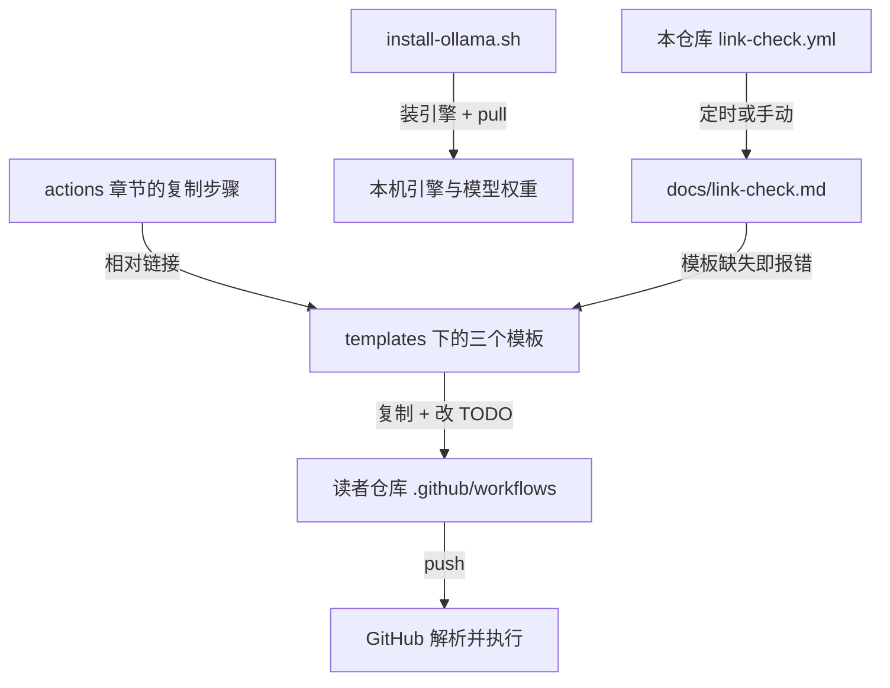

# 示例即产品：可复用模板与自举示例

这个仓库的读者分两种。一种读完就走；另一种会把某几段内容**复制进自己的仓库或终端**，然后指望它跑起来。对第二种读者，文件不是文档，是代码——写错一个缩进，代价落在别人的仓库里，而这个人大概率不会回来告诉你。

本页讲的就是这批「可执行产物」：它们在哪、各自教什么、哪些行删了就变成半成品、改完之后怎么证明它还能用。条目字段与「坑」章节的写法见[条目约定](entry-conventions.md)；`.github/workflows` 里两个工作流的完整触发面见[仓库自己的 CI](../operations/ci-workflows.md)，日常改动路线见[维护手册](../operations/maintenance-runbook.md)。

## 判定：什么算「可执行示例」

三个条件同时满足才算，缺一个就只是代码片段：

1. **能原样运行**：不需要读正文猜上下文（`cron-job.yml` 自带 `actions/checkout` 与 `setup-python`）；
2. **给了复制落点**：写清复制到哪个路径（`.github/workflows/`、`.devcontainer/`）；
3. **标出了必须改的地方**：TODO 注释或显式参数，读者改完即用。

按这个标准清点，被复制走的东西只有下面几处，而且**它们全部不在 `.github/workflows/` 里**：

| 产物 | 复制 / 执行落点 | 读者拿走后变成什么 |
|---|---|---|
| [`templates/cron-job.yml`](../../40-ship/actions/templates/cron-job.yml) | 读者仓库 `.github/workflows/` | 定时跑脚本并把结果提交回仓库 |
| [`templates/manual-run.yml`](../../40-ship/actions/templates/manual-run.yml) | 同上 | 手动填参数跑一次，产物归档 |
| [`templates/matrix.yml`](../../40-ship/actions/templates/matrix.yml) | 同上 | 多版本 / 多平台并行测试 |
| [`install/install-ollama.sh`](../../30-ai/install/install-ollama.sh) | `bash` 直接执行 | 本机 Ollama 引擎 + 一个中文可用的模型 |
| [Pages 方式 B 的 workflow](../../40-ship/pages/README.md) | 读者仓库 `.github/workflows/` | 构建 + 部署静态站点 |
| [devcontainer.json](../../40-ship/codespaces/README.md) | 读者仓库 `.devcontainer/` | 开箱即用的 Codespaces 环境 |

最后两处是**内嵌在正文里**的片段，没有独立文件——这一形态的代价在后面「验证」一节会说清。



图为两条生命周期：模板必须离开仓库才被执行，而仓库自己的 CI 一直在跑，并把「模板不见了」写进报告。

## 三个模板：同一个骨架，三种教学点

三个文件都以 `actions/checkout` 起步、都显式声明 `permissions`，差别在于**它们各自在演示哪一类保障**：

| | 触发 | 权限 | 主要教学点 |
|---|---|---|---|
| `cron-job.yml` | `schedule` + `workflow_dispatch` | `contents: write` | 定时任务怎么安全地写回仓库 |
| `manual-run.yml` | 只有 `workflow_dispatch` | `contents: read` | 参数化 + 产物归档 + 最小权限 |
| `matrix.yml` | `push: main` + `pull_request` | `contents: read` | 矩阵、排除项与失败隔离 |

`manual-run.yml` 与 `matrix.yml` 都用 `permissions: contents: read`，这不是顺手抄的：它们只读代码、只上传产物，所以**不给自己写权限**。与 `cron-job.yml` 的 `contents: write` 放在一起看，才构成一套完整的示范——需要 push 就显式声明，不需要就别声明。

### 必须保留的约束

模板跑得起来不等于能教人。下面这些行删掉后 YAML 依然合法，但读者会在别处踩坑：

- **cron 一律是 UTC**。`cron-job.yml` 同时在三处讲这件事：文件头注释「注意：cron 用的是 UTC。北京时间 08:00 = UTC 00:00」、`cron: "0 0 * * *"` 行尾的换算注释、以及章节页那张换算表。三者是同一句话的三次投递，删任何一处都会让读者以为 cron 按本地时间算。
- **`permissions: contents: write` 必须显式写**，行尾注释「需要 push 就必须显式声明，否则默认只读」正是原因：2023 年后的默认 token 只读，缺这行会在 `git push` 处报 403。
- **`workflow_dispatch` 必须与 `schedule` 并存**。定时任务没法立刻验证，手动入口是唯一的试跑通道；`link-check.yml` 与 `openwiki-update.yml` 也都留了这个入口，同一套习惯。
- **`concurrency` 的两个值方向相反**：`cron-job.yml` 用 `cancel-in-progress: false`（跑到一半的采集不要被取消），`link-check.yml` 用 `true`（报告是幂等的，新的覆盖旧的）。把两者改成一样就丢掉了这层对比。
- **`env:` 注入密钥，不在 `run` 里拼**。`MY_API_KEY: ${{ secrets.MY_API_KEY }}` 加注释「密钥统一从 Secrets 注入，绝不写死在 YAML 里」；`manual-run.yml` 里那个打印步骤干脆命名为「打印参数（不含任何密钥）」。
- **bot 身份 + 空提交守卫**。`git config user.name "github-actions[bot]"`、`git diff --cached --quiet` 判空后才提交——少了前者提交归属不明，少了后者每次运行都产生一个空提交。
- **成本注释**（`matrix.yml` 的「macOS 计费 10×，白嫖慎用」、`cron-job.yml` 的 `timeout-minutes: 20`）。这些是模板里唯一解释「为什么这么写」的地方，删掉后模板退化成脚手架。

### TODO 占位是刻意的未完成

三个模板合计留了四处明确的可替换点：`cron-job.yml` 的「TODO: 改成你的依赖文件」「TODO: 改成你的命令」、`manual-run.yml` 的 `echo "TODO: 用 \$TARGET / \$DRY_RUN 做你要做的事"`、`matrix.yml` 的 `|| python -c "print('TODO: 换成你的测试命令')"`。它们的价值有两条：告诉读者这里**必须**改，以及让「哪些是我的、哪些是你的」可以 grep 出来。

`matrix.yml` 那个 `||` 兜底还多做了一件事——没接上测试之前，模板不会一上来就红叉。同理，`manual-run.yml` 的 `dry_run` 默认 `true`、`if-no-files-found: ignore` 都是「默认不伤人」的取值。

## 安装脚本：可执行示例的另一种形态

`install-ollama.sh` 不像模板那样被复制进 `.github/workflows`，而是被直接在终端跑掉；它的「产品性」体现在行为契约上：

- **参数有默认值**：`MODEL="${1:-qwen2.5:3b}"`，与 [30-ai 章页](../../30-ai/README.md)手工敲的 `ollama pull qwen2.5:3b` 是同一个模型——两处不一致就等于教了两遍不同的东西。
- **平台分支允许「拒绝自动化」**：Windows 只打印三步人工步骤（官网下载 `OllamaSetup.exe`、双击安装、重开 Git Bash）然后 `exit 0`；未识别系统才 `exit 1`。示例可以说「这一步我帮不了你」，但不能假装帮了。
- **幂等**：`command -v ollama` 命中时只打印版本、跳过安装，重复跑不会重装。
- **自验证**：`pull` 之后紧跟 `ollama run "$MODEL" "用一句话说明你已经在本机跑起来了。"`。脚本判断「成功」的标准是一次真实推理，而不是命令退出码——这也是它作为示例最有价值的一段。
- **不锁版本**：Linux/macOS 走 `curl -fsSL https://ollama.com/install.sh | sh`，装的是当下最新版。所以这行的行为随上游变化，外链体检里 `https://ollama.com/install.sh` 常年作为一条外部链接被检查。

**边界：只装引擎、拉模型，权重不进仓库。** 脚本刚拉下来的几个 GB 权重从不被提交：根 `.gitignore` 排除了 `models/`、`*.gguf`、`*.safetensors`、`*.bin`、`*.onnx`，[30-ai 章页](../../30-ai/README.md)给了理由（GitHub 单文件上限 100 MB、仓库建议 < 1 GB）。这条边界反过来解释了为什么仓库里只能放「步骤」而不能放「结果」：可执行示例的准入条件是它足够小、且随时能被重跑重建。

## 自举：`link-check.yml` 的双重身份

`.github/workflows/link-check.yml` 既是在跑的 CI，也是 `40-ship` 章节里那个「免服务器定时任务」的活证据。它的头两行就把这层身份写明了：一行说它干什么，一行说「这是本仓库自己的『定时任务』示例」。

它与 `cron-job.yml` 是同一套骨架：`schedule` + `workflow_dispatch`、`permissions: contents: write`、bot 身份、`git diff --cached --quiet` 判空、`git commit && git push` 写回。差异是它比模板多背了真实任务（体检 + 同步数据集目录），并且 `concurrency` 取 `cancel-in-progress: true`。

正因为它**同时是可运行的 CI 和被引用的示例**，它的注释刻意写得比一般工作流啰嗦，专门解释踩过的坑：

- `push.paths` 段落那四行注释说明了为什么不写 `**/*.md`：这个任务会把结果提交回 `docs/link-check.md`（也是 md），写宽了就成了自触发死循环，进而不断产生新提交、把紧跟着的 Pages 构建一个个取消掉（表现为站点忽新忽旧）。
- `GITHUB_TOKEN` 上方的注释给出量化理由：未认证 60 次/小时，认证 5000 次/小时。
- commit message 结尾的 `[skip ci]` 是同一防护的第二层，防止写回动作再次唤起工作流。

因此改动这个文件，成本是三份的：**正在跑的 CI + 被引用的示例 + 至少一处正文引用**（[40-ship 章页](../../40-ship/README.md)拿它当「本站就是这条链路做出来的」证据）。改之前先读[仓库自己的 CI](../operations/ci-workflows.md) 里对触发面的分析，别把注释当成可以顺手精简的啰嗦。

## 改完之后怎么验证

模板和脚本没有任何自动化的语义校验：仓库没有 `package.json`、没有依赖清单，也**没有配 `yamllint` / `actionlint`**；而模板不在 `.github/workflows/` 下，GitHub 永远不会替你解析它——第一次解析发生在别人 `push` 的那一刻。所以验证只能由改动人自己做完这两步：

**一是语法可解析。**

```bash
# 三个 workflow 模板：任一 YAML 解析器或 actionlint（需自备，仓库没装）
python -c "import yaml,sys;[yaml.safe_load(open(p)) for p in sys.argv[1:]]" \
  40-ship/actions/templates/*.yml

# 安装脚本：只查语法，不执行
bash -n 30-ai/install/install-ollama.sh
```

**二是「文档里的复制步骤仍然成立」。** 这一半有自动化护栏：`scripts/verify_links.py` 会把 Markdown 里的相对链接当**站内链接**查本地文件是否存在，`docs/link-check.md` 里那三行 `templates/cron-job.yml` / `manual-run.yml` / `matrix.yml` 的「存在」就是它给的。改模板名或挪目录而不同步章节页，下一期报告会变成「文件不存在」。三点注意：

- 该检查按**第一条引用所在的目录**解析相对路径（`check_local(url, meta["refs"][0])`），所以同一个相对路径从不同深度的文件引用时，结论未必属于你刚改的那一处；
- 它扫描 `ROOT.rglob("*.md")`，`openwiki/` 下的页面也在范围内，站内相对链接写错同样会进报告；
- `link-check.yml` 的 `push.paths` 只列了内容目录的 `*.md`、`scripts/verify_links.py` 和它自己，**改 `templates/*.yml` 不会触发它**——要么等周一 UTC 01:00 的定时跑，要么手动 dispatch。

还有一类只能人工核对的耦合：正文片段与独立文件是否还互相支撑。`40-ship/actions/README.md` 的「复制到 `.github/workflows/` 下，改三处」随后给的三行 YAML 是缩略示意（`cron: "0 22 * * *"`、`python main.py`），取值与模板并不逐字相同——它不是模板摘录，所以不必强行对齐；但「改三处」这个说法、列表里三个文件的名称与用途、以及 URL 必须同时还在，否则读者照着做会失败。同理，改 Pages 方式 B 的片段要保留 `permissions` 的三行（`contents: read`、`pages: write`、`id-token: write`）与 `environment: github-pages`，改 `manual-run.yml` 要同步检查正文里提到的参数名。

最后一步最实在：**把它真的跑一次**。三个模板都带 `workflow_dispatch`，复制到自己仓库的 `.github/workflows/` 下、在 Actions 页面点一次 `Run workflow`，是唯一能同时验证「语法 + 权限 + 复制步骤」的办法；`install-ollama.sh` 的自验证则已经在脚本里了。

## 相关页面

- [仓库自己的 CI](../operations/ci-workflows.md)：`link-check.yml` 与 `openwiki-update.yml` 的触发面、并发与写回行为。
- [维护手册](../operations/maintenance-runbook.md)：改模板 / 改脚本 / 改文档内容的命令顺序。
- [条目约定](entry-conventions.md)：正文里的表格、来源标注与「坑」章节为什么不能随手精简。
