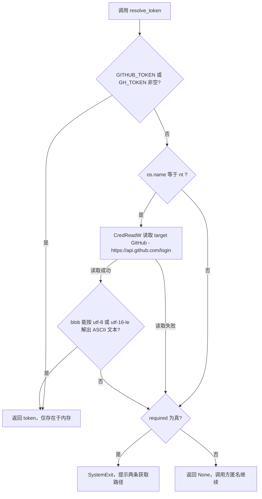
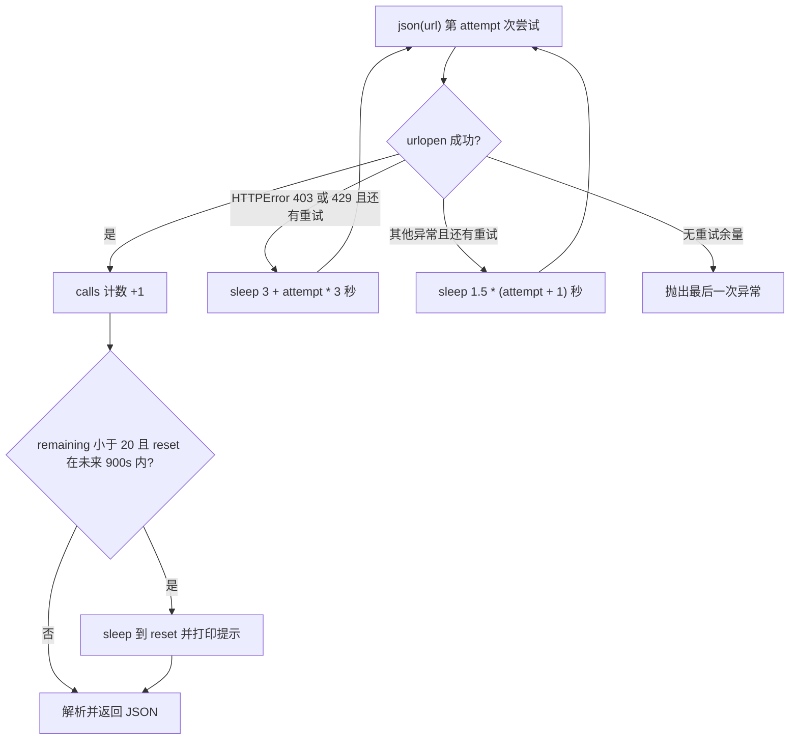
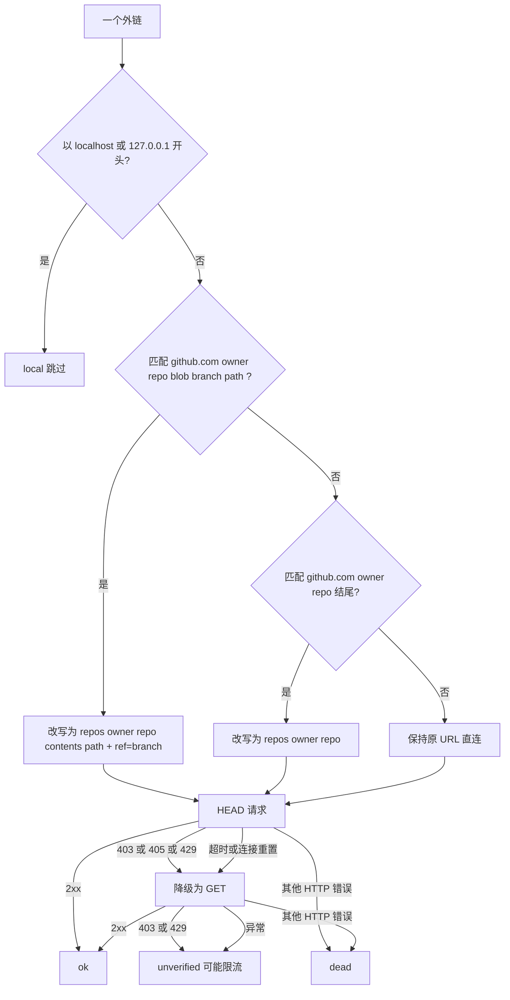

# GitHub API 通道与凭据（gh_auth 与各脚本客户端）

这个仓库没有服务端，但有四处必须"看外面"的动作：下载素材、同步姊妹仓库的数据集清单、体检全站链接、把整个目录推到 GitHub。这四条路径**共用同一条通道**——Python 标准库 `urllib.request` + `https://api.github.com` + 一个只活在进程内存里的 token。

本页讲这条通道的契约：为什么只能走 API、凭据从哪来、请求长什么样、失败时各自怎么退让，以及"共享的只有 `gh_auth`"这一结构给改动带来的实际成本。脚本各自的业务职责见 [仓库全景](../architecture/repository-map.md)，本页只管传输层。

## 三条硬约束

| 约束 | 具体表现 | 违反的后果 |
|---|---|---|
| 只走 `api.github.com` | 不请求 `raw.githubusercontent.com`，不请求 `github.com` 的页面（体检脚本会把仓库类链接改写成 API 端点） | 在作者所处的受限网络下直接连接被重置，脚本整个不可用 |
| 凭据只在内存 | 只出现在 `Authorization` 头里，不进 URL、不进 payload、不进日志、不写文件 | 一旦落盘就要新增 `.gitignore` 与轮换流程，而当前设计里根本没有"凭据文件"这个概念 |
| 只用标准库 | `urllib.request`、`urllib.error`、`urllib.parse`、`json`、`base64`；没有 `requests`、没有 PyGithub | 仓库没有依赖清单，`python scripts/<name>.py` 直接可跑是刻意保留的性质 |

第二条：凡是"能不能直连"的判断，最终都收敛成同一句话——**`api.github.com` 是唯一稳定可达的域名，所以它是通道本身，而不是几种实现之一。**

## 为什么不能直连：两个不同的根因

两种失败长得很像，来源完全不同，改法也不同。

**发布：TLS 栈问题。** `deploy_github.py` 的文档字符串写明，本机 shell 的 TLS 走 Windows schannel，`git push` 会报 `AcquireCredentialsHandle failed: SEC_E_NO_CREDENTIALS`，`git` / `curl` / PowerShell **全部**无法出网；Python 自带 OpenSSL，于是改用 GitHub 的 Git Data API 在 Python 里直接建 `blobs → trees → commits → refs`。这里换域名解决不了问题，是"换客户端"。

**素材与体检：可达性问题。** `github.com` 与 `raw.githubusercontent.com` 直连会被重置，只有 `api.github.com` 可达，所以素材下载走 `contents`（大文件回退 `git/blobs`），链接体检把 `github.com` 仓库链接改写成 `/repos/...`。这里换客户端解决不了问题，是"换域名"。

由此得出一条排查经验：出网失败时先分清是**"TLS 握手层面就挂了"（换 Python 即可）**还是**"特定域名被拦"（换端点即可）**，两者混在一起会让人误以为整个网络不通。

## 凭据：`resolve_token` 的两级解析

`scripts/gh_auth.py` 是唯一被多个脚本 `import` 的模块。它只暴露 `resolve_token(login="xushan628", required=True)`。



图注：`resolve_token` 的两级凭据解析与两种失败语义。

解析顺序与实现细节：

1. **环境变量优先**：先看 `GITHUB_TOKEN`，再看 `GH_TOKEN`，两者都 `.strip()`，空串等价于未设置。CI 走这条。
2. **Windows 凭据管理器次之**：`CredReadW` 的 target 是固定格式字符串 `GitHub - https://api.github.com/<login>`——也就是 GitHub Desktop / VS Code 的 GitHub 登录写进去的位置；读到的 blob 会依次尝试 `utf-8` 与 `utf-16-le` 解码，并要求结果为纯 ASCII，读完立即 `CredFree`。
3. **非 Windows 平台直接返回 None**：`os.name != "nt"` 时连尝试都不做。这条不是疏漏，是让 Linux runner 的行为可预测——CI 上只可能来自环境变量。
4. **失败语义由 `required` 决定**：`required=True` 抛 `SystemExit` 并在提示里给出两条获取路径（设环境变量 / 在凭据管理器存令牌）；`required=False` 返回 `None`，让调用方以匿名、低配额的方式继续。

### 四个调用方各自的取用方式

| 脚本 | 调用点 | 缺凭据时 | 设计意图 |
|---|---|---|---|
| `fetch_assets.py` | `Client(resolve_token(args.login))` | `SystemExit`（默认 `required=True`） | 要发几百次请求，匿名必然失败，不如一开始就拒绝 |
| `deploy_github.py` | `GitHub(resolve_token(args.login))` | `SystemExit`（同上） | 写入操作没有 token 无从谈起 |
| `verify_links.py` | 模块级 `TOKEN = resolve_token("xushan628", required=False)` | 匿名可跑 | 体检要能在任何机器上跑，配额低只是变慢/变「未验证」 |
| `sync_atlas.py` | `load_token()` 内部 `resolve_token(..., required=False)`，外面套 `try/except Exception` | 匿名可跑（连导入失败都被吞掉） | 每次运行只 1 次 API 调用，匿名足够 |

一个容易踩的细节：`deploy_github.py` 的 `--dry-run` 分支在 `resolve_token` **之后**才判断，所以 dry-run 虽然一次 API 调用都不发，仍然要求凭据可用。想纯看文件清单而手上没有 token 时，绕不过这一步。

## 请求契约：统一的头，不统一的实现

`fetch_assets.Client` 与 `deploy_github.GitHub` 发的是同一组头（`deploy` 在有请求体时另加 `Content-Type`）：

```python
{
    "Authorization": f"Bearer {token}",
    "Accept": "application/vnd.github+json",
    "User-Agent": UA,
    "X-GitHub-Api-Version": "2022-11-28",
}
```

| 头部 | `fetch_assets.Client` | `deploy_github.GitHub` | `sync_atlas.fetch_manifest` | `verify_links.http_status` |
|---|---|---|---|---|
| `Authorization: Bearer` | 有 | 有 | 有 token 才加 | 仅当 URL 以 `https://api.github.com` 开头 |
| `Accept: application/vnd.github+json` | 有 | 有 | 有 | **无** |
| `User-Agent` | `github-free-guide/1.0 (+https://github.com/xushan628)` | `github-free-guide-deployer/1.0` | `github-free-guide-sync/1.0` | `Mozilla/5.0 (compatible; github-free-guide-link-check/1.0)` |
| `X-GitHub-Api-Version: 2022-11-28` | 有 | 有 | **无** | **无** |
| `Content-Type: application/json` | 无（只读） | 有（有写请求） | 无 | 无 |

两点因此值得记牢：

- **API 版本 pin 只存在于"读得最狠"和"写得最多"的两个类里**。`verify_links` 与 `sync_atlas` 不 pin 版本，意味着它们的行为由 GitHub 的默认版本决定；如果将来 GitHub 改变默认版本语义，这两处会先受影响。
- `verify_links` 连 `Accept: application/vnd.github+json` 都不发，因为它绝大部分请求打向的是**第三方站点**，发 GitHub 专用头没有意义且会改变 `github.com` 的响应形态。

### 四种实现形态

| 实现 | 位置 | 形态 |
|---|---|---|
| `fetch_assets.Client` | `scripts/fetch_assets.py` `class Client` | `_request()` 造请求，`json()` 统一重试 + 限流等待，`contents()` / `blob()` 两个高层方法 |
| `deploy_github.GitHub` | `scripts/deploy_github.py` `class GitHub` | 单一 `call(method, path, payload)`；`path` 以 `http` 开头时当作绝对 URL，否则拼 `API + path` |
| `sync_atlas.fetch_manifest` | `scripts/sync_atlas.py` | 内联构造一个 `Request`，无类、无重试 |
| `verify_links.http_status` | `scripts/verify_links.py` | 内联构造请求，`HEAD` 失败降级 `GET`，无重试 |

## 失败处理：四套策略，各有语义

这是本页最需要按表核对的部分——四个调用方的超时、重试条件、退避节奏**全都不同**，且差异是刻意的。

| | `fetch_assets.Client.json` | `deploy_github.GitHub.call` | `verify_links.http_status` | `sync_atlas.fetch_manifest` |
|---|---|---|---|---|
| 超时 | 30s | 60s | 12s | 40s |
| 重试次数 | 3 | 3 | 无（只有 `HEAD` → `GET` 一次降级） | 无 |
| HTTP 重试条件 | **403 / 429** | **500 / 502 / 503 / 504** | 否 | 否 |
| 网络异常重试 | 有（非 `HTTPError` 的异常） | 有（非 `HTTPError` 的异常） | 有：`HEAD` 阶段异常转 `GET` | 无 |
| 退避节奏 | 403/429 → 3s、6s；其他异常 → 1.5s、3s | 5xx → 2s、4s；其他异常 → 1.5s、3s | 无 sleep | 无 |
| 限流感知 | 有（读响应头主动等待） | 无 | 无（把 403/429 记成「未验证」） | 无 |
| 失败结果 | 抛出最后一次异常 | `RuntimeError`，含方法、路径、HTTP 码与前 400 字符 body | 记入报告，不抛 | 异常冒泡，脚本带 traceback 退出 |

四套策略背后的语义：

- **`fetch_assets` 是"批量读、必须补齐"**：图标清单近 120 项、两套图标近似同一份请求量，再加字体与许可证，一轮就是两百多次读取，用 8 线程并发发出去，最容易撞配额。所以它既对 403/429 退避，也在成功响应里主动看配额。
- **`deploy` 是"写"**：403 在这里几乎总意味着 token 缺 `contents: write` 或权限不足，重试没有意义，所以它**不重试 403**，直接抛 `RuntimeError`；只有 5xx 这类服务端抖动才值得重来。
- **`verify_links` 是"体检，宁可疑不可误杀"**：一次失败不该把一个可能健康的链接判死，所以 403/429 与所有超时/重置都进 `unverified`，只有明确的非限流 HTTP 错误码才是 `dead`。
- **`sync_atlas` 是"一次请求"**：每次运行就取一个 `manifest.json`，为它写重试循环不值得；失败就带 traceback 崩，但因为**取数发生在写文件之前**，不会留下半截产物。

### 限流感知是主动而非被动

`fetch_assets.Client._respect_rate()` 在**成功响应之后**运行：读 `x-ratelimit-remaining` 与 `x-ratelimit-reset`，当剩余配额低于 20 且 reset 时间落在"未来 0～900 秒"区间内时，直接 `sleep` 到 reset 之后并打印「触发限流，等待 Ns」。



图注：`fetch_assets.Client.json` 的单次请求生命周期——成功路径主动节流，失败路径分级退避。

两个边界条件值得注意：`0 < wait < 900` 这个区间判断既排除了"reset 时间已过去"（`int(reset) - now` 为负）导致的负 sleep，也排除了上游给出荒谬时间戳时把脚本挂上一整天；而 `remaining < 20` 的阈值配上 8 线程并发，实际含义是"下一批请求发不完就要等"。

## 端点用法：通道上到底跑什么

**读取文件：`contents` 优先，`git/blobs` 兜底。** `fetch_file()` 先打 `/repos/<repo>/contents/<path>`（路径按 `quote(path, safe="/")` 编码）：`contents` 对 <1MB 的文件直接在响应里带 base64 的 `content`，直接解码即可；`content` 为空（大文件）时用响应里的 `sha` 再打 `/repos/<repo>/git/blobs/<sha>` 取 base64。若响应是数组，说明路径是目录，显式抛 `ValueError` 而不是继续解包。

**写入：Git Data API 三段式。** `deploy_github.py` 先用 `POST /git/blobs`（base64 内容）逐文件上传、6 线程并发，再 `POST /git/trees` 拼树、`POST /git/commits` 提交，最后落 ref：非 `--squash` 且已有父提交时 `PATCH /git/refs/heads/<branch>`（`force` 为 `false`）；首次提交先 `POST /git/refs`，失败则回退 `PATCH` 且 `force: true`。`--squash` 一律 `PATCH` 且 `force: true`，即用一个根提交覆盖历史。

**链接改写：只覆盖两种形态。** `verify_links.py` 用两条正则把 `github.com` 链接搬到 API 上：`github.com/<owner>/<repo>` → `/repos/<owner>/<repo>`（`.git` 后缀会被剥掉）；`github.com/<owner>/<repo>/blob/<branch>/<path>` → `/repos/<owner>/<repo>/contents/<path>?ref=<branch>`（先剥掉 `?` 与 `#` 之后的片段）。



图注：`verify_links.http_status` 的端点改写与四态判定；站内相对链接走另一条本地文件检查分支。

**改写规则的边界就是它的盲区**：`github.com/<owner>/<repo>/issues`、`/tree/<branch>/<path>`、`/releases` 这类更深的页面链接，两条正则都不匹配（`GH_REPO` 要求仓库名后紧跟结尾、`?` 或 `#`；`GH_BLOB` 只认 `blob`），于是仍然直连 `github.com`。在受限网络下它们只能得到 `unverified`——这正是报告里"文档页显示未验证属于网络限制、不代表链接失效"那句话的技术来源。

## 安全不变量

- **token 只作为 `Authorization: Bearer` 头存在**，不进 URL、不进请求体；三个脚本打印的内容是 URL、路径、文件大小、提交 sha 与调用次数，凭据本身从不出现。
- **`verify_links` 只在目标是 `api.github.com` 时才附带 Authorization**。这条最关键：它要访问任意第三方站点，若按"有 token 就加头"的写法，很快就会把 token 送给无关服务器。
- **Windows 凭据读取失败静默返回 `None`**，不打印 target 名与 blob，而是统一走 `SystemExit` 文案（只包含 target 格式，不包含任何值）。
- **错误详情有长度上限**：`deploy` 把 `HTTPError` 的 body 解码后截断到前 400 字符再拼进 `RuntimeError`，避免把大响应或回显写进日志。
- **仓库里不存在凭据文件**：`.gitignore` 排除 `.env`、`.env.*`、`*.pem`、`*.key`、`github_token*`、`secrets.*` 等，脚本侧也不需要任何写入路径。token 的生命周期就是一个进程内的字符串，随 `Client` / `GitHub` 实例存活，没有刷新、没有缓存、没有磁盘回写。

## 为什么没有公共 HTTP 客户端

共享的**只有 `gh_auth`**：`fetch_assets.py`、`deploy_github.py`、`verify_links.py` 直接 `from gh_auth import resolve_token`，`sync_atlas.py` 把它包在 `load_token()` 的 `try/except` 里。除此之外，传输层是两份近似重复的类加上两份内联实现。

代价是明确的，并且必须写进改动流程里：

| 想改的东西 | 需要分别确认的地方 |
|---|---|
| 重试次数 / 退避节奏 | `fetch_assets.Client.json`、`deploy_github.GitHub.call`（其余两处没有重试，改不改是设计决定） |
| `X-GitHub-Api-Version` | `fetch_assets.Client._request`、`deploy_github.GitHub.call` |
| `User-Agent` | 四处各自的模块常量（`sync_atlas` 是内联字符串） |
| 超时 | 四处 |
| 限流等待 | 只有 `fetch_assets.Client._respect_rate`，其余三处没有对应机制 |

换句话说：**在这条通道上"修一个 bug"通常是"改两到四个地方"**。反过来，抽一个公共客户端会改变仓库"零依赖、单文件可跑"的性质，并连带影响 README 里的用法示例与 CI 的调用方式——当前选择是保留重复。

同样需要注意的是隐式契约：`deploy_github.py` 的 `ensure_repo` 与 `ensure_initial_commit` 用 **404 字符串匹配**做控制流（`if "HTTP 404" not in str(exc)`，空仓库还可能拿到 409）。也就是说 `GitHub.call` 抛出的错误消息文本本身是接口的一部分，改文案就会悄悄改变建仓与初始提交的分支行为。

## 运维与验证

仓库没有 `tests/` 目录，也没有任何集成测试；每个脚本自带一个"不产生副作用"的验证入口，这是这条通道唯一的回归手段。

| 想验证的事 | 命令 | 观察点 |
|---|---|---|
| 凭据解析到了什么（以及能否推送） | `python scripts/deploy_github.py --dry-run` | 只列文件、不发请求；**但仍要求凭据可用** |
| 数据集通道是否通、结论是否最新 | `python scripts/sync_atlas.py --check` | 1 次 API 调用；有差异返回 1，不写文件 |
| 整条通道在各站点上的表现 | `python scripts/verify_links.py` | 报告四态计数；CI 里不启用 `--strict`，所以红不红与链接死没死无关 |
| 最小请求量的凭据/头部自检 | `python scripts/fetch_assets.py --only licenses` | 4 次文件读取，足够暴露 401/403 与版本头问题 |

两个客户端类都维护一个 `calls` 计数器，**只在 `urlopen` 成功返回后自增**，并在结尾打印"API 调用 N 次"。这使它可以当作配额消耗的粗略观测量，但要注意它不统计重试掉的失败请求——失败尝试对配额同样是消耗。

### 排障对照

| 症状 | 多半是 | 动作 |
|---|---|---|
| `SystemExit`：找不到 GitHub 凭据 | 未设环境变量，且不在 Windows 或没有对应凭据条目 | 设 `GITHUB_TOKEN`（CI 里用 `secrets.GITHUB_TOKEN`） |
| `HTTP 401` / `Bad credentials` | 凭据管理器里是过期的登录态 | 重新登录，或改用 PAT 走环境变量（环境变量优先） |
| `deploy` 立刻 `RuntimeError` 带 403 | token 缺 `contents: write` 等写权限；此处**刻意不重试** | 换有权限的 PAT，别指望重跑 |
| 报告里大片「⚠️ 未验证」 | 匿名 60 次/小时配额，或 `github.com` 直连被重置 | 设 token；仓库类链接的结论仍可信，深层页面链接不可信 |
| `fetch_assets` 打印「触发限流，等待 Ns」 | 剩余配额低于 20，主动等待中 | 正常行为，等它；或先把 token 配上 |
| 空仓库建 blob 报 409 | 仓库没有任何提交 | `ensure_initial_commit` 已覆盖；若失败信息文案被改动，这个分支会失效 |

## 延伸阅读

- [仓库全景](../architecture/repository-map.md)：脚本在整体数据流里的位置与"生成物不可手改"的边界。
- [发布与部署](../operations/publishing-and-deploy.md)：`deploy_github.py` 的建仓、提交、ref 编排与 Pages 生效链路。
- [素材摄取](../workflows/asset-ingestion.md)：`contents → git/blobs` 之后如何合并 `MANIFEST.json`、如何用 `sha256` 做审计。
- [链接体检](../workflows/link-health-check.md)：四态判定如何变成 `docs/link-check.md`，以及 CI 的调度与提交方式。
