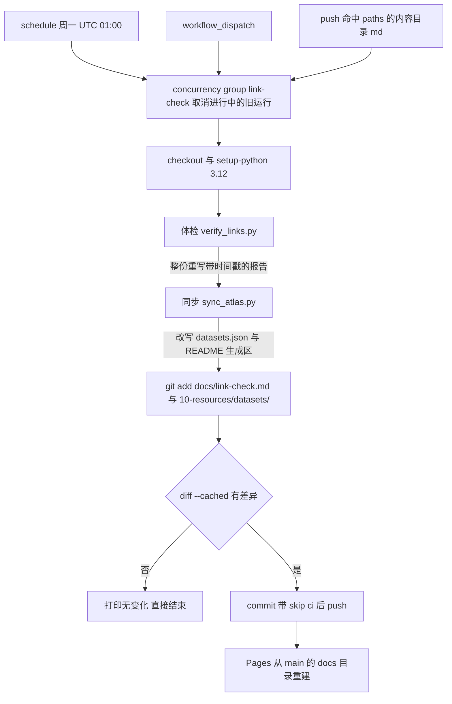
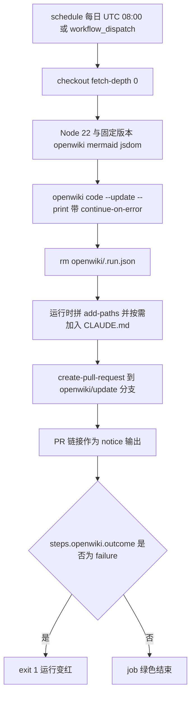

# 仓库自己的 CI：外链体检与 OpenWiki 更新

这个仓库没有服务端、没有构建步骤，所有「自己动起来」的部分就两个文件：`.github/workflows/link-check.yml` 和 `.github/workflows/openwiki-update.yml`。它们的差别不在任务内容，而在**写回方式**——一个改完就 push，一个必须先开 PR。理解这两个文件的触发面与权限边界，等于理解了这个仓库唯一会自动改仓库的通道。

两者同时还是 `40-ship` 章节「免服务器定时任务」的活证据，所以注释写得比一般工作流啰嗦：`**/*.md` 那几行、`GITHUB_TOKEN` 上方的速率注释，都是踩过坑之后留下的说明，改动前先读[示例即产品](../concepts/reference-artifacts.md)。日常按「任务 → 改哪些文件 → 跑哪些命令」维护时，回到[维护手册](maintenance-runbook.md)。

## 两个工作流，两种写回方式

| | `link-check.yml` | `openwiki-update.yml` |
|---|---|---|
| 触发 | `schedule`（每周一 UTC 01:00）+ `workflow_dispatch` + `push`（限定 paths） | `schedule`（每日 UTC 08:00）+ `workflow_dispatch` |
| 权限 | `contents: write` | `contents: write`、`pull-requests: write` |
| 并发 | `group: link-check`，`cancel-in-progress: true` | 未声明 |
| 超时 | `timeout-minutes: 15` | 未声明（吃默认 6 小时上限） |
| 运行内容 | `verify_links.py` → `sync_atlas.py` | `openwiki code --update --print` |
| 产出 | 整份 `docs/link-check.md` + `10-resources/datasets/` | `openwiki/`、`AGENTS.md`、工作流自身 |
| 写回 | 直接 `git commit && git push` 到当前分支 | 推到 `openwiki/update` 分支并开 PR，等人合并 |
| 失败语义 | 任何一步失败即中断，不提交 | 失败仍建 PR 保留已完成页，最终 `exit 1` 变红 |

一句话分工：**一个改内容产物，改完就落地；一个改文档基线，必须先过 PR。**

## `link-check.yml`：体检 + 同步 → 直接提交

### 触发面

三个入口写在同一段 `on:` 里：

- `schedule: cron "0 1 * * 1"`——每周一 UTC 01:00，即北京时间周一 09:00。cron 一律 UTC，且可能延迟几十分钟；仓库 60 天无活动会被自动停用定时 workflow，这些通用规则见[维护手册](maintenance-runbook.md)。
- `workflow_dispatch`——定时任务没法立刻验证，手动入口是唯一的试跑通道。
- `push.paths`——只列了六个内容目录的 `*.md`、`scripts/verify_links.py` 和它自己：

```yaml
      - "10-resources/**/*.md"
      - "20-tools/**/*.md"
      - "30-ai/**/*.md"
      - "40-ship/**/*.md"
      - "50-benefits/**/*.md"
      - "60-others/**/*.md"
      - "scripts/verify_links.py"
      - ".github/workflows/link-check.yml"
```

由这份清单可以反向读出两个「不会触发」的事实，改内容时容易踩：

- **改 `40-ship/actions/templates/*.yml` 不会触发它**（路径不在清单里，且不是 `*.md`）。模板改名或挪目录后想让报告反映出来，只能等周一，或手动 dispatch。
- **`push` 没有 `branches:` 过滤**。也就是说任何分支上改了内容目录的 Markdown 都会跑这次体检；`actions/checkout` 默认检出触发这次运行的那个 ref，末尾的 `git push` 也不带参数，因此 bot 的提交会回到**同一个分支**。「只在 main 上跑」是使用约定，不是配置保证。

### 为什么 `push.paths` 不能写 `**/*.md`

这是整个文件里唯一带四行注释的地方，也是最容易改坏的一处。逻辑链是这样的：

1. 这个任务会把结果提交回 `docs/link-check.md`——它本身是 Markdown；
2. 如果 `push.paths` 写的是 `**/*.md`，那么第 1 步产生的那个提交正好命中过滤条件，于是再触发一次自己；
3. 每次自触发都会重新生成一份带新时间戳的报告，于是又产生新提交——**死循环**，一周之内能堆出成百上千个提交；
4. 本站是 GitHub Pages「Deploy from a branch：`main` / `/docs`」模式，每次 push 到 main 都会起一次构建；构建彼此排队、后来的会顶掉先前的，于是紧跟其后的 Pages 构建一个个被取消，用户看到的是**站点忽新忽旧**。顺带还会撞上 Pages 「10 次构建/小时」的软限制。



图为 `link-check.yml` 从三个触发源到 `git push` 写回、再到 Pages 重建的完整路径；`[skip ci]` 与 GITHUB_TOKEN 的非递归特性在这条路径末端切断回环。

### 路径过滤其实不足以闭环，真正的保险是另外两层

只看 paths 清单会得到一个错误结论：既然 `docs/**` 不在清单里，报告提交就不会触发自己。**但 `10-resources/**/*.md` 覆盖了 `10-resources/datasets/README.md`**，而提交步骤 `git add` 的正是整个 `10-resources/datasets/` 目录。也就是说，写回提交里至少有一个文件落在触发面内。真正拦住第二次运行的是工作流之外的两条规则：

1. **`GITHUB_TOKEN` 推的提交不会触发新的 workflow**（GitHub 的防递归设计）。这里没有改 remote、没有配 PAT，用的就是 `actions/checkout` 默认持久化的内置 token，所以写回天然不引发下一轮。
2. **提交信息以 `[skip ci]` 结尾**：`chore(link-check): 更新外链体检报告与数据集目录 [skip ci]`。这是同一防护的第二层，也是唯一能说明「我知道这里会自触发」的地方——一旦哪天有人为了连锁触发而换成 PAT，`[skip ci]` 就是最后一道闸。

第三层是 `concurrency`：`group: link-check` + `cancel-in-progress: true`，保证同一时刻只有一个体检在跑，新的一轮直接取消旧的一轮。报告是幂等的（每次都整份重写），所以「新的覆盖旧的」是正确的取舍；这与模板 [`cron-job.yml`](../../40-ship/actions/templates/cron-job.yml) 里 `cancel-in-progress: false`（跑到一半的采集不该被取消）正好相反，两处取值不要统一。

### 权限、配额与运行环境

- `permissions: contents: write` 是必须的显式声明：2023 年后新建仓库的 `GITHUB_TOKEN` 默认只读，缺这行会在 `git push` 处报 403。
- 两个脚本步骤都注入 `GITHUB_TOKEN: ${{ secrets.GITHUB_TOKEN }}`。理由写在注释里：未认证 60 次/小时，认证 5000 次/小时。脚本侧由 `scripts/gh_auth.py` 的 `resolve_token()` 读取——环境变量优先，其次 Windows 凭据管理器，`required=False` 时允许匿名低配额跑完。凭据细节见 [GitHub API 通道与凭据](../integrations/github-api-transport.md)。
- `ubuntu-latest` + `python-version: "3.12"`，**没有 pip 依赖安装步骤**：两个脚本只用标准库（`urllib`、`json`、`base64`），这也是本仓库能在没有 `package.json`/`requirements.txt` 的情况下跑 CI 的原因。
- Action 版本用的是可变 tag（`actions/checkout@v4`、`actions/setup-python@v5`），与 `openwiki-update.yml` 的 commit SHA 钉法不一致——这是两个文件在供应链严格度上的差异，不是笔误。

### 两个脚本步骤各自的语义

**体检（`python scripts/verify_links.py`）**：扫仓库全部 Markdown（跳过自己的产物 `docs/link-check.md`），对外链做 HEAD→GET 回退、对 `github.com/<owner>/<repo>` 改走 `api.github.com`、对站内相对链接直接查本地文件，最后**整份重写** `docs/link-check.md`。注意 CI 里**没有加 `--strict`**：因此失效链接不会让 job 失败，报告只是信号而不是门禁；脚本只有在自身崩溃时才把 job 弄红。判定四态（✅ / ❌ 失效 / ⚠️ 未验证 / ⏭️ 跳过）的细节见[链接体检](../workflows/link-health-check.md)。

**同步（`python scripts/sync_atlas.py`）**：从姊妹仓库 `open-data-atlas` 的 `data/manifest.json` 重建 `10-resources/datasets/datasets.json` 与 `README.md` 的生成区，内容没变就不写文件。上游结构不符时脚本直接 `raise SystemExit("manifest 结构不符…")`，`README.md` 缺生成区标记时也拒绝覆盖；步骤失败后后续步骤不再执行，所以**不会出现「写了一半就提交」**。产物形状与幂等约束见[数据集目录同步](../workflows/dataset-catalog-sync.md)。

### 提交步骤的三个细节

```yaml
      - name: 提交报告
        run: |
          git config user.name  "github-actions[bot]"
          git config user.email "41898282+github-actions[bot]@users.noreply.github.com"
          git add docs/link-check.md 10-resources/datasets/
          if git diff --cached --quiet; then
            echo "外链与数据集目录均无变化"
          else
            git commit -m "chore(link-check): 更新外链体检报告与数据集目录 [skip ci]"
            git push
          fi
```

1. **bot 身份 + 空提交守卫**。没有 `git config` 提交归属不明；没有 `git diff --cached --quiet` 判空会攒出一堆空提交。不过要意识到：报告头部带 `生成时间`（UTC 时间戳），所以**正常情况下每次运行都会产生一次提交**，判空分支实际保护的是「脚本产出与上周逐字节相同」这种罕见情形。
2. **暂存边界比脚本写法窄**。`sync_atlas.py` 实际会写三处：`datasets.json`、`10-resources/datasets/README.md` 的生成区、以及 `docs/index.html` 里 `atlas-datasets` 那段 `<script type="application/json">`。而这里只 `git add docs/link-check.md 10-resources/datasets/`——**`docs/index.html` 的改动留在工作区、不进提交**。后果是：上游改了许可证，会先体现在 `datasets.json` 与 README 表里，站点卡片要等人在本地跑一遍 `python scripts/sync_atlas.py` 并一起提交才跟上。这个已知漂移是可接受的设计（避免 CI 改动站点结构），但排查「卡片和表格不一致」时必须先想到它。
3. **`git push` 仍可能非快进失败**。`concurrency` 只序列化这个工作流自己的运行，挡不住同时有人在 main 上推提交，此时 `git push` 报 non-fast-forward、job 变红；重跑一次即可，不要为此改成 `push --force`。

## `openwiki-update.yml`：文档生成 → 开 PR

### 触发与循环

只有两个入口：`schedule: cron "0 8 * * *"`（每日 UTC 08:00，北京时间 16:00）和 `workflow_dispatch`。**没有 `push` 触发**——这是设计选择：内容改动不会立刻触发 wiki 重写，`openwiki/` 的新鲜度取决于「每日那次运行 + 人把 PR 合了」。`AGENTS.md` 里写的也是这条路径：不要手改生成的页面，用仓库文档化的维护流程刷新，见 [AGENTS.md](../../AGENTS.md)。

这带来两个运维事实：wiki 可能落后内容最多一天；如果某天的 PR 一直没人合，第二天的新提交会继续堆在同一个 `openwiki/update` 分支上（分支名是固定的）。

### `fetch-depth: 0` 不是随手加的

```yaml
        with:
          # Full history so `openwiki code --update` can diff HEAD against the
          # commit it last documented; a shallow clone hides that commit and the
          # update runs against an empty change summary.
          fetch-depth: 0
```

`openwiki code --update` 的工作方式是**差分**：它要知道「上次把哪个提交记录进文档」，才能只重写受影响页面。这个基线记在仓库里——每页在 `openwiki/.page-manifest.json` 里有 `gitHead` 字段，另有 `openwiki/.last-update.json` 记录最近一次运行。默认的浅克隆（depth 1）只带最新一个提交，基线提交对象根本不在本地，`git diff` 拿不到差异，于是更新变成「按空变更摘要跑一遍」——看起来成功，实际什么都没重算。**这是本工作流唯一一行「删掉不会报错、但会静默降质」的配置**，改 checkout 参数时优先保它。

### 版本固定：三个 npm 包 + 一个 Node 大版本

```yaml
        run: npm install --global openwiki@0.9.0 mermaid@11.16.0 jsdom@29.1.1
```

- 三者都精确到补丁号，Node 固定 `22`。理由是可复现：同一份源码、同一个模型，不同 OpenWiki 版本生成的分页、frontmatter 和 Claim 结构都可能不同，浮动版本会让 PR 里出现无法解释的大面积 diff。
- `mermaid` + `jsdom` 按注释是**可选**的，作用是「高保真校验 Mermaid 图」：装上之后，图解析失败会被检出（并由 OpenWiki 转成纯文本 fence + 注释标记），而不是等到页面上渲染成空白。既然本仓库大量页面带图，就不该去掉这两个包。
- 三个 GitHub Action 反而全部按 commit SHA 钉住（`actions/checkout@34e1148…`、`actions/setup-node@49933ea…`、`peter-evans/create-pull-request@22a9089…`），行尾括注释标了版本号。这个文件承受的是「有模型的自动写权限」，比 `link-check.yml` 更值得钉死。

### 环境变量：密钥、变量与追踪

`openwiki` 用 `openai-compatible` provider 跑 `deepseek-flash`：

| 变量 | 来源 | 用途 |
|---|---|---|
| `OPENAI_COMPATIBLE_API_KEY` | `secrets` | 模型凭据，唯一不能见光的一项 |
| `OPENAI_COMPATIBLE_BASE_URL` | `vars` | 端点地址；不是凭据，放仓库变量便于切换而不动 YAML |
| `OPENWIKI_MODEL_ID` / `OPENWIKI_OPENAI_COMPATIBLE_STREAMING` | 字面量 | 模型与流式开关 |
| `OPENWIKI_LANGSMITH_API_KEY` | `secrets` | LangSmith connector 的 code-mode 拉取鉴权；多工作区按 `_2`、`_3` 追加 |
| `LANGSMITH_API_KEY` / `LANGCHAIN_PROJECT` / `LANGCHAIN_TRACING_V2` | `secrets` + 字面量 | 可选的自身运行追踪，项目名 `openwiki` |

区分 `secrets` 与 `vars` 是这份配置最值得学的一点：**只有凭据进 secrets，端点与开关进 vars**。密钥全部通过 `env:` 注入，从不拼进 `run` 命令行。

### 失败仍建 PR，但最终 `exit 1`

这是整个工作流最反直觉、也最需要的设计。三个机制配合：

- `Run OpenWiki` 步骤带 `id: openwiki` 且 `continue-on-error: true`。失败不会立刻中断 job，但 `steps.openwiki.outcome` 会保留 `failure` 这个值，供后面引用。
- 后续所有步骤带 `if: ${{ !cancelled() }}`：**失败时会继续执行**（清理、算路径、开 PR、打印链接），**被取消时会跳过**。两者区分得很准——取消意味着这次结果作废，没必要留 PR。
- 最后一步 `if: ${{ steps.openwiki.outcome == 'failure' }}` 执行 `exit 1`，把失败传播成红色的运行记录。

PR 正文里也把这件事说明白了：结果为 `failure` 时，这个 PR **有意只保留失败之前已完成的那几页**，合并它就把这部分进度变成下一轮的基线——否则每次失败都从零开始，永远原地打转。于是失败状态同时具备三个性质：运行记录是红的（不会被静默吞掉）、PR 是存在的（进度不丢）、正文写清了它是什么（合并者不会误以为是完整更新）。

### 清理与暂存边界

```yaml
      - name: Remove transient OpenWiki run state
        if: ${{ !cancelled() }}
        run: rm -f -- openwiki/.run.json
```

`openwiki/.run.json` 是「本次运行」的瞬态状态（阶段、runId、时间戳），对下一次运行没有价值。它必须被删，因为下游 `add-paths` 覆盖了整个 `openwiki/` 目录，而 `.gitignore` 并没有排除它——不删就会把一次运行的中间状态提交进 PR。

路径清单在运行时拼：

```yaml
          paths=openwiki,AGENTS.md,.github/workflows/openwiki-update.yml
          if [ -e CLAUDE.md ]; then paths="$paths,CLAUDE.md"; fi
          echo "list=$paths" >> "$GITHUB_OUTPUT"
```

`CLAUDE.md` 只在存在时才加入，因为 `create-pull-request` 内部按 `add-paths` 做 `git add`，而 `git add` 遇到不存在的路径会整体失败、结果**什么都没暂存**，PR 就静默消失了。列表里固定包含工作流自身，意味着 OpenWiki 一旦重写这个文件，改动也会随 PR 走审阅流程，而不是悄悄进 main。注意 `add-paths` 同时是**白名单**：工作区里其他文件（比如本地跑了一次 `sync_atlas.py` 改出来的 `docs/index.html`）不会被带进这个 PR。



图为 `openwiki-update.yml` 的作业生命周期：无论生成成功还是失败，PR 路径都会走完，失败只在最后一步被显式传播。

### PR 的形状

- 分支固定 `openwiki/update`、标题与提交信息固定 `docs: update OpenWiki`。固定分支让连续多天的运行复用同一个 PR，而不是每天开一个新的；代价是**没有 `concurrency` 与 `timeout-minutes`**，一次手动 dispatch 撞上定时运行，两者可能同时改写同一分支。
- 标注步骤只在真开了 PR 时才输出：`if: ${{ !cancelled() && steps.create-pr.outputs.pull-request-url != '' }}`。没有可提交的差异时 `create-pull-request` 不会建 PR，输出为空，这一步就跳过——这是「无变化」与「失败」在日志里的区分点。

## 两个工作流都覆盖不到的东西

下面的空白不是缺陷清单，而是「别指望 CI 替你兜住」的边界：

| 缺口 | 后果 |
|---|---|
| 都没有 `pull_request` 触发 | 外部贡献的 PR 不会经过链接体检，也不会生成文档预览 |
| 都没有 YAML / 脚本静态检查（无 `actionlint`、无 `pytest`） | 工作流改错只能靠第一次真实运行发现；脚本验证靠 `--strict`、`--check`、`--dry-run` 这些自带开关手动跑 |
| `link-check.yml` 的体检不带 `--strict` | 死链不会变红，只是写进报告；没人看报告就等于没检测 |
| `openwiki-update.yml` 没有 `push` 触发 | 内容改完不会立刻重写 wiki，最多滞后一天 |
| 两个都只由 `schedule`/`dispatch` 驱动，定时任务 60 天无活动会被停用 | 长期不说话之后，报告和 wiki 会双双停在某个时间点，需要人去 Actions 页面重新启用 |
| 权限停在仓库即可（`contents: write`） | 但这个 token 能直接写 main（link-check），所以对脚本执行内容的审查等同于对主分支的写权限 |

## 改动前的核对清单

| 你想改 | 必须同时确认 |
|---|---|
| `link-check.yml` 的 `push.paths` | 新的路径不会匹配写回提交里的文件（记住 `10-resources/datasets/README.md` 在 `10-resources/**/*.md` 之内）；不要写 `**/*.md` |
| 提交步骤的 `git add` 路径 | 与 `sync_atlas.py` 的三处输出对齐，或明确接受 `docs/index.html` 继续漂移 |
| 去掉 `[skip ci]` 或换成 PAT | 换 PAT 会真正打开自触发回路，此时路径过滤与 `concurrency` 是仅剩的两道闸 |
| `openwiki-update.yml` 的 `fetch-depth` | 不要降到 1；`--update` 的差分基线在历史里 |
| `openwiki` / `mermaid` / `jsdom` 版本 | 三者同步评估；升级 OpenWiki 可能改变分页与 Claim 结构，PR diff 会很大 |
| `add-paths` / `CLAUDE.md` 条件 | 保持「不存在就不列」的写法，否则 `git add` 整体失败、PR 静默消失 |
| 删除最后的 `exit 1` | 失败会变成绿色运行，等于放弃告警；也不能改成让生成步骤直接红，那样 PR 就不会产出 |
| 加删 `concurrency` | `link-check` 需要 `cancel-in-progress: true`（报告幂等），`openwiki-update` 若加则要考虑多天 PR 的合并顺序 |

改完最实在的验证方式是 `workflow_dispatch` 手动跑一次：两个文件都留了这个入口，且它是唯一能同时验证「YAML 可解析 + 权限够 + 写回目标正确」的手段。没有单测时如何拼出这套验证，见[验证手段](../testing/validation-harness.md)。

## 相关页面

- [维护手册](maintenance-runbook.md)：完成任务时的文件—命令—校验对照，以及 cron UTC、60 天停用、Secrets 注入等运维注意。
- [链接体检](../workflows/link-health-check.md)：四态判定、`github.com` → `api.github.com` 改道与报告结构。
- [数据集目录同步](../workflows/dataset-catalog-sync.md)：`sync_atlas.py` 的幂等、生成区标记与站点数据块。
- [示例即产品](../concepts/reference-artifacts.md)：这两个文件为何同时是 CI 与可复制示例，注释为何不能精简。
- [仓库全景](../architecture/repository-map.md)：CI 在整个仓库资产图中的位置。
