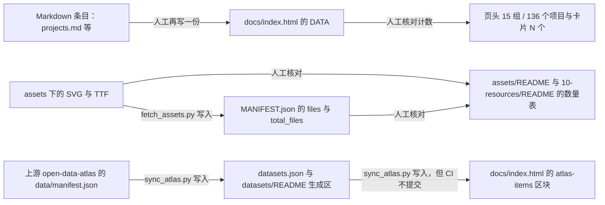

# 维护手册：每周循环与常见改动路径

这个仓库没有服务端、没有构建步骤、没有依赖安装，维护成本几乎全部落在一件事上：**一处改动通常要落到几个不同步就会漂移的位置**。所以本页不解释脚本内部实现（那些在 [CI 工作流](ci-workflows.md)、[素材入库](../workflows/asset-ingestion.md)、[数据集目录同步](../workflows/dataset-catalog-sync.md) 里讲），只给「任务 → 触及文件 → 命令 → 校验」的对照表，外加会让人白忙一场的几条失败语义。

## 每周循环：机器做什么，人做什么

| 时刻（UTC / 北京） | 谁 | 做什么 | 产出（写回仓库） | 人要看的 |
|---|---|---|---|---|
| 周一 01:00 / 09:00 | `link-check.yml` | 先 `verify_links.py`，再 `sync_atlas.py`，最后 `git add` 提交 | `docs/link-check.md`、`10-resources/datasets/` | 报告顶部的四态计数与 ❌ 表；`datasets.json` 的 diff |
| 每日 08:00 / 16:00 | `openwiki-update.yml` | `openwiki code --update`，推到 `openwiki/update` 分支开 PR | `openwiki/`、`AGENTS.md`、工作流自身 | 把 PR 合掉，否则 wiki 一直落后于内容 |
| 任意时刻 | 人 | `workflow_dispatch` 手动跑上面任一工作流 | 同上 | 改完 YAML 或想立刻看报告时，这是唯一试跑通道 |

三条顺序上的事实，影响「什么时候该人工介入」：

1. **顺序是固定的：体检 → 同步 → 提交。** 每一步之间没有 `continue-on-error`，同步步骤因上游 `manifest.json` 结构不符而 `SystemExit` 时，提交步骤根本不执行——不会出现「只提交了一半产物」的状态，但也就没有可看的报告 diff。
2. **报告每次整份重写，且头部带 UTC 生成时间。** 因此正常情况下每周必有一次提交，`git diff --cached --quiet` 的判空分支只在产出逐字节相同时生效。反过来说，「这周没有 `chore(link-check)` 提交」本身就是循环停了的信号。
3. **CI 跑的是裸命令，没有 `--strict` / `--check`。** 死链只写进报告，不会让 job 变红；把死链当门禁只能在本地跑 `python scripts/verify_links.py --strict`（有 `dead` 才返回 1），这也是「每周要有人读报告」的原因。

调度细节、权限与排障见 [CI 工作流](ci-workflows.md)，站点发布侧见 [发布与部署](publishing-and-deploy.md)。

## 不可手改的生成产物

这七类是脚本的写区，改了要么被下次运行覆盖，要么让脚本直接拒写：

| 产物 | 写它的脚本 | 手改的下场 |
|---|---|---|
| `MANIFEST.json` | `scripts/fetch_assets.py` | 整份重写；`sha256` 与磁盘文件脱钩，清单失去审计意义 |
| `10-resources/assets/{icons,fonts,LICENSES}/` 下的文件 | 同上 | 与 `MANIFEST.json` 的记录漂移，且下次运行会按上游内容覆盖 |
| `10-resources/datasets/datasets.json` | `scripts/sync_atlas.py` | 整份按上游 manifest 重算（内容不同才写），手改内容消失 |
| `10-resources/datasets/README.md` 的 `<!-- BEGIN GENERATED: datasets -->` … `<!-- END GENERATED: datasets -->` 之间 | 同上 | 表格整块被重写；**标记被移走或删掉时脚本直接 `SystemExit` 拒写**，同步整步失败 |
| `docs/index.html` 的 `<!-- BEGIN GENERATED: atlas-items -->` … `<!-- END GENERATED: atlas-items -->` 区块 | 同上 | 区块被重写；**标记缺失只打印「跳过站点卡片同步」然后继续**——不报错，于是你以为改成功了 |
| `docs/link-check.md` | `scripts/verify_links.py` | 下次体检整份覆盖，手写的备注全部丢失 |
| `openwiki/` 与 `AGENTS.md` 里的 `OPENWIKI` 区块 | `openwiki code --update` | 下次运行覆盖；改动只应经它开出的 PR 落地 |

最后一条的不对称值得单独记住：**`README.md` 缺生成区标记是硬失败，`docs/index.html` 缺标记是静默降级**。前者会让整个同步步骤变红，后者会让「数据集表格已更新、站点卡片永远不动」这种漂移长期潜伏；迁移或重排 `index.html` 时，先确认两行标记还在原位。

## 常见改动路径

| 任务 | 触及文件 | 命令 | 校验 |
|---|---|---|---|
| 新增一条资源条目 | 目标分组的跨期表（`20-tools/projects.md`、`30-ai/projects.md`、`60-others/README.md` 之一）加一行五列；`docs/index.html` 的 `DATA` 对应分类 `items` 加一条 `name` / `cn` / `license` / `repo_url` / `dl` / `ver`；页头 `15` / `136` 与卡片 `tags` 的「N 个」 | 无 | `python scripts/verify_links.py --strict` 退出码 0；本地打开 `docs/index.html` 看卡片、搜索、下载链接都正常 |
| 从待核实清单补录 | `60-others/pending.md` 删掉该行；目标分组加一条并写清来源期数 | 无 | 清单里不再有该项目；新条目的「来源」列能追到渠道或期号 |
| 加 / 换图标、字体、许可证 | `scripts/fetch_assets.py` 的 `ICON_NAMES` / `FONTS` / `LICENSES` | `python scripts/fetch_assets.py --only icons`（对象换成 `fonts` / `licenses`） | `git diff MANIFEST.json` 里有对应 `path`、`sha256`，`total_files` 随之变化 |
| 改素材数量口径 | `10-resources/assets/README.md` 的数量表、`10-resources/README.md` 的 `200 个 SVG`、`docs/index.html` 页头的 `200` | 无 | 目录里实际文件数 = `MANIFEST.json` 的 `total_files` = README 表 = 页头数字 |
| 数据集清单变了 | 改不了本仓库：正本在上游 `open-data-atlas` 的 `data/manifest.json`；本仓库三处由脚本写 | `python scripts/sync_atlas.py --check`，有差异后再 `python scripts/sync_atlas.py` | `--check` 返回 1 即表示需要更新；跑完 `git status` 里必须出现 `docs/index.html` |
| 改站点卡片、样式、页头 | `docs/index.html` 的生成区之外 | 无 | 本地打开页面；线上问题用 `python scripts/check_site.py`（0 正常 / 1 站点缺失或异常 / 2 连不上） |
| 修死链 | `docs/link-check.md` 只读，改的是条目所在的 `.md` | `python scripts/verify_links.py --strict` | 退出码 0，报告 ❌ 计数归零；⚠️「未验证」多数是网络限制，不要据此删条目 |
| 调整体检 / 同步的触发与调度 | `.github/workflows/link-check.yml` | 无（改完用 `workflow_dispatch` 手动跑一次） | `push.paths` 不匹配写回提交里的文件；提交步骤的 `git add` 路径与脚本输出对齐 |
| 首次发布 / 推到新仓库 | `scripts/deploy_github.py` 的参数（`--repo`、`--branch`、`--private`、`--squash`） | `python scripts/deploy_github.py --dry-run`，确认清单后去掉 `--dry-run` | dry-run 的输出里不能出现 `.env`、`*.pem`、`github_token*` 这类文件 |
| 刷新 `openwiki/` 文档 | 不手改；等 `openwiki/update` 的 PR 或手动 dispatch | 本地可选 `openwiki code --update` | PR 的 pages 清单与 `.page-manifest.json` 的 `gitHead` 前进 |

一个内容改动的推荐动作顺序：**先改内容 → 需要时跑生成器 → 手改与生成物配套的位置（`DATA`、数量表、页头数字）→ 跑一次 `verify_links.py` → 提交**。顺序反了不会报错，只会把「脚本刚写好的数字」又用手工覆盖回去。

## 三组必须成对更新的位置

图为三组成对关系的方向与写入方式：标注脚本名的边是自动的，标注人工的边漏了不会有任何报错。

1. **Markdown 条目 ↔ `docs/index.html` 的 `DATA`。** 两者不共享数据源：内容目录里加一行，站点不会自动出现卡片。要同时补 `DATA` 条目、该卡片 `tags` 里的「N 个」、页头 `15`（分类数）与 `136`（精选项目数）。字段形状与写法约定见[条目约定](../concepts/entry-conventions.md)。
2. **素材文件 ↔ `MANIFEST.json` ↔ 两张 README 数量表 ↔ 页头数字。** 当前口径是 106 个 Tabler + 94 个 Lucide = 200 个图标，`MANIFEST.json` 的 `total_files` 为 206（再加 2 套字体与 4 份上游许可证）。任何一处加图标，四处数字都要一起动；脚本不会替你算总数，也没有测试会报警。
3. **数据集表格 ↔ `datasets.json` ↔ `index.html` 的 `atlas-items` 区块。** 前两处由 `sync_atlas.py` 一起写，第三处它也写，但 `link-check.yml` 只 `git add docs/link-check.md 10-resources/datasets/`——**站点那段区块不进 CI 提交**。所以上游改了许可证，表格会自己跟上，卡片要等人在本地跑一次同步并一起提交才对齐。排查「卡片和表格不一致」先想这一条。

## 几条容易漏的判据

- **体检报告覆盖的是全仓 Markdown**，只排除报告自身；`openwiki/`、`skills/` 与六个内容目录一样被扫。给 wiki 页面加相对链接，等于给自己加一条会被机械检查的站内链接。
- **站内相对链接按「目标字符串」去重，且只用第一个引用它的文件所在目录解析**（报告里同一个 `../scripts/sync_atlas.py` 只出现一行）。所以报告 ✅ 只证明「至少一处能解析到」，不证明每个引用位置都通；改目录深度时别只看报告。
- **`sync_atlas.py` 的写盘是幂等的**：`datasets.json` 先整份比对再决定写，README 生成区与 `index.html` 区块也只在文本变化时落盘。想「只看不写」用 `--check`（有差异返回 1），想在 CI 里当门禁也用它。
- **`fetch_assets.py` 全量运行会重建 `files` 列表。** 不带 `--only` 时，清单里只有本次实际下载并记录成功的条目——某个上游文件这次 404，文件仍在磁盘上、条目却从 `MANIFEST.json` 消失了；带 `--only` 才会按 `path` 与旧清单合并。要局部刷新就带 `--only`，要一份完整快照就全量跑并检查 `total_files`。
- **`deploy_github.py` 不读 `.gitignore`。** 它用 `rglob` 直接走文件系统，只跳过 `.git`、`__pycache__`、`node_modules`、`.venv`、`venv` 这几个目录。也就是说 `.gitignore` 里那串密钥规则对 `git add` 有效、对这条 REST API 推送路径无效；发布前必须用 `--dry-run` 看清单（它只列前 200 个文件，大仓库要留意截断）。

## 运维注意

**cron 一律是 UTC。** 体检写的是 `0 1 * * 1`，即北京时间周一 09:00；wiki 更新写的是 `0 8 * * *`，即北京时间 16:00。改时间要按 UTC 换算（对照表见 [免费额度速查](../../50-benefits/limits/README.md)），并且定时任务可能延迟几分钟到几十分钟，不要用它做精确计时或「等一下看结果」的操作。

**仓库 60 天无活动，GitHub 会自动停用定时 workflow**（同时发邮件提醒）。两个工作流都靠 `schedule` 自转（`link-check.yml` 另有 `push` 与手动入口），所以长期不动仓库的症状是「报告和 wiki 一起停在某一天」，而不是报错；`push` 触发的体检还会继续跑，于是更容易误以为定时任务还活着。恢复入口是在 Actions 页面重新启用对应 workflow，不要靠删掉重建。这也是上面「这周没有 bot 提交」这条判据存在的理由。

**密钥只从 Secrets 注入。** `openwiki-update.yml` 里 `OPENAI_COMPATIBLE_API_KEY`、`OPENWIKI_LANGSMITH_API_KEY`、`LANGSMITH_API_KEY` 走 `secrets`，`OPENAI_COMPATIBLE_BASE_URL` 这类端点与开关走 `vars` 或字面量，全部经 `env:` 传入，从不拼进 `run:` 命令行。本地跑脚本时凭据由 `scripts/gh_auth.py` 的 `resolve_token()` 解析：`GITHUB_TOKEN` / `GH_TOKEN` 环境变量优先，其次 Windows 凭据管理器；token 只在内存里，不落盘、不打印。

**`.gitignore` 挡住的是 git，不是全部。** 它排除了 `.env`、`.env.*`、`*.pem`、`*.key`、`*.p12`、`github_token*`、`secrets.*`、`id_rsa*`，也排除了 `models/`、`*.gguf` 之类大文件与 `__pycache__/`、`tmp/`、`*.log`。注意它**不会** `untrack` 已经提交过的文件，而 `openwiki/.run.json` 这个瞬态文件并未被忽略——CI 靠 `rm -f` 处理，本地手工提交 `openwiki/` 时要自己排除。

**没有依赖清单，别引入。** 脚本只用标准库（`urllib`、`json`、`hashlib`、`base64`、`ctypes`、`concurrent.futures`），CI 只做 `setup-python` + `python-version: "3.12"`，没有 install 步骤。为一个小需求加 `requirements.txt` 会让 CI 静默跑在缺包的代码上，第一次真实运行才红。验证手段也就只能用脚本自带的开关（`--strict` / `--check` / `--dry-run`）拼出来，见[验证手段](../testing/validation-harness.md)。

**未认证访问 `api.github.com` 只有 60 次/小时。** 本地跑 `fetch_assets.py`、`sync_atlas.py` 前先设 `GITHUB_TOKEN`，否则容易被限流成「未验证」或重试失败——那不是链接坏了。

**写回冲突时重跑，不要 force push。** CI 里的提交用 `github-actions[bot]` 身份并带 `[skip ci]`；`git push` 报 non-fast-forward 说明有人在同一分支推了提交，重跑一次即可。`deploy_github.py --squash` 用单个根提交覆盖分支（`force: true`），只适合首次发布，日常维护不要用。

## 相关页面

- [CI 工作流](ci-workflows.md)：两个工作流的触发矩阵、权限、写回方式与排障。
- [发布与部署](publishing-and-deploy.md)：Pages 从 `main:/docs` 直出的契约、404 兜底与发布后的自查。
- [仓库全景](../architecture/repository-map.md)：四类资产的职责边界与「改动落点速查」。
- [素材入库](../workflows/asset-ingestion.md)：`fetch_assets.py` 走 GitHub REST API 的下载、限流退避与 `MANIFEST.json` 字段。
- [数据集目录同步](../workflows/dataset-catalog-sync.md)：三处生成的幂等、生成区标记与站点数据块。
- [验证手段](../testing/validation-harness.md)：没有测试框架时如何用脚本开关与手动 dispatch 拼出验证。
- [条目约定](../concepts/entry-conventions.md)：五列表格的列语义、许可证加粗信号与「Markdown + `DATA`」双写的字段形状。
