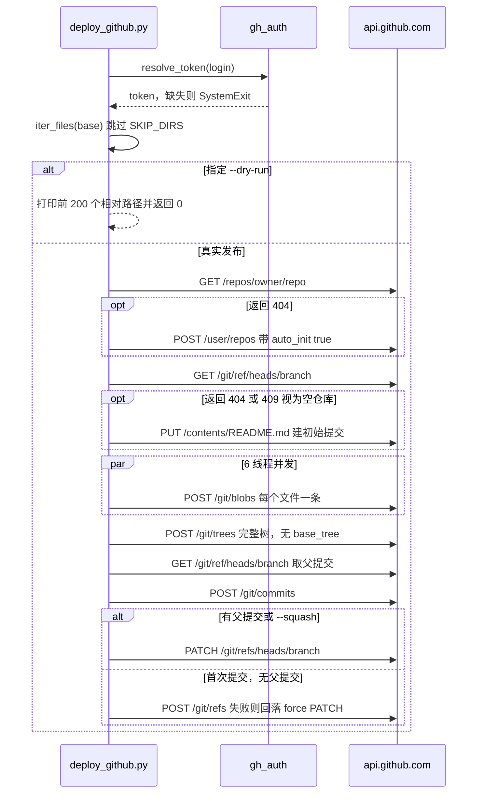
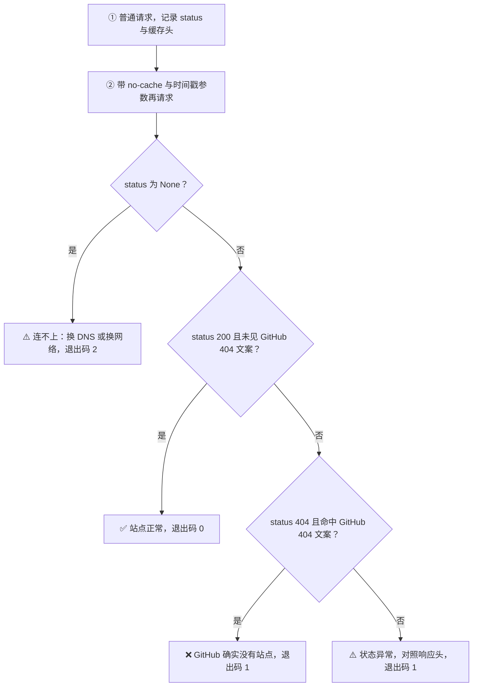

# 发布与部署（deploy_github.py、Pages 与 check_site.py）

这个仓库的「发布」有两段，且只有两段：**内容怎么落到 `main`**（一条不依赖 git 客户端的上传路径），以及**站点出去以后怎么自证它是好的**（一条从本机网络出发的体检路径）。站点没有构建步骤，`docs/` 里的字节就是线上的字节（见[静态站点](../architecture/static-site.md)），所以发布脚本要做的全部事情，就是把当前工作目录变成 `main` 上的新提交。

`deploy_github.py` 不配置 Pages，`check_site.py` 不改任何东西——前者只让文件出现，后者只读响应。两者的分界线正好是「Pages 在中间自己完成的那一步」。

## 两条上传路径，一个共同结果

| 场景 | 走哪条 | 结果 |
|---|---|---|
| 日常改内容 | `git push`，或 CI 里的 `github-actions[bot]` 提交 | `main` 前进 → Pages 按 `main:/docs` 重建 |
| 首次发布 / 本机无法出网 | `python scripts/deploy_github.py` | 同上，只是提交由 Git Data API 拼出来 |

用第二条路径的原因写在脚本头部：本机 shell 的 TLS 走 Windows schannel，`git push` 会报 `AcquireCredentialsHandle failed: SEC_E_NO_CREDENTIALS`，`git` / `curl` / PowerShell **全部**出不了网；Python 自带 OpenSSL，于是整条发布改成在 Python 里直接建 `blobs → trees → commits → refs`。这条通道的请求头、重试与凭据解析不在本页展开，见 [GitHub API 通道与凭据](../integrations/github-api-transport.md)。

## 调用顺序：先建仓库，再建提交

图注：一次发布从凭据解析到 ref 落定的完整调用顺序；两条 `opt` 分支就是必须先跑的引导步骤。

### 为什么 `ensure_repo(auto_init)` 与 `ensure_initial_commit` 必须最先跑

Git Data API 的每一次写操作都挂在一个**已经存在的 git 仓库对象**上。刚创建、没有任何提交的空仓库不具备这个对象，连 `POST /git/blobs` 都会直接返回 **409 `Git Repository is empty`**。所以引导不是「顺手做的好事」，而是顺序上的硬前提：

1. **`ensure_repo`**：`GET /repos/{owner}/{repo}` 探测；只有 404 才 `POST /user/repos` 建仓库，并且必定带 `"auto_init": True`（源码注释：必须初始化，否则空仓库建 blob 会 409），同时设 `has_issues: true`、`has_wiki: false`、`has_projects: false`。仓库已存在时它只打印 `html_url` 与 `visibility` 就返回。
2. **`ensure_initial_commit`**：兜住「仓库是别处建的、没勾 README」的情况。它把 `GET /git/ref/heads/{branch}` 的 **404 或 409** 都当作「空仓库」判据，然后用 `PUT /contents/README.md`（内容 `# init`）写一个提交，把 git 对象建起来。

两条守卫都是幂等的（仓库在、ref 在就直接返回），因此重复运行无副作用。代价是**仓库已存在时 `--description` / `--homepage` 不会更新**——它们只出现在创建仓库的载荷里。

### 主体：blob → tree → commit → ref

- 每个文件一次 `POST /git/blobs`（base64 内容），用 `ThreadPoolExecutor(max_workers=6)` 并发；tree 条目固定 `mode: "100644"`、`type: "blob"`、`path` 为 POSIX 相对路径。
- `POST /git/trees` **只带 `tree`，没有 `base_tree`**——这是全量快照而不是增量补丁，本地删掉的文件在下一次发布后从分支上消失。
- 父提交是在树建好之后才读的 `GET /git/ref/heads/<branch>`；有父提交时 ref 用 `PATCH` 前进且 `force: false`。
- 没有父提交（且未 `--squash`）时先 `POST /git/refs`；**任何** `RuntimeError` 都会回落到 `PATCH ... force: true`。这条兜底不区分「引用已存在」与别的原因，所以它具备强制覆盖远端分支的能力。
- 成功凭据就是末尾几行 stdout：commit 链接、`sha[:7]`、文件数、API 调用次数，以及预期站点地址。脚本不写任何状态文件，这几行是唯一的可核对记录。

## 发布之前：`iter_files` 与 `.gitignore` 是两套规则

`iter_files` 用 `sorted(base.rglob("*"))` 直接走文件系统，只按 **`SKIP_DIRS` 的五个目录名**过滤：`.git`、`__pycache__`、`node_modules`、`.venv`、`venv`。它**不读 `.gitignore`**，所以那份文件里精心列出的排除规则在这条路径上完全无效：

| `.gitignore` 挡住的东西 | `SKIP_DIRS` 会跳过吗 | 这条发布路径的后果 |
|---|---|---|
| `.env`、`.env.*`、`*.pem`、`*.key`、`*.p12`、`github_token*`、`secrets.*`、`id_rsa*` | 否 | 一旦磁盘上存在，就逐字节上传成公开文件 |
| `models/`、`*.gguf`、`*.safetensors`、`*.bin`、`*.onnx` | 否 | 大文件被 base64 塞进 blob，发布变慢、仓库变大 |
| `tmp/`、`temp/`、`*.log`、`dist/`、`build/` | 否 | 临时产物与构建目录一起进站 |
| `node_modules/`、`.venv/`、`venv/`、`__pycache__/`、`.git/` | 是 | 唯一被跳过的类别 |

因此 `--dry-run` 在首次发布前不是可选项，而是强制动作：

- 它会先打印「待推送 N 个文件，X KB」，再逐个列出相对路径，然后返回 0、一次 API 写请求都不发。
- **清单被截断**：只列 `files[:200]`，大目录要看总结行的文件数与体积，不能靠数清单确认没有漏网文件。
- 它出现在 `resolve_token` **之后**，所以 dry-run 仍然要求凭据可用——想纯看清单而手上没 token 时绕不过去。
- 默认 `--dir` 是仓库根，意味着 `openwiki/`、`conversation_history/`、`docs/` 会整棵上线；要缩小范围就显式传 `--dir`。

## `--squash`、`--private` 与 `--branch`

- **`--squash`**：跳过父提交查询，`parents: []`，ref 用 `force: true` 覆盖。结果是分支上只剩**一个根提交**，旧历史不可达。它适合首次发布或有意重写历史，**日常维护不要用**——这是唯一会丢历史的开关（[维护手册](maintenance-runbook.md) 里同一条约定）。
- **`--private`**：脚本会照建私有仓库并把 `homepage` 设成 `https://<owner>.github.io/<repo>/`，但 Free 计划下私有仓库不能用 Pages（需 Pro/Team/Enterprise），所以打印出来的站点地址是打不开的。
- **`--branch`**：默认 `main`。由于 `GET /git/ref/heads/<branch>` 的 404 被统一当成「空仓库」，分支名与仓库实际默认分支不一致时的症状**不是报错**，而是又打印一遍「仓库为空，先创建初始提交」，然后在一个新分支上建立历史。

## 发布之后：Pages 侧的两段延迟与一条软限制

- **启用方式**：`Settings → Pages → Source: Deploy from a branch → main + /docs`，保存后 30–60 秒生效；此后每次 push 到 `main` 自动更新。仓库里没有 Pages 工作流（`.github/workflows/` 只有外链体检与 OpenWiki 更新），需要编译的站点才走 Actions 那一套。
- **1–2 分钟缓存延迟**：push 完立刻刷新看到旧页面是**正常现象**，不要在这一分钟里改内容、重跑脚本或判定发布失败。
- **构建 10 次/小时（软限制）**：一小时内反复 push 会排队甚至失败。把 Pages 当预览服务器刷，症状是「最后一次改动没生效」，而原因与内容无关。站点大小 1 GB、月流量 100 GB 同为软限制；只发静态文件，没有后端。
- **写回提交同样消耗构建**。`link-check.yml` 的 `push.paths` 刻意只监听内容目录与脚本，注释写明：若写成 `**/*.md`，自触发产生的连续提交会「把紧跟着的 Pages 构建一个个取消掉（表现为站点忽新忽旧）」。排查「站点忽新忽旧」时，这条比内容 diff 更可能是答案（详见 [CI 工作流](ci-workflows.md)）。
- 发布脚本到此为止：它不启用 Pages、不写 `CNAME`、不碰 `docs/.nojekyll`，`homepage` 只是仓库元数据。

## `check_site.py`：把「站点挂了还是我被缓存坑了」问清楚

默认目标是硬编码的 `https://xushan628.github.io/github-free-guide/`，第一个命令行参数可换成任意 URL（在模块层由 `sys.argv[1]` 求值）。它发两次请求，超时 30 秒、无重试：

1. **普通请求**：打印 status，以及存在则打印 `server`、`x-served-by`、`x-cache`、`age`、`etag`、`last-modified`、`content-type`，再判断响应体里是否出现 GitHub 的 404 文案，最后打印内容长度。
2. **绕过缓存再请求一次**：带 `Cache-Control: no-cache, no-store` 与 `Pragma: no-cache`，并在 URL 上追加 `?_probe=<时间戳>`（已有 `?` 时用 `&`），打印新的 status 与 `x-cache`。

图注：`check_site.py` 的两次探测与四类结论分派；退出码 0 / 1 / 2 分别对应正常、站点缺失或异常、连不上。

| 结论 | 触发条件 | 退出码 | 该做什么 |
|---|---|---|---|
| ✅ 站点正常 | status 200 且响应体不含 GitHub 404 文案 | 0 | 你浏览器里还是 404，就是**本机缓存了旧的 404**：`Ctrl+Shift+R`、无痕窗口，或等 10 分钟缓存过期 |
| ❌ GitHub 确实没有站点 | status 404 且命中 `There isn't a GitHub Pages site here` / `Site not found` | 1 | 不是缓存问题：查 `Settings → Pages` 是否指向 `main` 与 `/docs`，构建是否报错（注意 10 次/小时上限） |
| ⚠️ 连不上 | status 为 `None`（超时 / DNS / TLS 异常被收敛成 None） | 2 | 网络问题，不是站点问题：换 DNS（223.5.5.5 / 1.1.1.1）或换网络（手机热点） |
| ⚠️ 状态异常 | 其余全部：403、5xx，或 404 但响应体不含 GitHub 文案 | 1 | 站点在，但响应不对；先读上面打印的响应头再决定 |

两条边界必须记住：

- 「GitHub 确实没有站点」靠响应体里的**英文子串**匹配。GitHub 换文案、返回本地化 404 页，或中间层改写了 body，都会让同一情形掉进第 4 类而不是第 2 类。
- 它只能证明**你这台机器的网络**拿到了什么样的响应，因此能证明「站点正常」，却不能证明「你的浏览器缓存是对的」——所以 ✅ 之后仍需你强刷一次，这一步脚本代劳不了。

## 一次发布的标准动作

| # | 动作 | 判据 |
|---|---|---|
| 1 | `python scripts/deploy_github.py --dry-run` | 清单与总结行里没有 `.env`、`*.pem`、`github_token*`、`models/`、`*.gguf`、`*.log`；文件数与体积合乎预期 |
| 2 | 首次发布加 `--squash`，日常不加 | stdout 末尾有 commit 链接与「文件 N · API 调用 M 次」 |
| 3 | 等 1–2 分钟 | 这段时间里不要重跑、不要改内容，也不要判失败 |
| 4 | `python scripts/check_site.py`（或指向新 URL） | 退出码 0 才算发布完成；1 且命中 404 文案 → 查 Pages 设置；2 → 查网络 |
| 5 | 脚本 ✅ 但浏览器仍 404 | 强刷 / 无痕 / 等 10 分钟；仍然不对再怀疑缓存层 |

## 失败语义速查

| 症状 | 最可能的原因 | 动作 |
|---|---|---|
| blob 上传报 409 `Git Repository is empty` | 跳过了 `ensure_repo` / `ensure_initial_commit`（例如自己改过执行顺序） | 让引导照原样跑；不要先手工建空仓库再指望跳过 |
| 403 立刻失败、没有任何重试 | token 缺 `contents: write` 权限 | 换有写权限的 token；403 在写路径上重试没有意义 |
| 5xx 之后自动重来 | 服务端抖动：500/502/503/504 重试 3 次，退避 2s、4s；其他异常退避 1.5s、3s | 等它重试；失败时 `RuntimeError` 里带方法、路径、HTTP 码与前 400 字符 body |
| `POST /git/refs` 失败但脚本仍报成功 | 兜底的 `PATCH + force: true` 覆盖了已存在的分支 | 核对被覆盖的是不是你预期的那条分支 |
| 推送成功但站点 404 | Pages 未启用 / 指向别的分支或目录 | 走 `check_site.py` 第 2 类结论的处置路径 |
| 推送成功、站点 200，内容却是旧的 | 1–2 分钟缓存延迟，或恰好撞上 10 次/小时 | 等，别重复发布 |

## 不变量

- **发布 = 让 `main` 前进。** 没有构建步骤、没有生成器，云端不会重新计算任何文件。
- **空仓库不可写。** 任何 blob / tree / commit 调用之前必须至少有一个提交，这就是两条引导步骤排在最前的原因。
- **可见性由 `SKIP_DIRS` 决定，不由 `.gitignore` 决定。** 想上线什么、不想上线什么，只能靠 dry-run 核对与目录布局。
- **`--squash` 是唯一会丢历史的一步。**
- **延迟与配额不是失败信号。** 1–2 分钟缓存延迟、10 次/小时构建上限，都是需要「等」或「少推」的情况，不是代码坏了。

## 相关页面

- [静态站点](../architecture/static-site.md)：`docs/` 的单页运行时、`404.html` 兜底与 `main:/docs` 契约。
- [GitHub API 通道与凭据](../integrations/github-api-transport.md)：`urllib` + `resolve_token` 的传输层契约与四套重试策略。
- [维护手册](maintenance-runbook.md)：日常改动路径、发布与部署之外的运维底线。
- [CI 工作流](ci-workflows.md)：写回提交如何触发 Pages 重建、`push.paths` 为何收窄。
- [Pages 三种部署方式](../../40-ship/pages/README.md)、[.gitignore](../../.gitignore)。
