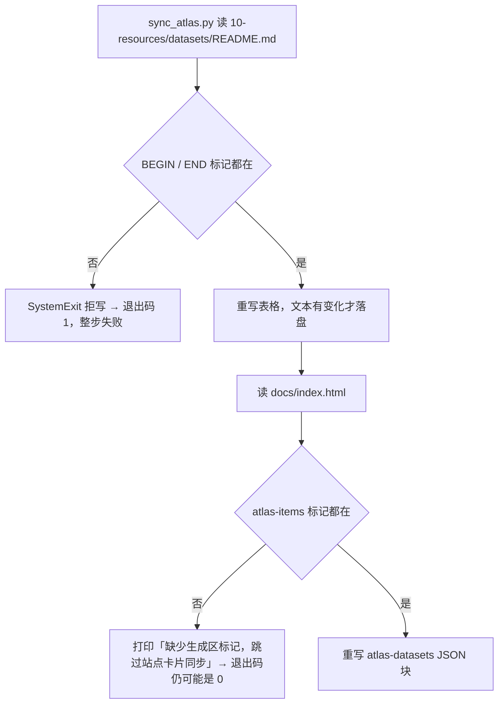

# 验证手段：没有单测时如何证明改动安全

先摆事实，因为它决定了后面所有判据的形状：

- **没有测试框架。** 仓库里不存在 `tests/` 目录，也没有任何 `pytest` / `unittest` 的引用（唯一的 `pytest` 字样出现在 `40-ship/actions/templates/matrix.yml` 里，那是给读者抄的 CI 模板，不是本仓库的自测）。
- **没有构建步骤，也没有依赖清单。** 根目录没有 `requirements.txt` / `pyproject.toml` / `package.json`；`scripts/` 下的五个脚本只用标准库（`urllib`、`json`、`hashlib`、`base64`、`ctypes`、`concurrent.futures`），CI 里也只有 `actions/setup-python` + `python-version: "3.12"` 加一条裸命令。
- **没有静态检查。** 没有 `actionlint`，没有 JS/HTML lint；工作流 YAML 与 `docs/index.html` 的内联脚本只有第一次真实运行才会暴露错误。

于是"改动是否安全"只能靠三种信号手工作证：**进程退出码**、**stdout / 报告里的具体字样**、**产物 diff**（`git status` / `git diff`）。本页就是把这三样东西拼成每类改动的最小验证流程，并标出哪些信号会骗人。

## 现成的四个开关

脚本没有一个统一的 `--validate`，但各脚本自带了一个"只看不改"或"当门禁"的开关。它们是本仓库唯一可复用的验证手段：

| 命令 | 它真正检查什么 | 干净时看到什么 | 有问题时的退出码 |
|---|---|---|---|
| `python scripts/sync_atlas.py --check` | 上游 `data/manifest.json` 重新拉一遍后算出的目录，与本地 `datasets.json`、`datasets/README.md` 生成区、`docs/index.html` 的 `atlas-items` 区块是否一致 | `已是最新：N 个数据集，无需改动`，退出 0 | 有差异时打印 `需要更新: <路径列表>（N 个数据集）` 并返回 **1**（不写盘） |
| `python scripts/verify_links.py --strict` | 全仓 Markdown 的外链（HEAD→GET 回退）与站内相对链接（查本地文件） | 末行 `✅ n  ⚠️ m  ❌ 0  ⏭️ k  → docs/link-check.md`，退出 0 | 有 `dead`（❌）时返回 **1**；⚠️「未验证」不触发非零 |
| `python scripts/deploy_github.py --dry-run` | 待推送文件清单（`iter_files` 的真实产物，**不读 `.gitignore`**） | `待推送 N 个文件，X KB` + 前 200 条相对路径 + `dry-run 结束（未做任何修改）`，退出 0 | 无凭据时 `resolve_token` 直接 `SystemExit` |
| `python scripts/check_site.py [URL]` | 线上站点的两次探测（普通请求 + 绕过缓存）与响应头 | `✅ 结论：站点正常，内容已返回。` | **0** 正常 / **1** 站点缺失或异常状态 / **2** 连不上 |

第五种"开关"不是命令行参数，而是**生成区标记守卫**：`sync_atlas.py` 写盘前要求目标块的两行注释标记都在位。它对两处产物的态度并不一样，这直接决定了验证方法（见下面的[静默失败](#静默失败清单)）：

图注：同一个脚本对两个生成区的不对称处理——README 缺标记是硬失败，`index.html` 缺标记是静默降级，于是"同步成功"不等于"三处一致"。

## 幂等：用第二次运行当判据

本仓库的写盘脚本都刻意做成幂等，这让"再跑一次"成为最便宜的正确性检查。但四个脚本的幂等性并不一致，误用会得出相反结论：

| 命令 | 第二次运行的表现 | 副作用 |
|---|---|---|
| `sync_atlas.py` | `datasets.json` 先整份比对、README/`index.html` 区块只在文本变化时写；无变化时打印 `已是最新：N 个数据集，无需改动`，`git status` 保持干净 | 无（`--check` 完全不写） |
| `sync_atlas.py --check` | 同一份输入永远返回同一个码：0 一致 / 1 需更新 | 无 |
| `verify_links.py` | **永不幂等**：报告头写 `生成时间：<UTC ISO>`，因此每次运行都会改写 `docs/link-check.md` | 整份覆盖报告 |
| `deploy_github.py --dry-run` | 幂等且无副作用：构造了 `GitHub` 客户端但一次 API 都没发 | 无 |
| `check_site.py` | 只读探测，不改任何文件 | 无 |

由此得到两条使用规则：

1. **`sync_atlas` 的验收要跑两次**：先 `--check`（期望 1，说明确实有差异要合入）→ 实跑（期望 0，`已更新: ...`）→ 再 `--check`（期望 0，`已是最新`）。第二次 `--check` 才是"改动已收敛"的证据。
2. **不要用 `git status` 判断体检是否通过**。`verify_links.py` 每次都会留下报告 diff，所以"有 diff"不代表有问题、"没 diff"也不代表没跑。判据只能是退出码和报告里的 ❌ / ⚠️ 计数。

## 按改动类型给最小验证

下面的表是"改完必须跑什么"，不是完整回归——没有完整回归可跑。

| 改动 | 最小验证 | 期望结果 | 这次验证**证明不了**什么 |
|---|---|---|---|
| 内容目录的 Markdown（`10-resources/` … `60-others/`） | `python scripts/verify_links.py --strict` | 退出 0；报告 ❌ 表为空；⚠️ 数可以非 0 | HTML 里的链接、以及同一目标字符串的第二次引用（见坑 6） |
| `scripts/sync_atlas.py` 或其产物相关 | `--check` → 实跑 → 再 `--check` | 1 → 0（`已更新`）→ 0（`已是最新`） | `docs/index.html` 的卡片与表格是否一致，若标记缺失（见坑 1） |
| `docs/index.html` 的生成区**之外**（`DATA`、样式、页头数字） | 浏览器直接打开 `docs/index.html` | 控制台无报错；卡片数、分类 pill、搜索、`repo_url` / `dl` 链接都正常 | 线上可见性（需 `check_site.py`）与生成区是否被手改覆盖 |
| `docs/404.html`、`HOME` 常量、站点根路径相关 | 发布后 `python scripts/check_site.py` + 手动访问一个不存在的深层路径 | 退出 0；深层 404 页约 800 ms 后落到首页且不循环重定向 | 仓库改名/换域名后前缀失配（只有人看路径才知道） |
| 新增待发布文件、`.gitignore`、首次发布 | `python scripts/deploy_github.py --dry-run` | 退出 0；清单里**没有** `.env`、`*.pem`、`github_token*` | 清单是否被截断（只列前 200 条） |
| `.github/workflows/*.yml` | `workflow_dispatch` 手动跑一次 | job 绿；写回提交只含 `docs/link-check.md` 与 `10-resources/datasets/`，并带 `[skip ci]` | 定时触发是否还活着（60 天无活动会被 GitHub 停用） |
| `scripts/gh_auth.py` 或凭据来源 | 先清掉 `GITHUB_TOKEN` / `GH_TOKEN` 跑任一 API 脚本（期望 `SystemExit` + 明确提示），再带上 token 跑一次（期望成功） | 两种情况的行为都符合「环境变量 → Windows 凭据管理器」的顺序 | 仅限于本机凭据管理器的真实存在性 |
| `scripts/fetch_assets.py` 的 `ICON_NAMES` / `FONTS` / `LICENSES` | `python scripts/fetch_assets.py --only icons`（或 `fonts` / `licenses`） | `git diff MANIFEST.json` 里出现对应 `path`、`sha256`，`total_files` 随之变化 | 全量运行会不会丢掉某个 404 的上游条目 |

一个顺序上的事实：`verify_links.py` 扫**全仓** Markdown（只排除自己写出的报告），`openwiki/` 与 `skills/` 一样在扫描范围内。所以给 wiki 页面加相对链接等于给自己加一条会被机械检查的站内链接——链接写错时，报告里会多一条 ❌，而它和你的内容改动没有任何关系。

## 退出码 1 的二义性

在"非零即失败"的直觉下，下面这些情况会读错：

- `sync_atlas.py --check` 的 **1** 表示"有差异，需要更新"——这是好消息。
- 同一脚本因 `manifest 结构不符：...` 或 `缺少生成区标记，拒绝覆盖` 走 `SystemExit("...")`，退出码也是 **1**，但这是硬失败。
- `check_site.py` 的 **1** 同时覆盖"GitHub 确实没给这个地址发站点"和"站点在但返回 4xx/5xx"两种结论。

所以判据必须配字样：`需要更新` / `已是最新` / `已更新` / `❌ 结论：` / 以 `manifest 结构不符` 或 traceback 形态出现的 stderr。只看 `$?` 会把"待更新"当成"脚本崩了"，也会把"拒写"当成"跑过了"。

## 静默失败清单

按危险性排序。前四条会让"验证通过"变成假话。

1. **`index.html` 缺生成区标记 → 静默跳过。** 打印一句 `· docs/index.html 缺少生成区标记，跳过站点卡片同步` 后继续，退出码取决于另外两处是否有变化，通常还是 0；`--check` 也不会报差异，因为该区块根本没进入比对。结果是「数据集表格已更新、站点卡片永远不动」的长期漂移。迁移或重排 `index.html` 时，先确认 `<!-- BEGIN GENERATED: atlas-items -->` 与 `<!-- END GENERATED: atlas-items -->` 两行还在原位。
2. **站内链接检查在大小写上是"本机宽、线上严"。** `check_local` 用 `Path.exists()` 判存在，而 Windows 文件系统不区分大小写，GitHub Pages 区分。于是 `Images/Logo.png` 写成 `images/logo.png` 在本地报告里是 ✅，线上是 404——这类问题只有发布后点页面才能发现（对照 [Pages 的坑](../../40-ship/pages/README.md)）。
3. **`.md` 之外一律不检查。** `verify_links.py` 只 `rglob("*.md")`，`docs/index.html`、`docs/disclaimer.html`、`docs/404.html` 里的 `href` 完全不进报告。而 `404.html` 偏偏是唯一使用绝对路径 `/github-free-guide/` 的文件（`HOME` 常量、按钮 href、canonical 三处硬耦合），仓库改名或换域名后它会把访问者送去另一个 404，却不会有任何检查报警。验证方式只有人工：发布后故意访问一个不存在的深层路径。
4. **token 缺失导致"低配额 + 未验证"混进正常结论。** `verify_links.py` 与 `sync_atlas.py` 用 `resolve_token(..., required=False)`，没有凭据也能跑，但 `api.github.com` 匿名只有 60 次/小时；打满后 403/429 被归类成 `unverified`（⚠️），**不是** `dead`，所以 `--strict` 依然退出 0。也就是说"✅ 通过了"可能是"一半链接根本没验成"。本地跑之前先设 `GITHUB_TOKEN`，并把 ⚠️ 数当成"未覆盖比例"而不是"没问题"。
5. **本机缓存造成的 404 假象。** Pages 会把 404 响应交给浏览器缓存，所以"我改完还是 404"经常是你被自己坑了，而不是站点坏了。`check_site.py` 就是为这个二义性写的：它先发普通请求，再带 `Cache-Control: no-cache, no-store` + 时间戳参数探测一次，只有当响应体里出现 GitHub 的 "Site not found" 文案时才判定为真·站点缺失。结论与退出码映射见 [发布与部署](../operations/publishing-and-deploy.md)。
6. **站内相对链接按目标字符串去重，只用第一个引用位置解析。** 报告里同一个 `../scripts/sync_atlas.py` 只出现一行，`check_local` 取 `refs[0]` 的文件所在目录作为基准。因此报告 ✅ 只证明"至少一处能解析到"，不证明每个引用都通。移动目录深度、或在更深的页面里引用同一个目标时，别只看报告那一行。
7. **`--check` 不是离线干跑。** 它第一步就 `fetch_manifest()` 走网络（`api.github.com` 的 contents API）。断网、被重置或限流时它不会返回 1，而是抛异常/`SystemExit`——于是"1 表示需要更新"这条判据只在网络可用时成立。
8. **`--dry-run` 也需要凭据，且清单会截断。** `GitHub(resolve_token(args.login))` 在 dry-run 分支之前执行，`resolve_token` 默认 `required=True`，所以没有 token 时 dry-run 直接 `SystemExit`。输出只列前 200 个文件，大仓库下"清单里没有密钥文件"这句话本身可能是截断造成的。
9. **`verify_links.py` 的正则覆盖有限。** 带空格或尖括号的链接写法（`[x](<a b.md>)`）不匹配 `MD_LINK`，localhost / 127.0.0.1 的目标被标记为 `local`（⏭️ 跳过）。前者等于没检查，后者意味着"本地起服务试试"不能作为验收证据。锚点（`#...`）与 `mailto:` 被直接跳过，所以页内锚点无效不会进报告。
10. **`fetch_assets.py` 全量运行会重建 `files` 列表。** 不带 `--only` 时清单只保留本次成功下载的条目：某个上游文件这次 404，磁盘上的旧文件还在，`MANIFEST.json` 里的记录却消失了。要局部刷新就带 `--only`（按 `path` 与旧清单合并），要完整快照就全量跑并核 `total_files`。

## CI 到底覆盖了什么

`link-check.yml` 是本仓库唯一的自动验证，它只做两件事：`python scripts/verify_links.py`（**不带 `--strict`**）与 `python scripts/sync_atlas.py`（**不带 `--check`**，直接写文件），然后 `git add docs/link-check.md 10-resources/datasets/` 提交。

具体边界值得记住：

- **死链不会让 job 变红。** 没有 `--strict`，失效链接只写进报告；脚本自身崩溃才会让 job 失败。想要门禁只能在本地跑 `--strict`。
- **`docs/index.html` 不进 CI 提交。** 提交步骤只 `git add` 两个路径，所以脚本即使重写了 `atlas-items` 区块，那份改动也不会被提交——站点卡片要靠本地跑同步并一起提交才对齐。
- **CI 不碰站点、不碰发布、不碰 `index.html` 的内联脚本、不跑任何形式化的测试。** `check_site.py` 与 `deploy_github.py` 从来不在 CI 里出现。

所以"CI 绿"只等于"外链体检没崩 + 数据集同步没崩"，不等于改动安全。这个数字上的落差就是本页存在的原因：剩下的证据只能靠人按上表手跑。

## 相关页面

- [维护手册：每周循环与常见改动路径](../operations/maintenance-runbook.md)：哪类改动会触及哪些文件、按什么顺序跑命令，以及不可手改的生成产物清单。
- [CI 工作流](../operations/ci-workflows.md)：两个工作流的触发、权限、写回方式与"没有静态检查"的后果。
- [发布与部署](../operations/publishing-and-deploy.md)：`deploy_github.py --dry-run` / `--squash` 的语义与 `check_site.py` 的四类结论。
- [链接体检](../workflows/link-health-check.md)：四态判定、`github.com` 改走 API 的原因与报告的读法。
- [数据集目录同步](../workflows/dataset-catalog-sync.md)：`--check` 与幂等写盘的实现细节。
- [静态站点结构](../architecture/static-site.md)：项目站点根路径 `/github-free-guide/` 与 404 兜底为何必须用绝对路径。
