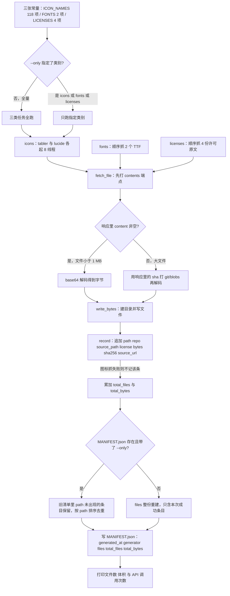
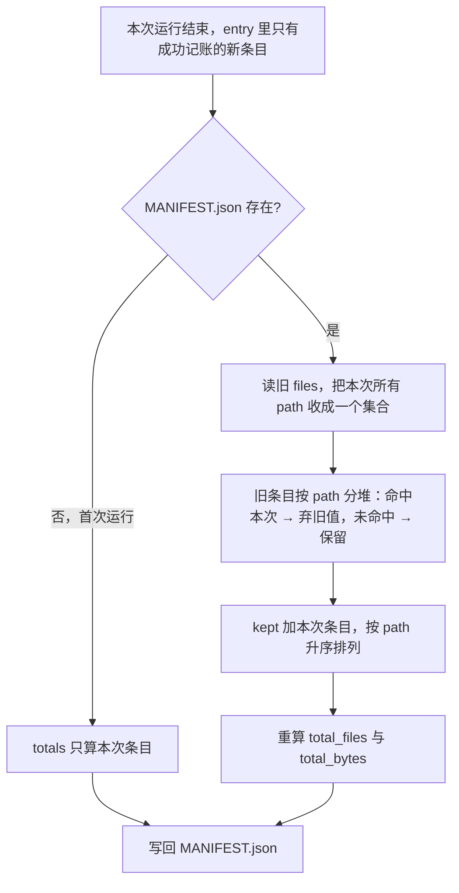

# 素材入库流水线（fetch_assets.py → MANIFEST.json）

`10-resources/assets/` 里那 200 个图标、2 套可变字体、4 份上游许可原文，全部由一个脚本落地：`scripts/fetch_assets.py`。它做三件事——按写死的清单去上游仓库抓字节、把字节写进仓库、给每个字节记一笔带 `sha256` 与 `source_url` 的账（根目录 `MANIFEST.json`）。

这是仓库里**唯一**没有 CI 参与的生成物管道。`.github/workflows/link-check.yml` 只跑 `verify_links.py` 与 `sync_atlas.py`，触发路径里也不含 `scripts/fetch_assets.py`，所以素材侧的清单只能人工刷新。判断"某个图标的哈希是不是还是上游那个"永远是要有人跑一次脚本的问题，不是一次 CI 红灯。

传输层的通用契约（为什么只能走 `api.github.com`、`resolve_token` 的两级凭据、为何没有公共 HTTP 客户端）在 [GitHub API 通道与凭据](../integrations/github-api-transport.md) 里讲；本页只讲这条管道自己的形状：清单从哪来、字节怎么取、账怎么记、增量怎么合。

## 输入：三张常量表就是清单

脚本不枚举上游目录、不解析上游 `package.json`、也不读任何 Markdown。它只有三张模块级常量（`scripts/fetch_assets.py#L40-L73`）：

| 常量 | 形态 | 条数 | 落盘位置 | 许可证 id |
|---|---|---|---|---|
| `ICON_NAMES` | kebab-case 名单，一份名单同时喂两个库 | 118 | `10-resources/assets/icons/<lib>/<name>.svg` | `tabler` → `MIT`，`lucide` → `ISC`（在 `download_icons` 里按库名决定） |
| `FONTS` | `(repo, 上游路径, 本地文件名, 许可证 id)` | 2 | `10-resources/assets/fonts/` | `OFL-1.1` |
| `LICENSES` | 同上四元组 | 4 | `10-resources/assets/LICENSES/` | `MIT` / `ISC` / `OFL-1.1` |

由此得出两条改动纪律：

- **扩充素材 = 改常量再跑。** `10-resources/assets/README.md` 的「自己扩充素材库」一节写的正是这件事：想加图标就改 `ICON_NAMES` 再 `python scripts/fetch_assets.py --only icons`。表里没有的名字，脚本永远不会去抓；表里有的名字，即使上游 404 也不会被"猜"成别的名字。
- **许可证结论只写在常量里。** `FONTS` / `LICENSES` 的最后一列是人工判断的 SPDX 标识，`record()` 只是把它抄进清单——脚本从不解析许可文本，也就永远不会发现上游换证。判定规则本身见 [许可证与风险策略](../concepts/licensing-and-risk-policy.md)。

### 一份名单两个库，命中率不是 100%

`ICON_NAMES` 只有一份，`download_icons(client, entry, "tabler", ICON_NAMES)` 与 `("lucide", ICON_NAMES)` 各自拼一次上游路径：tabler 是 `icons/outline/<name>.svg`，lucide 是 `icons/<name>.svg`。两个库风格相近、命名近似，但近似不是相等，于是 118 个名字实际命中 **Tabler 106 个、Lucide 94 个**，合计 200；`MANIFEST.json` 的 `total_files` 是 206（再加 2 个字体与 4 份许可原文）。

落空的 12 + 24 个名字不会留下任何痕迹：`one()` 里 `except Exception: return False`，只在 `pool.map` 结束后打一行 `· tabler: 命中 106/118`。磁盘上没有文件、清单里没有条目、退出码仍是 0。举例：`lucide/home.svg` 在仓库里与 `MANIFEST.json` 里都不存在（Lucide 的同类图标叫 `house`），tabler 侧则缺 `message-square`、`play`、`save`、`grid` 等——不是漏抓，是这些名字在对应上游路径上不存在。**因此"清单里有 118 个图标名"与"仓库里有 118 个图标"永远是两个数，改常量时别拿名单长度当产出预期。**

## 主流程



图注：`main()` 的端到端形状——常量选目标、contents 优先 blobs 兜底、先落盘再记账、最后合并写清单。

## 取字节：`contents` 优先，`git/blobs` 兜底

`fetch_file()`（`#L135-L143`）只做两件事：

1. 打 `/repos/<repo>/contents/<path>`，路径按 `urllib.parse.quote(path, safe="/")` 编码（`#L126-L128`）。小于 1 MB 的文件，响应里直接带 base64 的 `content`，解码即得字节。
2. `content` 为空（大文件）时，拿响应里的 `sha` 再打 `/repos/<repo>/git/blobs/<sha>` 取 base64。

两个边界值得记住：

- **响应是数组就意味着路径错了。** 目录会返回 list，脚本显式 `raise ValueError(f"{repo}/{path} 是目录，不是文件")`，而不是继续按键取值。
- **兜底分支在当前素材集下是休眠代码。** 清单里最大的文件是 `Inter[opsz,wght].ttf`，876 KB，仍在 `contents` 的内联范围内；所以今天跑一遍只会产生 206 次成功读取，一次 `git/blobs` 都不会发生。它真正会被用到的是"加一套 CJK 字体或一张大插画"的时候——那也是仓库体积开始失控的时候（`assets/README.md` 因此建议对中文字体用 `pyftsubset` 先裁剪）。

## 并发与重试：图标才是压力来源

- **并发只用在图标。** 每个库各起一个 `ThreadPoolExecutor(max_workers=8)`（`#L183-L189`），字体与许可证是普通 `for` 循环。两个库串行跑，所以峰值并发是 8，不是 16。
- **单个图标的失败不传染。** `one()` 内部吞掉所有异常并返回 `False`；线程池不会因为某个 404 而中断，最多是命中数变小。
- **重试在客户端层，不在任务层。** `Client.json()` 默认 3 次尝试，403/429 按 3s、6s 退避，其他网络异常按 1.5s、3s 退避；成功响应之后还会读 `x-ratelimit-remaining`，剩余低于 20 且 reset 落在未来 900 秒内就主动 sleep 到 reset（`#L95-L124`）。一轮全量大约两百多次成功读取，8 线程下最容易撞配额，这也是它比仓库里另外三个 GitHub 调用方都更在意限流的原因。
- **并发不影响清单内容。** `record()` 是从 8 个线程往同一个 `entry["files"]` 里 `append`，完成顺序天然不确定；脚本在写盘前无条件 `entry["files"].sort(key=lambda f: f["path"])`，把顺序归一成 path 升序。所以同一份上游内容重跑两次，`files` 逐字节一致——除了 `generated_at`。

## 记账：`record()` 写进去的七个字段

`record()`（`#L154-L166`）是唯一往 `entry["files"]` 追加条目的地方，也是"账本"这个词的全部实现：

| 字段 | 取值 | 性质 |
|---|---|---|
| `path` | 调用方传进来的仓库相对路径，如 `10-resources/assets/icons/tabler/home.svg` | 与磁盘位置一一对应 |
| `repo` | 上游 `owner/name`，如 `tabler/tabler-icons` | 出处 |
| `source_path` | 上游仓库内路径，如 `icons/outline/home.svg` | 出处 |
| `license` | 来自常量表的声明，如 `MIT` | **人写的结论**，不是解析结果 |
| `bytes` | `len(data)` | 与落盘字节同源 |
| `sha256` | `hashlib.sha256(data).hexdigest()` | 与落盘字节同源 |
| `source_url` | `https://github.com/<repo>/blob/main/<URL 编码后的 source_path>` | 可点回上游的那一行 |

清单顶层的 `generated_at`（UTC，秒级）、`generator`、`total_files`、`total_bytes` 由 `main()` 补上。

两条不变式与两个后果：

- **哈希来自刚写下去的那份内存字节。** `write_bytes()` 与 `sha256_bytes()` 吃的是同一个 `data`，所以"清单哈希 = 磁盘哈希"只在文件没被手改时成立。脚本**没有任何读回校验**：它不会重新读磁盘、不会比对已有文件、也不会报"清单与磁盘不一致"。审计价值完全建立在"没人手改、且每次都重跑脚本"上。
- **`source_url` 硬编码 `blob/main`。** 上游默认分支若改名（`master`、`develop`），链接会 404 而清单不会报警。反方向的坑是编码：`Inter[opsz,wght].ttf` 在清单里记成 `.../Inter%5Bopsz%2Cwght%5D.ttf`——`[` `]` 与 `,` 都被百分号编码，这与 `assets/README.md` 提醒的 CSS 写法（`%5B` `%5D`）是同一个问题的两处表现。

## 三类任务的失败语义完全不同

这是最需要按表核对的部分，因为它决定"脚本跑挂了"到底意味着什么：

| 类别 | 单文件失败时 | 脚本结局 | 磁盘与清单的关系 |
|---|---|---|---|
| 图标（`download_icons`） | `except Exception: return False`，不记账、不打印该名字 | 继续跑完，退出 0，只少几条记录 | 该文件没写、清单里也没条目；**旧文件与旧条目原样保留** |
| 字体 / 许可证（`main` 里的两个循环） | 没有 `try` | 异常直接冒泡，带 traceback 退出 | 已经写下去的图标/字体留在磁盘上，而 `MANIFEST.json` **一个字都没更新** |

关键结构是**写清单是最后一步、且只写一次**：`MANIFEST.write_text(...)` 在所有下载之后执行，所以不存在"清单写了一半"的中间态；但反过来，硬失败会留下"磁盘已更新、清单仍是上一版"的漂移，而且脚本只会写、从不删除文件——从常量里删掉一个图标，全量运行会让它的记录消失，`10-resources/assets/icons/tabler/<name>.svg` 却还躺在仓库里成为孤儿文件。

**全量运行会整份重建 `files`。** 不带 `--only` 时，清单里只有本次成功下载并记账的条目：某个上游文件这次 404，磁盘上的旧文件还在、记录却消失了，`total_files` 随之缩水。要局部刷新就带 `--only`。

## `--only`：合并、去重、排序

`--only` 的取值被 `argparse` 的 `choices` 限死在 `icons` / `fonts` / `licenses` 三项，写错类别是参数错误而不是静默忽略。合并在下载全部完成之后进行（`#L226-L231`）：



图注：`--only` 的合并只在"清单已存在"时生效，判据是新旧 `path` 的集合差。

由此得到的四条语义：

1. **未涉及的类别一律保留。** 只刷 `fonts` 时，200 条图标记录原样留下——这正是 `--only` 存在的理由。
2. **去重键是 `path`。** 同一路径的新条目顶掉旧条目，不会出现两条同 `path` 的记录（前提是常量里没有重复项；脚本不会对本次结果内部再去重）。
3. **顺序统一按 `path` 升序**，与旧清单的书写顺序无关，所以 diff 只反映"哪些条目变了"，不反映"谁先跑完"。
4. **`--only` 永远不缩小清单。** 本次抓取失败的同类文件，其 `path` 不在新集合里，于是被当作"未涉及"从旧清单保留下来。推论很实际：**删条目只能靠全量运行**——从 `ICON_NAMES` 里删掉一个名字再跑 `--only icons`，记录仍在。

还有一个容易忽略的性质：**脚本不幂等。** `generated_at` 每次运行都重置为当前 UTC 时间，`generator` 每次重写，`write_text` 无条件执行。所以哪怕素材一个字节都没变，`--only` 也会在 `MANIFEST.json` 里产生一行 diff；不要把它当成"没有变化"的证据，要看 `files` 与 `total_files`。（对比 `sync_atlas.py` 的"内容没变就不写文件"。）

## 运行与验收

```bash
# 全量重建：三类都抓，files 整份替换
python scripts/fetch_assets.py

# 局部刷新：与现有 MANIFEST.json 按 path 合并
python scripts/fetch_assets.py --only icons
python scripts/fetch_assets.py --only fonts
python scripts/fetch_assets.py --only licenses
```

凭据走 `resolve_token(args.login)`，默认 `required=True`：没设 `GITHUB_TOKEN` / `GH_TOKEN` 且本机没有对应 Windows 凭据条目时，脚本在发出第一个请求之前就 `SystemExit`。`--login` 只影响 Windows 凭据管理器里查找的 target 名，不改变请求以谁的身份发出。

| 想确认的事 | 命令 | 观察点 |
|---|---|---|
| 凭据与请求头是否可用（最小请求量） | `python scripts/fetch_assets.py --only licenses` | 4 次文件读取，足够暴露 401/403 与 `X-GitHub-Api-Version` 问题 |
| 增量是不是只动了这一类 | `--only icons` 后 `git diff MANIFEST.json` | 只有 `icons/...` 的 `path` 与 `generated_at` 变化，`total_files` 按合并结果变 |
| 快照是否完整 | 全量跑一次后看结尾打印 | `total_files` 应回到 206；缩水说明有上游文件这次没抓到 |
| 有没有把清单手改坏 | 任意重跑后 `git diff MANIFEST.json` | 手改内容应被整份覆盖；覆盖不掉的说明改的是常量与清单之外的文档 |

结尾那行 `完成：206 个文件，1137.8 KB，API 调用 N 次` 是本管道唯一的自我报告：`calls` 只在 `urlopen` 成功返回后自增，所以 N 大致等于成功读取的文件数（206 量级），**不含**失败的 404 与重试请求——那些对配额同样是消耗。

## 扩容清单（改完必做的四处同步）

脚本只写 `10-resources/assets/` 与 `MANIFEST.json`，**从不修改任何文档里的数字**，仓库里也没有测试会替它报警。所以加素材之后，下面四处必须一起动：

| 位置 | 当前口径 | 扩容后要改什么 |
|---|---|---|
| `10-resources/assets/README.md` 的「已经下载进仓库的」表 | Tabler 106、Lucide 94、字体各 1 | 数量列、目录列，以及许可证描述 |
| `10-resources/README.md` 的素材小节 | 「200 个 SVG + 2 套可变字体」、`MIT / ISC / OFL-1.1` | 图标总数与许可证列表 |
| `docs/index.html` 页头统计 | `<b>200</b> 个图标已入库` | 数字本身 |
| `MANIFEST.json` | `total_files` 206、`total_bytes` | 脚本会算，只需核对，不要手改 |

具体步骤：

1. 改常量。加图标就扩 `ICON_NAMES`（kebab-case，尽量选两个库都存在的名字，否则只会进一边）；加字体/许可证就加四元组，本地文件名沿用现有 `<上游>-<SPDX>.txt` 的命名习惯。
2. 跑对应类别的 `--only`，看 `MANIFEST.json` 的 diff：新条目应带 `path`、`sha256`、`source_url`，`total_files` 按合并结果变化。
3. 同步上表四处数字与许可证描述。
4. 若新素材引入了白名单外或带附加条款的许可证，先回到 [许可证与风险策略](../concepts/licensing-and-risk-policy.md) 走判定，再谈入库。

顺带一个 CI 侧的副作用：`link-check.yml` 的 `push` 触发路径包含 `10-resources/**/*.md` 但不含 `scripts/fetch_assets.py`。所以改 README 数字会顺带触发一次外链体检与数据集同步（并可能产生一提交），而只改常量不会触发任何 CI——这正是"素材侧没有自动验证"的具体形状，详见 [验证与自检矩阵](../testing/validation-harness.md)。

## 边界与已知缺口

- **没有测试，也没有 CI 覆盖。** 唯一的回归手段是"跑一遍 + 看 diff + 核 `total_files`"。
- **上游换证不会被发现。** `license` 是常量里的声明，脚本不读许可文本；没人重跑，清单里就一直是上一次的声明。
- **没有读回校验。** 没有工具能回答"磁盘上这 206 个文件是否仍与清单一致"；`sha256` 只在写入时算一次。
- **只写不删。** 从常量移除条目后，孤儿文件留在磁盘；`--only` 连清单记录都不删，只有全量运行才重建 `files`。
- **非幂等。** 每次运行都重写 `generated_at`，`--only` 空跑也会有 diff。
- **`source_url` 假定默认分支是 `main`**，上游改名会产出失效链接，而清单本身不会报错。

## 延伸阅读

- [GitHub API 通道与凭据](../integrations/github-api-transport.md)：`contents → git/blobs` 所在的传输层、`resolve_token` 的两级解析、以及四个调用方各自的重试与限流策略。
- [许可证与风险策略](../concepts/licensing-and-risk-policy.md)：`record()` 记下的 `license` 该填什么、白名单如何约束托管层、上游换证为何是本仓库的结构性缺口。
- [验证与自检矩阵](../testing/validation-harness.md)：改常量后"最小验证"是什么，以及为什么 `git diff` 才是判据。
- [仓库全景](../architecture/repository-map.md)：`MANIFEST.json` 作为生成产物的"不可手改"边界与其他脚本的职责分工。
- [运维手册](../operations/maintenance-runbook.md)：素材数量口径为何要四处同步，以及本地跑 API 脚本前先设 token 的原因。
