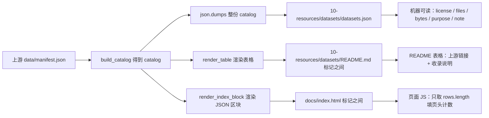
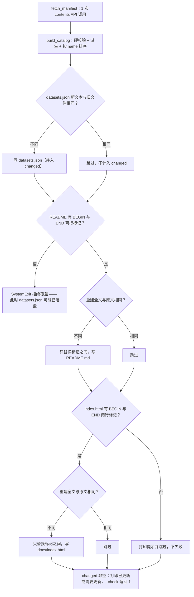

# 数据集目录同步（sync_atlas.py 与生成块）

`10-resources/datasets/` 里的目录没有一行是手写的。这一章的表格、机器可读清单，以及站点页头那个「数据集」数字，全部由 `scripts/sync_atlas.py` 从姊妹仓库 `xushan628/open-data-atlas` 的 `data/manifest.json` 重算出来。脚本头部把这条纪律写成了三行设计取舍：不带 star 数（每周都变，会制造无意义提交）、幂等（内容没变就不写文件）、结构不对就报错退出（`scripts/sync_atlas.py#L11-L14`）。

所以本页讲的不是「怎么维护一张表」，而是一条**从上游 manifest 到三处本地产物的单向流水线**：输入长什么样、三处产物各自由谁覆盖、什么情况下一个字节都不写、以及哪些失败是静默的。产物里的许可证措辞与降级规则另见[许可证与风险策略](../concepts/licensing-and-risk-policy.md)，站点那段区块在前端怎么被消费见[静态站点](../architecture/static-site.md)。

## 一份输入，一份中间产物，三处产物

图注：`build_catalog()` 是唯一的数据形状决定点，三个渲染函数都只读同一份 catalog，所以表格、JSON、站点区块不可能给出互相矛盾的数据集集合。

产物定位集中在文件头部（`scripts/sync_atlas.py#L30-L40`）：`OUT_DIR` / `JSON_OUT` / `README` / `INDEX` 都是相对 `ROOT` 的路径，而 `ROOT` 由 `Path(__file__).resolve().parent.parent` 推出来，因此脚本与当前工作目录无关，从仓库任何位置调用都写同一个地方。

## 输入：一个 contents API 加一次 base64

`fetch_manifest()`（`#L61-L70`）没有用 raw 地址，而是打 contents API：

- URL 硬编码为 `https://api.github.com/repos/xushan628/open-data-atlas/contents/data/manifest.json`，固定 `User-Agent: github-free-guide-sync/1.0` 与 `Accept: application/vnd.github+json`，超时 40 秒，**没有重试**。
- 响应里的 `content` 字段是 base64，`b64decode` 后再 `json.loads` 得到 manifest 本体。
- 凭据是「可选」的：`load_token()` 把 `gh_auth.resolve_token("xushan628", required=False)` 包在 `try/except Exception` 里（`#L52-L58`），既吞掉「没有凭据」，也吞掉「导入失败」。拿不到 token 就匿名发请求，`GITHUB_TOKEN` / Windows 凭据管理器的两级顺序见 [GitHub API 通道与凭据](../integrations/github-api-transport.md)。匿名配额只有 60 次/小时，但这条通道每次运行只花 1 次调用。
- **取数发生在任何写盘之前**，所以网络失败（403、超时、DNS）会带 traceback 崩掉且不留下任何半成品。这也是「不为它写重试循环」的理由。

## 中间产物：catalog 的形状与硬校验

`build_catalog()`（`#L73-L96`）先校验、再派生，两条顺序不可颠倒。

**硬校验（失败即 `SystemExit`，此时尚未写任何文件）：**

1. `manifest["datasets"]` 必须是非空 dict，否则 `manifest 结构不符：缺少 datasets 字典，拒绝生成`。
2. 每个条目必须有非空的 `name` / `repo` / `repo_url` / `license`，否则 `manifest 结构不符：<slug> 缺少字段 <key>`。校验按 manifest 的迭代顺序进行，报出来的是**第一个**违规条目。

由此得出一条对上游的要求：「许可证不明」必须被写成字面量 `NOASSERTION`，不能留空——留空等于让渲染层替上游猜。这也解释了 `datasets.json` 里 `exercises-dataset` 与 `word-atlas` 的 `license` 为什么是字符串 `NOASSERTION`。

**派生字段（都不来自 manifest 的直接计数）：**

| 字段 | 来源 |
|---|---|
| `slug` | manifest 里 `datasets` 字典的 key |
| `files` | `len(ds["files"])`，列表长度 |
| `bytes` | `sum(int(f.get("bytes") or 0) for f in files)`，缺 `bytes` 按 0 计 |
| `purpose` | `PURPOSE.get(slug, "")` |
| `note` | `NOTE.get(slug, "")` |

条目最后按 `name` 排序（不是 slug、不是 manifest 顺序），所以 `datasets.json`、README 表格、站点区块三处的行序天然一致：上游新增一个数据集会让整张表按显示名重新插位，diff 里出现的是插入而不是追加。

顶层三个字段分别是 `source`（写死 `xushan628/open-data-atlas`）、`source_path`（写死 `data/manifest.json`）、`generated_at`（**直接透传** `manifest.get("generated_at")`，不是本地时钟，`#L95-L96`）。

## PURPOSE / NOTE：脚本内的人工旁注

`PURPOSE`（`#L42-L48`）与 `NOTE`（`#L99-L103`）是两个按 slug 索引的模块级字典，注释写得很清楚：PURPOSE 是「每个数据集能拿来做什么——人工判断，随数据集本身稳定，不随 manifest 变化」，NOTE 是「需要额外说明的收录边界（事实性描述，不替上游下结论）」。

这带来三条使用约束：

- **它们永远不会被同步覆盖，也永远不跟着上游变。** 上游改了 `name`、`license`、文件列表，旁注仍是脚本里那句；要改旁注只能改脚本。
- **上游新增数据集不会报错，只会「没旁注」。** 新 slug 不在字典里时 `PURPOSE.get` 返回空串，README 表格的「能拿来做什么」列渲染成 `——`，名字下面也不会出现 `` 说明。想补齐就得往 `PURPOSE` / `NOTE` 加一项。
- **键写错是静默的。** 没有任何交叉校验能发现 `PURPOSE` 里的 slug 在上游不存在（或拼错），代价只是那条数据集少一句旁注。加键时请对照 `datasets.json` 里的 `slug` 字段，而不是数据集显示名。

`NOTE` 只影响两处：`datasets.json` 的 `note` 字段，以及 README 表格里名字单元格中的 ` …`。站点区块不带 `note`（`render_index_block()` 只取三个字段），所以那句「仅收录元数据」「manifest 标记 skipped」只在 README 与 JSON 里出现。

## 三处产物与覆盖边界

| 产物 | 写入方式 | 覆盖边界 | 目标缺失时的行为 |
|---|---|---|---|
| `10-resources/datasets/datasets.json` | **整份重写**（`indent=2`、`ensure_ascii=False`、末尾换行） | 整个文件归脚本所有，没有标记 | 不存在则 `mkdir` 父目录后创建 |
| `10-resources/datasets/README.md` 的表格 | 只替换两行标记**之间**的文本 | `<!-- BEGIN GENERATED: datasets -->` 与 `<!-- END GENERATED: datasets -->` | 缺任一标记 → `SystemExit("README.md 缺少生成区标记，拒绝覆盖")`；整个文件不存在 → 打印「不存在，跳过表格同步」 |
| `docs/index.html` 的 `atlas-items` 区块 | 只替换两行标记**之间**的文本 | `<!-- BEGIN GENERATED: atlas-items -->` 与 `<!-- END GENERATED: atlas-items -->` | 缺标记 → 打印「缺少生成区标记，跳过站点卡片同步」后**继续**；整个文件不存在 → 打印跳过 |

### README 生成区：切头切尾，中间整块换掉

`sync()` 里对 README 的处理（`#L155-L168`）是纯字符串手术：`text.split(BEGIN, 1)` 得到 `head` 与 `rest`，`rest.split(END, 1)` 得到 `tail`，然后拼成 `head + BEGIN + "\n" + 表格 + "\n" + END + tail`。标记之外的字节一个不动，标记之间的内容（包括原来紧跟 `BEGIN` 的换行）全部丢弃重写。所以：

- 表格前后各留一行说明文字（`> 表格由 scripts/sync_atlas.py …`）是安全的，它们属于 `tail`。
- 直接编辑表格单元格会在下一次同步时消失；要改内容只能改上游 manifest 或脚本里的 `PURPOSE` / `NOTE`。
- 表头是 `render_table()` 里写死的五列（数据集 / 上游仓库 / 许可证 / 收录 / 能拿来做什么，`#L118-L130`）。加一列必须改这个函数，并且**不能**只改 README。

**标记是拒绝而不是风险开关。** 缺 `BEGIN` 或 `END` 时脚本抛 `SystemExit` 而不是「找不到就整体覆盖」——这是本仓库生成块里唯一会**让整步失败**的一处。

### 单元格怎么来的

- 上游仓库列渲染成 `[<repo>](<repo_url>)`，许可证列经 `license_label()`（`#L112-L115`）：空串或 `NOASSERTION` → 「见上游 LICENSE」，其余原样。
- 收录列是 `N 个文件 · 体积`，体积由 `fmt_mb()`（`#L106-L109`）决定：小于 1 MiB 用整数字节换 KB，否则保留一位小数的 MB。
- `note` 非空时以 ` …` 拼在加粗名字后面，使表格保持五列。

### `docs/index.html` 区块：字段比卡片窄

`render_index_block()`（`#L132-L140`）只写三个字段 `name` / `license` / `repo_url`，用 `separators=(",", ":")` 压成一行，放进 `` 之类片段提前闭合标签。

消费端（`docs/index.html#L409-L415`）用 `textContent` 取文本再 `JSON.parse`，且**只用 `rows.length` 去覆盖页头的 `stat-datasets`**，解析失败或空数组就静默保留 HTML 里硬编码的数字。也就是说：想给数据集卡片加中文名、下载链接，改脚本还不够，得同时改这个消费端；否则多写的字段永远没人读。

## 主流程：先取数、再逐个比对、最后才写

图注：`sync()` 的端到端判定——三处各自做「文本相同就不写」的比较，README 标记缺失是唯一能让流程中途终止的分支。

**幂等的实现方式**是「重建全文再与磁盘原文比较」，不是时间戳或哈希：`datasets.json` 比较整份序列化结果（`#L150-L153`），README 与 `index.html` 比较切头切尾后重新拼出的完整文本。未变化时既不写盘，也不进 `changed` 列表，所以「跑了脚本但 `git status` 干净」是正常结果，不是没跑成功。

`generated_at` 是这条幂等规则唯一的例外通道：它来自上游 manifest 而非本地时钟，所以同一次同步跑多少遍都产生同一个值；但上游重新生成 manifest 时它会变，于是 `datasets.json` 单独出现一行 diff，而 README 与站点区块不动——因为这两个渲染函数都不读 `generated_at`。

### `--check`：只比对、不落盘

`main()`（`#L195-L200`）只接受一个开关 `--check`，转发成 `sync(check_only=True)`。区别只有两处：所有 `write_text` 被跳过；有差异时返回值从 0 变成 1。输出文案也随之切换：

| 情形 | 实跑（默认） | `--check` |
|---|---|---|
| 三处都最新 | `已是最新：N 个数据集，无需改动`，退出 0 | 同一句，退出 0 |
| 有差异 | `已更新: <路径列表>（N 个数据集）`，退出 0 | `需要更新: <路径列表>（N 个数据集）`，退出 **1**，不写盘 |

`--check` 的 1 是「有差异，需要更新」这种正常信号，不是错误码；把它当门禁用时别把 1 误报成失败。它仍然会打一次 API，因此同样受匿名配额影响。完整的验收序列（`--check` → 实跑 → 再 `--check`，期望 1 → 0 → 0）见[验证手段](../testing/validation-harness.md)。

## 为什么剔除 star 数

脚本头部的第一条取舍就是它（`#L12`）：「不带 star 数：每周都会变，会制造无意义提交；需要看热度请点上游链接。」这条决定的实质是把**易变且与本仓库价值无关的指标**挡在生成物之外：

- 这条流水线每周由 CI 跑一次，提交动作是「有 diff 就 `git commit`」。star 数每周都在涨，一旦进表，每周都会产生一次只改数字的提交，把真正的变更（许可证、文件数、体积）淹没在噪声里，也让「内容没变就不写」的幂等设计失去意义。
- 需要热度的人点表格里的上游仓库链接即可，star 数在上游是实时且权威的；本仓库转述反而会过期。
- 反向的代价是：`datasets.json` 里也没有任何热度信号，想按流行度排序或筛选只能回上游。

同理，`datasets.json` 只保留 `license` / `files` / `bytes` / `purpose` / `note` 这类「随数据集内容变化而变」的字段，把每周都会动的指标全部排除在外。

## 改动落点

| 我想改… | 落在哪 | 注意 |
|---|---|---|
| 增删数据集、改名字/许可证 | 上游 `open-data-atlas` 的 `data/manifest.json` | 本仓库改不了正本；三处产物会在下一次同步时一起变 |
| 补「能拿来做什么」或收录旁注 | `scripts/sync_atlas.py` 的 `PURPOSE` / `NOTE` | 键必须是上游 slug；新数据集缺席不报错，只是渲染成 `——` |
| 表格列、单元格格式、体积单位 | `render_table()` / `fmt_mb()` / `license_label()` | 站点区块复用 `license_label()`，改它会同时影响两处 |
| 站点区块的字段形状 | `render_index_block()` **加** `docs/index.html` 的消费端 | 只改一侧，另一边读到的是没人用的字段 |
| 生成区位置 | 两对 `BEGIN` / `END` 注释 | 标记必须成对留在原位；README 缺标记会让同步整步失败，`index.html` 缺标记只是静默停更 |
| 让 CI 也提交站点区块 | `.github/workflows/link-check.yml` 的 `git add`（现为 `docs/link-check.md 10-resources/datasets/`） | 现状是 `docs/index.html` 的改动不进 CI 提交，站内数字会滞后于表格，见[CI 工作流](../operations/ci-workflows.md) |

## 失败语义一览

| 情形 | 行为 | 落盘情况 |
|---|---|---|
| 网络错误 / 403 / 超时 | 未捕获的 urllib 异常，带 traceback 退出 1 | 什么都没写 |
| `datasets` 缺失、不是 dict 或为空 | `SystemExit("manifest 结构不符：缺少 datasets 字典，拒绝生成")` | 什么都没写 |
| 某个条目缺 `name` / `repo` / `repo_url` / `license` | `SystemExit` 指出第一个违规 slug 与字段 | 什么都没写 |
| README 缺任一标记 | `SystemExit("README.md 缺少生成区标记，拒绝覆盖")`，退出 1 | **`datasets.json` 可能已经写完**，README 与 `index.html` 未动 |
| `docs/index.html` 缺任一标记 | 打印「跳过站点卡片同步」，继续；退出码只看另两处 | `datasets.json` / README 正常写，站点停止更新 |
| `docs/index.html` 或 `10-resources/datasets/README.md` 整个不存在 | 打印跳过，不失败 | 其余产物照常写 |

两处值得记住的推论：

1. **「绝不写半截文件」是每个文件内部的保证，不是跨文件的原子性。** README 标记守卫发生在 `datasets.json` 写完之后（`#L148-L160`），所以标记被误删时会出现「JSON 已更新、表格还是旧的」的中间状态。CI 里这一步失败会中止后续提交，但如果本地跑完看到 `SystemExit` 又匆匆提交，就会把这种不一致带进库。
2. **`index.html` 的标记缺失对 `--check` 完全不可见。** 该区块根本没进入比对，于是 `--check` 可能报「已是最新」而站点数字早已停更。判断站点是否还在同步，看的是 `python scripts/sync_atlas.py` 跑完后 `git status` 里有没有 `docs/index.html`（详见[验证手段](../testing/validation-harness.md)的静默失败清单）。

## 相关

- [静态站点：`atlas-items` 区块与页面脚本](../architecture/static-site.md)
- [许可证与风险策略：`license_label()` 的降级链路](../concepts/licensing-and-risk-policy.md)
- [CI 工作流：`link-check.yml` 的调用与提交范围](../operations/ci-workflows.md)
- [验证手段：`--check` 的三段式验收与静默失败](../testing/validation-harness.md)
- [日常维护手册：三处生成物的归属表](../operations/maintenance-runbook.md)
- [GitHub API 通道与凭据](../integrations/github-api-transport.md)
- 源码 [`scripts/sync_atlas.py`](../../scripts/sync_atlas.py)、产物 [`datasets.json`](../../10-resources/datasets/datasets.json) 与 [`datasets/README.md`](../../10-resources/datasets/README.md)
