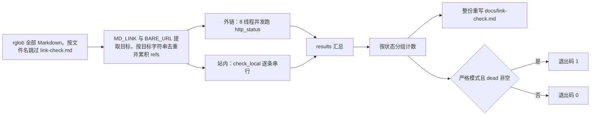
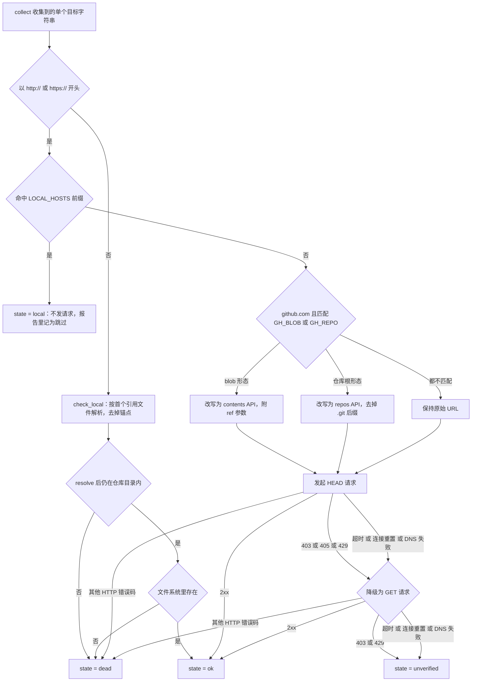

# 外链体检：一条链接如何被判成四态

这个仓库卖的是「这些项目现在还能用」，而它腐烂的方式只有一种：某个推荐改名、删库、换域名，链接悄悄死掉，没人发现。`scripts/verify_links.py` 是唯一系统性地对抗这件事的东西——它不修链接、不改条目，只做一件事：把仓库里所有 Markdown 的链接逐个判一个状态，整份写成 [`docs/link-check.md`](../../docs/link-check.md)，再用退出码告诉调用方「有没有失效的」。

本页只讲判定内核：什么算一条链接、单条链接怎么被判、四态各代表什么、站内相对路径的围栏在哪、报告长什么样、`--strict` 到底卡什么。传输层（`api.github.com`、token、UA、限流）见 [GitHub API 通道与凭据](../integrations/github-api-transport.md)；CI 的触发面与写回见 [仓库自己的 CI](../operations/ci-workflows.md)；这两处本页不重复。

## 职责与边界

一句话概括它的职责分工：**判定归脚本，处置归人。**

- **只读仓库内容，只写一个文件**：唯一的写操作是 `REPORT.write_text(...)`，整份覆盖 `docs/link-check.md`。它不会去改任何条目所在的内容 Markdown，也不会提交。
- **输入范围是 `ROOT.rglob("*.md")`**：仓库根下所有层级的 Markdown，包含 `openwiki/`、`skills/` 与各类模板文档；**HTML 完全不在范围内**（`docs/index.html`、`docs/404.html` 里的 `href` 不会进报告）。
- **唯一的排除项是它自己的产物**，按文件名排除（理由见[下一节](#收集什么算一条链接)）。
- **不做的事**：不判断许可证、不判断项目是否还活跃、不抓页面内容——活着(`ok`)只意味着「HTTP 给了成功响应」或「本地文件存在」。

## 一次运行的五个阶段



图注：收集 → 并发探测外链 → 串行检查站内路径 → 汇总写报告 → 由 `dead` 与 `--strict` 决定退出码。注意「写报告」与「退出码」是两条独立出口：报告永远写，退出码只在严格模式下才可能非零。

两个顺序上的事实值得记住：

1. **外链先跑完，站内链接才开跑。** 外链走 `ThreadPoolExecutor(max_workers=8)` 并发，站内检查是普通循环。所以报告里同一个目标的「出现在」列与检查先后无关，只与收集顺序有关。
2. **`results` 的顺序不等于报告顺序。** `results` 是「外链发现顺序 + 站内发现顺序」，而全量表在写盘前会重新排序（见[报告](#报告形状与读法)）。

## 收集：什么算一条链接

`collect()` 对每个 Markdown 只做两趟正则扫描，然后把结果塞进一个以**目标字符串**为键的字典：

| 来源 | 认什么 | 边界（不认 / 特殊处理） |
|---|---|---|
| `MD_LINK`：`[label](target)` | target 是 `http(s)://…` 时记为外链；以 `#` 或 `mailto:` 开头时跳过；其余一律记为站内链接 | 目标到第一个空白或 `)` 为止，因此 `[x](<a b.md>)`、`[x](a b.md)` **一条都不算**；reference 式 `[x][ref]`、纯 `[x]` 不算；可选的 `"title"` 会被吃掉 |
| `BARE_URL`：正文里的裸 URL | 任何 `http(s)://…` 串，一律记为外链 | 用后行断言 `(?<![(\[])` 跳过紧贴 `(` 或 `[` 的 URL，避免把刚收过的行内链接目标再计一遍；尾部 `.,;:，。；）)` 会被 `rstrip` 裁掉 |

几个由此推出的结论，写内容时会直接撞上：

- **代码块与行内代码没有豁免。** 正则跑在原始文本上，没有 fence 感知：示例里的 `http://localhost:8080`、模板里的占位域名一样会被探测。报告里那六条 `⏭️` 的本地服务地址，无论写在正文、代码块还是行内代码里，都是以同样方式被收进来的。
- **`<https://…>` 这种尖括号写法会一次制造两条互相矛盾的记录。** `MD_LINK` 的目标字符集允许尖括号，于是 `[x](<https://a>)` 被收成一条以 `<` 开头的**站内**目标（下一步判「文件不存在」= ❌）；`BARE_URL` 又把真正的 URL 收成一条外链（可能 ✅）。同一处写法，报告里给两个结论——看到 `> ` 结尾或 `<` 开头的目标出现在失效表里，先怀疑这个写法。
- **去重键是字符串，不是「文件 + 位置」。** 同一个目标被 30 个文件引用，只探测一次，`refs` 里堆 30 条 `文件 → 标签`（裸 URL 只记文件）。行内链接的 refs 形如 `20-tools/projects.md → Awesome Tool`，`check_local` 正是靠 `split(" → ")[0]` 从这份字符串里取回文件名——两处格式是隐式耦合的。
- **`#anchor` 与 `mailto:` 被直接丢弃。** 页内锚点写错、`mailto:` 地址失效，都永远不会进报告。

### 为什么排除 `docs/link-check.md` 自身

排除发生在收集入口：`if md.name == REPORT.name: continue`。原因不是「自己查自己很奇怪」，而是**报告本身就是一份几百条 URL 的 Markdown**：它的结果表每一行都含一个裸 URL，若纳入扫描，下一轮报告就会把上一轮的表格当成新链接，计数与失效表随报告本身漂移，形成自我喂养的循环。

这条排除是按**文件名**而不是路径做的，所以任何目录下叫 `link-check.md` 的文件都会被静默跳过。给新文件起名时避开这个 basename，否则它会永远不进体检。

## 判定：单条链接的路径



图注：`http_status` 的完整判定路径——本地服务短路 → GitHub 页面改写为 API → HEAD 优先、失败退 GET → 只有在 GET 上拿到明确的非限流错误码才判 `dead`。

### 第一道分叉：本地服务直接跳过

四个前缀（`http://localhost`、`http://127.0.0.1` 及其 `https` 形态）用 `startswith` 匹配，因此 `http://localhost:11434/v1` 这种带端口的写法也算。命中即返回 `("local", "本地服务示例，跳过")`，**一个字节都不发出去**。这是刻意的：文档里教读者「本地起个服务试试」的地址不该让体检报警，也不该被当成可达性证据。

### GitHub 改写：两种形态，两条限制

`github.com` 页面在作者所处网络下直连会被重置，所以凡能改写的地址都改写成 `api.github.com`（为什么只有这个域名可达，见[传输层那一页](../integrations/github-api-transport.md)）。改写规则是两条正则，**先匹配 blob、再匹配仓库根**：

| 原链接形态 | 改写目标 | 目的 |
|---|---|---|
| `https://github.com/<owner>/<repo>/blob/<branch>/<path>` | `https://api.github.com/repos/<owner>/<repo>/contents/<path>?ref=<branch>` | 校验文件仍在；`?` / `#` 片段在改写前被剥掉 |
| `https://github.com/<owner>/<repo>`（可带 `/`、`?`、`#` 结尾） | `https://api.github.com/repos/<owner>/<repo>` | 校验仓库仍在；仓库名上的 `.git` 后缀被 `removesuffix` 掉 |

两条限制都来自正则形状，而不是网络：

- **`<branch>` 不能含 `/`**（`([^/]+)`）。指向 `blob/feature/xxx/file.md` 的链接会被解析成 `ref=feature`、`path=xxx/file.md`，contents API 回 404，于是被判 `dead`——**这是「链接没错却判死」的假阳性之一**（另一类是下面提到的 GET `405`），看到 blob 链接被判死且分支名带斜杠，先怀疑这里。
- **只有仓库根与 blob 两种形态被改写。** `github.com/o/r/issues/7`、`/tree/main/x`、`/releases/tag/v1` 都不匹配（`GH_REPO` 要求 `#`、`?` 或字符串结尾），于是原样直连 `github.com`——在受限网络里它们的常态就是 `unverified`。

### 探测阶梯：HEAD 先探，失败退 GET

拿到最终 URL 后，`for method in ("HEAD", "GET")` 逐级尝试，每一级都在 12s 超时内：

| HEAD 上发生什么 | 下一步 | 为什么不直接下结论 |
|---|---|---|
| 2xx | `ok`，detail 是响应码（如 `200`） | — |
| `403` / `405` / `429` | 降级发 GET | 很多站点拒绝 HEAD（`405`）或对无头请求限流（`403`/`429`），HEAD 的拒绝不代表资源不在 |
| 超时 / 连接重置 / DNS 失败 | 降级发 GET | 第一次失败可能是瞬时抖动，不值得立刻判死 |
| 其他 HTTP 错误码（含 `404`、`500`） | 直接 `dead` | 明确的服务端否定，不再浪费一次请求 |

GET 这一级是终点，映射为：2xx → `ok`；`403`/`429` → `unverified`（detail 写作 `HTTP 403（可能限流）`）；超时等网络异常 → `unverified`（detail 是异常类型加截断的消息）；其余错误码 → `dead`（detail 写作 `HTTP 404`）。由此得到两个容易被忽略的事实：

- **单条外链最多两次请求**，所以一份 230 个目标的报告，最坏情况接近 460 次出网。8 线程 + 12s 超时决定了这个量级能在 CI 的 `timeout-minutes: 15` 内跑完，也决定了匿名配额（60 次/小时）根本不够。
- **`405` 落在 GET 上照样算 `dead`。** 存在「只允许 HEAD、禁止 GET」的服务端，它会在这里被误判；判死前值得人工点一次。

重定向由 `urllib` 默认跟随，报告只记最终状态码，**不提示「这个链接已经改址」**——所以「永不失效」的短链与已迁移的仓库页在报告里都只是 `200`。

## 四态语义与「未验证 ≠ 失效」

| 状态 | 含义 | 触发条件 | detail 样例 | 影响 `--strict` 退出码 |
|---|---|---|---|---|
| `ok` ✅ | 外链有成功响应，或站内文件存在 | 2xx / `Path.exists()` | `200`、`存在` | 否 |
| `dead` ❌ | 明确失效 | 非限流的 HTTP 错误码 / 文件不存在 / 越出仓库目录 | `HTTP 404`、`文件不存在`、`越出仓库目录` | **是** |
| `unverified` ⚠️ | 无法得出结论 | 403/429、超时、连接重置、DNS、TLS 异常 | `HTTP 429（可能限流）`、`TimeoutError: …` | 否 |
| `local` ⏭️ | 刻意不检查 | 命中 `LOCAL_HOSTS` 前缀 | `本地服务示例，跳过` | 否 |

**为什么 `unverified` 不等于 `dead`，也不等于「没问题」。** 这份报告的直接用途是驱动人去删改推荐条目，所以误杀的代价远高于漏报的代价：一次限流、一次网络重置，都不构成「这个仓库没了」的证据。脚本因此把所有模糊结果都推给 `unverified`，只有拿到明确错误码才敢判死。

但反过来读也成立：`unverified` 是**未覆盖率，不是通过率**。报告自己在头部用一段引用块写明了这一点——`github.com` 页面在部分网络环境会被重置，所以显示未验证的 `docs.github.com` 文档页「不代表链接失效」。匿名跑时 `api.github.com` 只有 60 次/小时，打满后成片的 403 就会变成成片的 ⚠️。所以正确的读法是：**先压 ⚠️ 数，再看 ❌ 表**；本地跑之前设好 `GITHUB_TOKEN`（凭据解析的两级顺序见[传输层](../integrations/github-api-transport.md)）。

## 站内相对链接：一个基准，一道围栏

`check_local()` 只有十行，却决定了所有相对路径的语义。

**基准是「首个引用位置」，不是仓库根。** 目标字符串在收集阶段就去重了，所以一个目标只有一条记录；检查时取 `meta["refs"][0]`，从那条 refs 里 `split(" → ")[0]` 拿到文件名，再以该文件所在目录为基准拼路径。结论：报告里 ✅ 只证明**至少一处**能解析到，同一目标被更深的页面引用时不会被单独验证。移动目录深度、或在别处复用同一个相对路径，报告不会替你把关。

**锚点在检查前被剥掉。** `target.split("#")[0]` 后才查文件系统，所以 `foo.md#section` 只证明 `foo.md` 存在，小节标题写错、锚点被删都不会有信号。

**围栏是 `resolve()` 后的仓库包含性判断。** 解析结果必须 `relative_to(ROOT.resolve())` 成功，否则直接 `dead`（detail 为「越出仓库目录」），连 `exists()` 都不查。这道围栏有三个直接后果：

- **`../../` 爬出仓库的路径必死**，这是它存在的理由。
- **以 `/` 开头的站内目标必死。** `Path("/repo/a") / "/docs/x.md"` 得到的是文件系统根下的 `/docs/x.md`，越界 → ❌。所以本 wiki 与内容目录里的内部链接一律写成相对路径，绝不写 `/docs/…`；这类错误会在下一期报告里以「越出仓库目录」出现，但和内容对错无关。
- **不区分大小写是本机的事，不是链接的事。** `exists()` 在 Windows 上宽、GitHub Pages 上严，`Images/Logo.png` 写成 `images/logo.png` 本地 ✅、线上 404。`%20` 这类百分号编码也不会被解码，带空格的相对链接一律判死。

## 报告：形状与读法

`docs/link-check.md` 是生成物，**手写备注下次体检整份覆盖即丢**。它的结构固定为下面四块：

1. 头部：`生成时间`（UTC ISO，精确到秒）、`生成脚本`、`总计 N 个链接：✅ / ❌ / ⚠️ / ⏭️` 四态计数，以及那段「未验证」释义引用块。
2. `## ❌ 失效链接（需要修）`：仅在存在 `dead` 时出现，列为「链接 / 原因 / 出现在」，`出现在` 是去重排序后的 `refs` 全量列表——这是修链接时真正要看的一列。
3. `## ⚠️ 未验证`：仅在存在 `unverified` 时出现，只有「链接 / 原因」两列（未验证没有责任人需要定位）。
4. `## ✅ 全部结果`：永远出现，`| 状态 | 链接 | 说明 |` 三列。

全量表**不是按状态分组的**：排序键是 `(status != "ok", url)`，即所有 `ok` 按 URL 字母序排在最前，其余三态混在一起再按 URL 排。所以一条死链会**在报告里出现两次**（❌ 表 + 全量表），查原因看 ❌ 表，查「某个 URL 到底怎么判的」看全量表。

写报告这一步还是一个扩展边界：状态用 emoji 的字典映射（`ok`/`dead`/`unverified`/`local`）取值，未知状态会在**写盘之前**抛 `KeyError`。想加第五种状态，必须同时改 `http_status` 的返回值、`main` 里四组计数、以及这张映射表——只改前两处的话，报告与总结行都不会产出，磁盘上留着的是上一期的旧报告，日志里只有开跑那句「共 N 个链接，开始检查 …」，很容易被当成跑完。

## 并发、超时与门禁

**并发与超时**：`max_workers=8`、`TIMEOUT = 12` 是两个硬编码常量，没有命令行开关。它们与 CI 的 `timeout-minutes: 15` 是一组配套关系——把 8 调小或把 12 调大，长期看都会把 job 推向超时。脚本**没有重试**（对比 `fetch_assets.py` 自带的重试策略），失败一次就是定论，这也是它敢用「HEAD 失败退 GET」而不是「重试 HEAD」的原因。

**门禁语义只有一行**：

```python
return 1 if (args.strict and dead) else 0
```

即 `--strict` 下**只有 `dead` 非空才返回 1**；`unverified`、`local`、乃至「一条链接都没收到」都返回 0。默认（不带 `--strict`）恒为 0，只有脚本自身崩溃才会非零。这条语义使它可以安全地接进任何门禁：它只拦「明确死了的链接」，不会因为网络环境变化把别人的流水线弄红。

但要注意两个现实落差：

- **CI 里跑的是裸命令。** `link-check.yml` 的体检步骤是 `run: python scripts/verify_links.py`，**没有 `--strict`**，所以失效链接不会让 job 变红，只写进报告并随写回提交落地。想让死链阻断合入，只能在本地、pre-commit 或另一条流水线里显式加 `--strict`（CI 侧的完整语义见[仓库自己的 CI](../operations/ci-workflows.md)）。
- **不要用 `git status` 判断体检通过。** 头部时间戳让这份报告**永不幂等**，每次运行都会改写文件；「有 diff」不代表有问题，「没 diff」也不代表没跑。唯一可靠的判据是退出码，加上 stdout 末行那串 `✅ n  ⚠️ m  ❌ d  ⏭️ k  → docs/link-check.md`（有 `dead` 时还会追加前 10 条明细，便于直接修）。

## 已知盲区清单

按「会不会让你误以为安全」排序：

1. **只查 Markdown。** `docs/*.html` 里的 `href` 完全不进报告，而 Pages 站点真正的入口恰恰是 HTML。
2. **代码块里的 URL 也查、代码块里的相对路径也算站内链接。** 示例地址一旦指向不存在的域名或文件，报告会把它当成内容问题。
3. **带空格的目标一条都不收，尖括号写法会被误收成站内路径。** `[x](<a b.md>)` 既不查也不报，等于空白；`[x](<https://a>)` 则同时产出一条 ❌ 与一条外链记录。
4. **同一目标只按首个引用解析。** 报告 ✅ 不覆盖第二个、第三个引用位置。
5. **锚点、reference 式链接、`mailto:` 永不校验。**
6. **根绝对路径必判死**（越界），百分号编码与大小写则「本地宽、线上严」。
7. **blob 链接的分支名含 `/` 会假死**（正则不吃斜杠），`405 on GET` 也会被当成死链。
8. **非仓库根 / 非 blob 的 `github.com` 子路径不改写**，受限网络下它们恒为 ⚠️，看起来像「没检查」。
9. **无 token 时成片 403/429 变成成片 ⚠️，`--strict` 依然退出 0**——「绿」可能只是「没验成」。
10. **报告本身永不幂等**，提交里永远有它，所以「本次提交只含报告」不足以说明有内容变化。

这些都源于同一个设计取舍：脚本用极少的代码换覆盖面，宁可漏查也不误杀；代价是「报告干净」只能作为必要条件，不能作为充分证据（各类改动该跑什么、该看什么字样，见[验证手段](../testing/validation-harness.md)）。

## 相关页面

- [GitHub API 通道与凭据](../integrations/github-api-transport.md)：为什么 `github.com` 必须改写成 `api.github.com`、token 从哪来、四个调用方各自的重试与限流策略。
- [仓库自己的 CI：外链体检与 OpenWiki 更新](../operations/ci-workflows.md)：`link-check.yml` 的触发面、写回方式与「为什么 `push.paths` 不能写 `**/*.md`」。
- [维护手册：每周循环与常见改动路径](../operations/maintenance-runbook.md)：周一读报告、修死链时改哪份文件、哪些产物不可手改。
- [验证手段：没有单测时如何证明改动安全](../testing/validation-harness.md)：`--strict` 作为门禁的最小用法、可接受的输出字样与静默失败清单。
